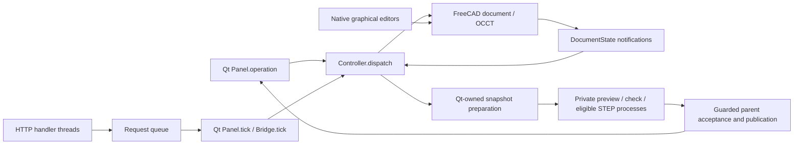

# KurtShape architecture

The current implementation includes the accepted S01–S09B responsiveness work, [S14 queue-independent canonical status lookup](docs/architecture-responsiveness-upgrade/STATUS_REPORT.md#accepted-improvements), [S16 STEP admission digest reuse accepted through S16C](docs/architecture-responsiveness-upgrade/STATUS_REPORT.md#accepted-improvements), [S17 early STEP preparation cancellation](docs/architecture-responsiveness-upgrade/STATUS_REPORT.md#accepted-improvements), and wire contract **3.0**. FreeCAD 1.1.4 / OCCT 7.8.1 remain authoritative. Invalidatable derived caches, immutable native archives and private native processes reduce repeated application work without introducing a second editable CAD model. [Status report](docs/architecture-responsiveness-upgrade/STATUS_REPORT.md#executive-summary) records accepted scope, exact receipts, preserved failures and limitations. [S10 measurements](docs/architecture-responsiveness-upgrade/STATUS_REPORT.md#performance-evidence) compares the then-accepted revision with the preserved original baseline. Older [Q03 evidence](docs/architecture-responsiveness-upgrade/STATUS_REPORT.md#validation-and-source-versions) and queue records are historical, not current validation totals.

[S18 GUI regression coverage](docs/architecture-responsiveness-upgrade/STATUS_REPORT.md#validation-and-source-versions) extends the STEP recipe to 91 passing checks without changing S17 production. Two one-shot injected OSError cases exercise the real UI-supplied ownership predicate after cancellation or document switch, preserving the exact exception cause, newer feedback and cleanup; later real context checks return stale normally. The retained S17 five focused passes and 426 native passes/four expected skips remain valid against all 98 unchanged native inputs. This adds no persistent native-exception fix or latency claim.

## Native document ownership

The FreeCAD document is authoritative. Sketcher geometry and constraints, native features, expressions, links and transactions live in FCStd. `KurtShapeProject` stores project identity, revision, build status, failure information and source mapping as native properties. Inspection JSON describes that document; it is not a parallel CAD model.

The main entry points are [core.py](src/kurtshape/core.py) `Controller` and [ui.py](src/kurtshape/ui.py) `Panel`:

## Commands and transactions

`Controller.OPS`, operation subsets and `ARGS` are explicit sets and argument tables; `_dispatch` implements the branches. `studio.OPS/ARGS` and `reference_tools.OPS/ARGS` extend them. Mutations check document identity, expected revision, managed ownership, busy state and graphical/edit leases before native transactions. Successful changes recompute, inspect native flags and result constraints, and commit; ordinary modeling does not run BRepCheck. Failures abort or restore the leased sketch draft. Managed sketch editing keeps bounded native `dumpContent` buffers for edit undo/redo and reconciles native editor commits at Finish or Cancel. Reopening a project assigns a fresh session revision.

`Panel.operation` inspects the current document with `measure=False`, supplies its revision and selected Body, calls the controller at that same measurement level and refreshes the shell. Native workbench commands are another legitimate writer: `Panel.native_command` guards reference files and active editors before invoking them. Document observation reconciles those changes. Explicit Measure requests full mass properties or selected geometry; Check geometry checks current solids and reports issues in Messages without changing model history.

Contract 3.2 splits one typed modeling step out of `_dispatch` as `Controller._model_step` (handler, studio reconciliation, recompute, native build gate, applied-formula check, legacy one-solid gate) that never opens, commits or aborts a transaction, rotates the revision or syncs; single operations, `preview` and batches share it. Result validation runs through one window per request (`ValidationWindow`: key table before, `step_done` per batch step, `finish` once before the commit). [batch.py](src/kurtshape/batch.py) runs 1–32 steps in one native transaction (one undo step, one revision change), resolves `$ref`/`$part` aliases between steps and, through `SplitGuard`, undoes and honestly reports a step that broke the transaction; `tests/test_batch.py` keeps the list of functions that call native transaction APIs reviewed (D12). [parameters.py](src/kurtshape/parameters.py) owns the document's model parameters (a marked native `App::VarSet` "Params"), the one formula validator every formula path uses, and parameter edits that prune consumers whose evaluated inputs did not change. The view operation `render_view` ([render_jobs.py](src/kurtshape/render_jobs.py)) captures on the owner thread and renders in a child process; the bridge parks its handle and the Panel tick completes it.

[parameter_panel.py](src/kurtshape/parameter_panel.py) is the left panel's Parameters section (Qt only; FreeCAD imported lazily). It reads rows from the inspect payload the Panel already holds and usage lazily through `parameters.usage_rows`, and writes through `Panel.operation` behind `ControllerParameterAdapter`, the only code that knows op names, fields and error codes. A field commits on Enter or an in-window focus move (never on a window switch), as one deferred, document- and revision-tokened request = one undo step; `SectionLayout` remembers the three section heights in the profile.

[native_content.py](src/kurtshape/native_content.py) hashes exact archive member names and complete payloads for feature Copy, excluding serialization wrapper timestamps. The controller accepts that content fingerprint or the current raw archive SHA256 from one dump; actual source changes remain guarded. This ephemeral fingerprint adds no editable model or persisted geometry verdict.

[shortcuts.py](src/kurtshape/shortcuts.py) loads `shortcuts.json` and optional profile `shortcuts.user.json`. Its Qt event filter selects a context, then invokes a callback or guarded native command. Help, search and S use this shortcut metadata. Toolbar/menu callbacks are wired separately in `ui.py`; [feature_tools.py](src/kurtshape/feature_tools.py) supplies installed native tool metadata. There is no unified operation/toolbar/keyboard descriptor registry on this baseline.

[tool_session.py](src/kurtshape/tool_session.py) gives transient native, reference and dimension tools one owner and generation. Hover uses the latest pointer at a bounded cadence; clicks still pick synchronously at their own coordinates. Tool changes suppress reentrant work, foreign views are rejected before pointer side effects, and callbacks validate ownership around native picking and Coin publication. A stale callback removes only its own highlight. Retained assembly rows preserve selection/collapse state. Non-Studio parts refresh reads each nonempty body's presentation and icon once per refresh, then performs the same ordered full reconciliation; this is not a persistent cache or an assembly-path change.

## Intent, references and geometry status

[document_state.py](src/kurtshape/document_state.py) `DocumentState` observes native changes and maintains `intent_dirty`, `generation`, `refresh`, `snapshot_pending`, per-object versions and separate shape-only versions. Most derived Shape notifications invalidate geometry without changing intent; replacing an embedded assembly source also invalidates intent. Native recompute callbacks set a pending boundary and record recomputed object names without evaluating selectors, booleans or nested recomputes. Transaction, undo/redo and document-close notifications maintain these boundaries and release caches.

`Controller.sync` obtains the exact whole-document intent digest through [incremental_intent.py](src/kurtshape/incremental_intent.py), reusing unchanged per-object canonical payloads under observer invalidation. `native_intent` remains the full reference representation; `KURTSHAPE_FULL_INTENT=1` selects that path. The ordered traversal/digest remains. [document_index.py](src/kurtshape/document_index.py) separates structure, history, topology, placement and metadata domains, with document-instance ownership and conservative invalidation. [inspection_cache.py](src/kurtshape/inspection_cache.py) retains up to 4096 invalidatable summaries and returns deep copies. These caches do not replace native intent or make complete inspection constant-time.

`_build_status` combines cheap native flags, expected shape presence, cached Studio/reference/assembly diagnostics and any cached geometry verdict into `valid`, `needs_rebuild`, `failed` or `sketch_only`. A valid build is not a BRepCheck result. Inspection exposes a separate `geometry_check` and nullable measurement fields; failed/touched results expose retained measurements separately from current valid results. Inspection still scans feature objects and builds summaries, so the complete status path is not constant-time.

[geometry.py](src/kurtshape/geometry.py) `GeometryCache` stores transient per-result facts. Its tokens combine the object's own observer version, native source Shape hash and source/occurrence placement dependencies. Validity uses a source shape-only version and hash, so rigid occurrence placement changes invalidate world-space facts without rechecking unchanged topology. The cache retains at most 1024 check verdicts and 4096 scalar/query-pair memo entries, evicts old entries and drops document data on close. `measure=False` requests solid count only; `True` adds bbox, volume and area; `"full"` adds centre of mass. Measurement never implicitly runs a geometry check. `check_geometry` and export explicitly populate/reuse the check cache; export requires valid current geometry before staging either output.

[result_checks.py](src/kurtshape/result_checks.py) `ResultChecks` (contract 3.2 F1) keys every studio Add/Remove/Intersect by a Merkle digest of its input closure's native intent (through the shared `IntentCache` rows), stores one verdict of the 3.1 post-conditions per key (controller-wide LRU, persisted compactly in `KurtShapeProject.KurtShapeResultChecks`), and validates in modes (`edit`, `navigate`, `rebuild`, `report`, `check`, `export`, `preview`) through `Controller._validate_results`: only affected operations without a reusable verdict are checked, reuse is gated by observer shape versions and confirmed by a copy-free vertex fingerprint, failures fold into the stored `BuildStatus` only, and the stamped table makes inspect O(1). `studio.check_operation` runs the post-conditions at an operation's own history position from its recorded snapshots, tool Body and output tips, with volumes and boxes from the `GeometryCache`.

[studio.py](src/kurtshape/studio.py) maintains feature order, rollback and logical part generations using native features and links. `_recompute` coordinates Studio preparation, selector-aware native recomputation, auto merge-scope stabilization and exact cached scope validation. [selectors.py](src/kurtshape/selectors.py) stores declarative inputs on native consumers and refreshes references at their regeneration positions; native reference properties remain the actual feature inputs. Conservative bounding boxes reject impossible pairs before exact common-volume/distance work; memo keys retain exact native versions, frames, subelements and query parameters. Closest-point pruning retains all tolerance ties.

Selector contexts perform lightweight literal membership reads and defer full entity rows and ElementMap ownership indexes until needed; world shapes are shared within that context. The full resolver remains an oracle. Scope membership uses a bounded 64-entry immutable cache keyed by the full relevant domains, operation, cutoff and ordered native-tool identity, returning fresh lists. Foreign dependencies bypass reuse; changing or uncertain reads retry the full path or fail closed. Production selector traversal and native recompute order remain unchanged; affected-consumer scheduling is not implemented.

After a recorded external native recompute, `Controller.sync` consumes the boundary once, reconciles selector diagnostics without rewriting authored native links, and fills exact scope diagnostics. Ordinary inspection reads cached health plus cheap native-link and pending-scope divergence. Unrecomputed scope changes require regeneration before acceptance/export; idle inspection performs no exact scope booleans or query evaluation. Standalone U2 calls without a controller retain exact uncached evaluation. These derived caches add no second authoritative feature or query graph.

Managed stored Part Studios already using `UseHasher=false` open without a modeled-feature recompute. A true-hasher managed attachment migrates once through native recomputation. Assembly reopen retains native solve/recompute; recovery retains reconstruction. `EngineFreeCAD`, `EngineOCCT`, native saved ProgramVersion and stored shape presence determine explicit rebuild reasons. Rebuild stamps the current engine in its native undo transaction; Undo restores the old reason/stamp. Part Studio opening retains failed and Touched states, preserves input bytes and clears GUI Modified only after successful inspection.

## Disposable preview and recovery

`Controller._preview` and direct [extrusion_preview.py](src/kurtshape/extrusion_preview.py) `ExtrusionEvaluator` calls remain synchronous. UI `DebouncedExtrusionPreview` displays provisional geometry and schedules exact evaluation in a private bundled-native-Python process. Proposal preparation, native archive capture and Coin publication remain on Qt's thread. Sequence, complete accepted-state key, geometry generation and UI ownership prevent stale results from becoming current; `flush` and `current_result` do not wait for a worker. Serialized detached mesh/measurement results cross the process boundary; no native handle does. Bounded proposal caches retain up to eight results.

The exact preview worker can reuse its received archive without another `saveCopy` only after strict attachment equivalence, including intent, schema, relevant metadata, native flags, geometry generation and actual map version/size. Existing source/clone map-marker restoration remains narrowly scoped. Uncertain attachment uses an owned snapshot fallback. Each uncached proposal still uses a fresh operation clone; borrowed archives use `newDocument` plus `load` to avoid filename deduplication. Resident clone reset and staged recompute are not activated.

[snapshots.py](src/kurtshape/snapshots.py) caches independently copied accepted recovery archives under `SnapshotKey(instance_id, revision, generation, serial, policy)`. Exact-key acquisition returns a lease with captured file identity. Retired archives remain pinned until all readers release them. Preview, geometry-check and STEP jobs can own these leases; otherwise preparation captures an owned archive on the native thread. Sharing is optional and never substitutes for recovery or explicit Save.

[recovery.py](src/kurtshape/recovery.py) still captures FCStd with native `saveCopy` on the GUI thread. Idle-gated `Panel.checkpoint_projects` polls publication and permits at most one native capture attempt per timer pass; active native tools, mouse input, feature/task dialogs and preparation suppress capture. An idle managed sketch can still receive draft recovery. Normal revision/30-second throttling remains. A single file executor verifies ZIP contents, hashes and publishes the recovery snapshot/manifest pair, then optionally publishes a compatible immutable archive. Forced checkpoints remain synchronous and serialize behind earlier publication for that document. Draft recovery and explicit Save bypass sharing. Recovery restores accepted/draft sketch buffers where present; shutdown can wait for file publication, unlike nonblocking CAD-worker cancellation.

## Geometry-check and STEP jobs

Eligible uncached UI checks use [geometry_check_worker.py](src/kurtshape/geometry_check_worker.py). Direct Controller/bridge calls, cached checks and conservative contexts retain the synchronous contract. The child checks detached native source shapes. The parent validates captured document/key/targets, original wrappers and fingerprints before importing complete verdicts under parent-owned topology keys. Cache receipts allow stale reentrant acceptance to undo only its own insertions. Snapshot preparation and parent acceptance remain synchronous.

Eligible UI STEP/.stp exports use [step_export_worker.py](src/kurtshape/step_export_worker.py). Admission requires an accepted self-contained nonassembly source, exact detached world-BRep roundtrip stability, already-Touched project metadata, and no Link target or Link cache source. These predicates select fallback without modifying or reopening the source; they do not replace independent exact child archive/attachment checks. Numeric coefficients and map fields remain exact under the existing narrow Checked-bit policy. Clean metadata, unstable/uncertain sources and STL use synchronous export. Admission fallback synchronizes native edits before capturing the Controller revision token and retains context checks. Archive/attachment incompatibility discovered by an already-launched STEP child returns an error; it does not automatically retry synchronously.

The STEP child receives no user destination and writes fixed private `export.step`. After confirmed successful exit, the parent verifies artifact identity, size and SHA-256, rechecks source/owner/destination, and copies verified bytes to unique destination-local stages. Geometry/provenance replacement has rollback and recovery copies; it is not an atomic two-file transaction. Invalid geometry cannot publish output. Complete current invalid verdicts can update derived status through guarded parent cache keys. Save remains synchronous with verified replacement.

Output provenance uses the original parent's UUID, revision, FileName, import/source mapping and settings, never the child's fresh attachment revision. Parent acceptance guards the ordered original targets, world shape/placement and request-time destination identities.

## Native assemblies

[assembly.py](src/kurtshape/assembly.py) supports one root `Assembly::AssemblyObject`, embedded `Part::Feature` source snapshots, `App::Link` occurrences and the pinned FreeCAD 1.1.4 native joint proxies/solver. Fixed, revolute and slider joints are supported. Saved FCStd/STEP sources are preflighted; repeated occurrences can share an embedded snapshot of the same saved source. Source provenance and mesh-free canonical BRep SHA-256 seals detect unsupported source changes. Geometry seals are cached at observer generation boundaries; placement and solver validation remain native.

There are no external live source links: later source edits require explicit reinsertion. Nested assemblies and joint limits are outside this workflow. The controller owns typed assembly transaction/revision checks; native references, placements and solver results remain authoritative.

## Thread, process and filesystem boundaries

[bridge.py](src/kurtshape/bridge.py) serves authenticated JSON on loopback. HTTP threads validate and enqueue requests into a bounded queue; they never access CAD documents. Canonical `request_status` with only a valid string request ID can instead use the supported Controller's explicit plain-JSON ledger lookup, after all transport guards. It reads live primitive configuration and the locked ledger, never dispatch/pruning/native state or owner-thread timings. It reports `queue_wait_ms:0.0` and does not register/consume queue or ledger capacity. Noncanonical payloads, invalid measurement defaults and custom controllers retain queued validation. This removes CAD-queue dependence, while Python GIL scheduling and lock contention still apply. `Panel` polls every 25 ms and `Bridge.tick` dispatches one queued request on the Qt thread. [request_ledger.py](src/kurtshape/request_ledger.py) tracks session-local replay and outcomes. A timeout after start can mean an unknown outcome; clients must reconcile through `request_status` or identical replay.

Live application documents and GUI state remain on Qt's thread. FreeCAD bindings can hold the Python GIL during save, geometry and export; Python threads are used only for file/process work such as hashes, ZIP checks and output reading. Native preview, geometry-check and eligible STEP jobs already run in isolated bundled-native-Python processes with their own documents and handles. Only paths and serialized data cross these boundaries. Cancellation returns without waiting; teardown retains leases/files until exit is confirmed, including repeated timeout/kill failures. STEP artifacts also remain until explicit parent close; their consumption requires confirmed successful exit. Preparation, fingerprints, capture, result acceptance/staging/publication, import, explicit Save and synchronous fallbacks can still block the GUI. There is no authoritative CAD document service outside the main process.

[settings.py](src/kurtshape/settings.py) selects the session profile and write roots; GUI-selected destinations can grant a parent directory, while bridge requests cannot create grants. Save/export stage files and verify or preserve recovery/provenance data before replacement. The native test runner uses fresh subprocesses with private session, FreeCAD user-home, TEMP/TMP, APPDATA and LOCALAPPDATA paths, owned PID records and private evidence. Contributors should use those validation launchers instead of a live profile.

Explicit Save reports success only after native staging, ZIP verification, verified replacement and filename update complete. These checks do not establish power-loss durability. Recovery/cache publication does not substitute for that contract. Process overlap is not an end-to-end responsiveness guarantee: S09B's representative STEP GUI proof still recorded about 2.34 seconds of parent launch and 3.42 seconds of completion polling.

[S15's private STEP diagnostic](docs/architecture-responsiveness-upgrade/STATUS_REPORT.md#private-and-disabled-experiments) attributes most of one instrumented 2.32-second launch to roundtrip admission and initial/final world fingerprints; its warm measurement counters do not advance. A separate private pending helper proves actual Qt feedback paint completion before native capture and queued cancellation with exact ownership guards. Neither helper is installed in production. Hidden-window Qt painting is not physical presentation, the unpaintable-feedback policy remains unresolved, and the original failed cleanup receipt is retained alongside the repaired small-probe pass.

[S16's digest-reuse implementation](docs/architecture-responsiveness-upgrade/STATUS_REPORT.md#accepted-improvements), now accepted through S16C, retains the initial canonical BRep hash from exact single-target admission while preserving fresh field/map reads and independent final fingerprints. Four fresh ABBA processes show full warm borrowed-snapshot preparation medians of2043.4ms baseline and1670.4ms candidate (18.25% lower) on the same1000-solid fixture, with exact source/history/map/archive preservation. Eighteen focused tests and the preserved timing arms remain valid. S16's original native/GUI lifecycle receipts were incomplete and caused a historical rollback to S14; those failures remain unchanged. This is no end-to-end latency claim or authority migration, and pending feedback is unchanged.

[S16B lifecycle validation](docs/architecture-responsiveness-upgrade/STATUS_REPORT.md#accepted-improvements) closes the GUI gate for that exact candidate:76 assertions, observed native exit0 and natural Job drain. Its native run drains naturally but fails functional validation with nested260–282-character error paths and five native-save assertion failures, causing another historical rollback. [S16C](docs/architecture-responsiveness-upgrade/STATUS_REPORT.md#accepted-improvements) removes only the native parent's conflicting temporary-root override. All421 native tests then pass with the four expected opt-in skips, including every38 previously unsuccessful case; parent/suite exit0 and the48-process Job naturally drains to zero. The unchanged113-file candidate is accepted using this native gate and the retained S16B GUI proof. All prior failed evidence and the111-file S14 rollback copy remain preserved.

[S17](docs/architecture-responsiveness-upgrade/STATUS_REPORT.md#accepted-improvements) adds an optional current-request callback to synchronous STEP preparation. The UI passes its existing generation/document ownership predicate; non-UI callers retain default None behavior. Checks after eventful admission and before allocation/capture raise dedicated cancellation rather than selecting fallback, and acquired leases/workers retain exact cleanup. The final eventful check precedes existing independent source/destination guards, followed by the UI's existing ownership check before submission. Five focused native tests,426 full native passes plus four expected skips, and85 GUI checks verify the accepted113-source set with observed zero exits and natural cleanup. This only stops subsequent work after a callback invalidates the request: queued Escape cannot interrupt a non-yielding native call, pending/paint scheduling remains deferred, and no new latency improvement is claimed.

Native document test fixtures use exclusive short UUID directories under `runtime/test-tmp`, with exact suite/PID/allocation receipts and directory identities. Cleanup rechecks ancestry and identity, preserving suspect folders. `-KeepNativeTemp` retains suite profiles and receipts while ordinary per-test cleanup still removes disposable document fixtures. These guards are point-in-time checks.

[native_validation_snapshot.py](tools/native_validation_snapshot.py) is a validation-only reader; it never runs in application inspection or idle paths. Only actual Origin-owned `App::Origin`, `App::Line`, `App::Plane` and `App::Point` separate volatile native hashes from content invariants. Complete serialized BRep, type/null state, placements and ownership remain checked, with only the existing narrow Checked-cache-bit mask for intrinsic datums. Modeled shape hashes/content, object order, Body Group/Tip, intent, revision and histories remain strict. Planted placement and equal-volume/equal-bbox model changes must still be detected. Headless proofs record GUI state as unavailable; they do not verify Modified, camera or user interaction.

## Unproven approaches and remaining work

S05 rejected native transaction-abort plus cache-clear resident reset: the Body becomes Touched immediately after abort and its native shape hash changes despite matching complete BRep/maps and authored state. Later retry, multipart, memory and timing gates were not reached. Fresh operation clones remain required.

S06/S06B staged recompute remains unactivated and unproven. Fewer explicit recompute calls did not reduce observed native callbacks or establish speedup. Ordered dependencies differed during history insertion even with zero staged calls; two of three oracle-only pairs reproduced the variation, so it is not demonstrated candidate-caused behavior. Strict ordering, signed-zero/native-state and cycle-restoration discrepancies remain preserved without normalization. QuerySources/OutList alone cannot prove complete dependencies for global, creator, owner and scope selectors. Production retains the original traversal.

Incremental intent/summaries, idle-gated recovery, provisional/exact preview and limited check/STEP workers implement parts of older queue proposals. Unified command descriptors/chords, general import/export migration, broader event-driven shell work, live external assembly links and an authoritative CAD-process boundary remain future work. S13B supplies a private saved-model authority proof; general new-model identity, native Sketcher/GUI ownership, broader models and crash/recovery behavior still require evidence before any production migration.

Matched headless Plate60/Studio comparisons do not cover dense sketches, assembly workflows, representative private projects, cold-process distributions or GUI input-to-paint budgets. S08's isolated three-before/three-after icon experiment remains separate from combined-revision measurements. Ordinary native runs skip four opt-in status-performance methods; enabling them measures correctness and reports absolute budget misses separately. See [S10 measurements](docs/architecture-responsiveness-upgrade/STATUS_REPORT.md#performance-evidence), [OPERATION_CONTRACT.md](docs/OPERATION_CONTRACT.md) and the preserved execution receipts before extending these subsystems.

The opt-in status guard also installs a global Python/C-event profiling callback during idle/changed inspection, tip-edit and open timing. Its direct-inspect/original-fixture sequence differs from the primed dispatch/post-edit benchmark sequence. These official instrumented budget results remain valid for that harness, but are not interchangeable with unprofiled benchmark or GUI latency. S11 uses private matched diagnostics before recommending any inspection optimization; it does not change production or close targets by subtracting estimated profiler overhead.

[S11's paired diagnostic](docs/architecture-responsiveness-upgrade/STATUS_REPORT.md#performance-evidence) measured warm arm medians of 13.93 ms with profiling off and 29.68 ms on. Coarse traces record 124 warm summary hits and 124 rebuilds after native recompute, consistent with the existing global summary-epoch fence. Nested instrumented spans point to summary handling and status/inspection reads, but their wrapper overhead is unmeasured. No cache or invalidation optimization is accepted from this evidence.

[S12's private summary-reuse feasibility probe](docs/architecture-responsiveness-upgrade/STATUS_REPORT.md#private-and-disabled-experiments) preserves that production fence. Its runtime-only Pad/Pocket candidate credits only a proved recompute callback and retains identity, dependency, unknown/full-invalidation and read-stability guards. It reuses60 unaffected rows after the Plate60 terminal edit and rebuilds all61 after the upstream edit, with31 targeted native cases and11 existing tests passing. Nested/failed-callback and independent dirty-history equivalence proofs remained incomplete at that checkpoint, so no timing or production activation occurred. Benefits and overhead are unmeasured. S13/S13B subsequently exercised a private headless authoritative-process slice under separate finite authorization.

[S12B](docs/architecture-responsiveness-upgrade/STATUS_REPORT.md#private-and-disabled-experiments) adds passing native evidence for explicitly injected nested/throwing observer callbacks, final read fences and scoped adversarial native read preservation using the unchanged private adapter. Complete raw snapshots include losslessly pooled element history and enforce map/history/placement/BRep/hash stability. Independent current/current/candidate dirty-history proof remains unfinished because its complete snapshot matrix cannot fit the finite batch. Timing, benefit claims and production activation remain blocked; the production summary epoch is unchanged. No authoritative-process work or further batch starts automatically.

[S13B's private saved-model probe](docs/architecture-responsiveness-upgrade/STATUS_REPORT.md#private-and-disabled-experiments) establishes owner-thread committed-command/ledger/history/save/reopen behavior for one immutable managed plate. Identical saved input preserves native IDs and all archive member contents. Raw positional map enumeration differs even direct/direct and stays a retained failed gate. A separately source-backed API association comparison passes30 retained native pairs while keeping ordered graph/property data, indexed topology, inner history, IDs, placements and BReps exact. This does not repair S13's independently created native-identity mismatch, migrate production ownership or measure GUI responsiveness. The current application still owns live documents and native tools on Qt's thread; Sketcher/GUI authority and broader models require future finite work.
