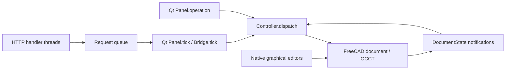

# KurtShape architecture

This describes the application inherited from main `7a20a63` (`longrun/Q01`), with wire contract **2.0**. Q24a changes validation fixtures and documentation, not these application paths. Queue state and parked work are recorded in [STATUS.md](docs/long-run/STATUS.md); a parked implementation is not shipped behavior.

## Native document ownership

The FreeCAD document is authoritative. Sketcher geometry and constraints, native features, expressions, links and transactions live in FCStd. `KurtShapeProject` stores project identity, revision, build status, failure information and source mapping as native properties. Inspection JSON describes that document; it is not a parallel CAD model.

The main entry points are [core.py](src/kurtshape/core.py) `Controller` and [ui.py](src/kurtshape/ui.py) `Panel`:

## Commands and transactions

`Controller.OPS`, operation subsets and `ARGS` are explicit sets and argument tables; `_dispatch` implements the branches. `studio.OPS/ARGS` and `reference_tools.OPS/ARGS` extend them. Mutations check document identity, expected revision, managed ownership, busy state and graphical/edit leases before native transactions. Successful changes recompute, validate and commit; failures abort or restore the leased sketch draft. Managed sketch editing keeps bounded native `dumpContent` buffers for edit undo/redo and reconciles native editor commits at Finish or Cancel. Reopening a project assigns a fresh session revision.

`Panel.operation` inspects the current document, supplies its revision and selected Body, calls the controller and refreshes the shell. Native workbench commands are another legitimate writer: `Panel.native_command` guards reference files and active editors before invoking them. Document observation reconciles those changes.

[shortcuts.py](src/kurtshape/shortcuts.py) loads `shortcuts.json` and optional profile `shortcuts.user.json`. Its Qt event filter selects a context, then invokes a callback or guarded native command. Help, search and S use this shortcut metadata. Toolbar/menu callbacks are wired separately in `ui.py`; [feature_tools.py](src/kurtshape/feature_tools.py) supplies installed native tool metadata. There is no unified operation/toolbar/keyboard descriptor registry on this baseline.

## Intent, references and geometry status

[document_state.py](src/kurtshape/document_state.py) `DocumentState` observes native changes and maintains `intent_dirty`, `generation`, `refresh` and `snapshot_pending`. Most derived Shape notifications invalidate geometry without changing intent; replacing an embedded assembly source also invalidates intent. Transaction, undo/redo and document-close notifications maintain these boundaries and release caches.

`Controller.sync` compares a full `intent_signature` when dirty. `native_intent` serializes native properties, expressions and exact sketch geometry/constraints while excluding derived shapes and diagnostic fields. This is a whole-document signature, not an incremental intent index.

`_build_status` combines native object flags, Studio/reference/assembly errors and solid validity into `valid`, `needs_rebuild`, `failed` or `sketch_only`. `_evaluated_shape` and `_geometry` cache measurements by observer generation in `Controller.evaluations`. Inspection still scans feature objects and builds summaries; cached measurements do not make the complete status path constant-time. Failed/touched results expose retained measurements separately from current valid results.

[studio.py](src/kurtshape/studio.py) maintains feature order, rollback and logical part generations using native features and links. `_recompute` coordinates Studio preparation, selector-aware native recomputation and auto merge-scope stabilization. [selectors.py](src/kurtshape/selectors.py) stores declarative inputs on native consumers and refreshes references at their regeneration positions; native reference properties remain the actual feature inputs.

## Disposable preview and recovery

`Controller._preview` evaluates a typed proposal in a hidden FCStd clone. [extrusion_preview.py](src/kurtshape/extrusion_preview.py) `ExtrusionEvaluator` likewise snapshots the source, opens a disposable native document and uses the same modeling/recompute/validation path. It retains at most eight normalized proposal results per task, with revision and generation guards. The viewport receives detached BRep geometry through a non-pickable Coin overlay. Cleanup closes clones and restores the active document, camera and selection. `DebouncedExtrusionPreview` uses Qt timers; evaluation and its exact geometry/Boolean work are synchronous.

[recovery.py](src/kurtshape/recovery.py) `RecoveryStore.capture` synchronously saves a staged FCStd, verifies its ZIP, hashes it and replaces the snapshot/manifest pair, preserving a previous complete pair. The manifest can include accepted and draft native sketch buffers. `Panel.checkpoint_projects` runs from a one-second timer; the store normally suppresses unchanged revisions and captures more often than once per 30 seconds only when forced. Recovery verifies the manifest/hash, opens a recovered document without the original filename, and restores an unfinished sketch lease when present. This is not the planned idle/background recovery system.

## Native assemblies

[assembly.py](src/kurtshape/assembly.py) supports one root `Assembly::AssemblyObject`, embedded `Part::Feature` source snapshots, `App::Link` occurrences and the pinned FreeCAD 1.1.4 native joint proxies/solver. Fixed, revolute and slider joints are supported. Saved FCStd/STEP sources are preflighted; repeated occurrences can share an embedded snapshot of the same saved source. Source provenance and mesh-free canonical BRep SHA-256 seals detect unsupported source changes. Geometry seals are cached at observer generation boundaries; placement and solver validation remain native.

There are no external live source links: later source edits require explicit reinsertion. Nested assemblies and joint limits are outside this workflow. The controller owns typed assembly transaction/revision checks; native references, placements and solver results remain authoritative.

## Thread, process and filesystem boundaries

[bridge.py](src/kurtshape/bridge.py) serves authenticated JSON on loopback. HTTP threads validate and enqueue requests into a bounded queue; they never access CAD documents. `Panel` polls every 25 ms and `Bridge.tick` dispatches one queued request on the Qt thread. [request_ledger.py](src/kurtshape/request_ledger.py) tracks session-local replay and outcomes. A timeout after start can mean an unknown outcome; clients must reconcile through `request_status` or identical replay.

Keep GUI application access to `App`, `Gui`, live documents, native shapes and OCCT on the GUI thread. FreeCAD bindings can hold the Python GIL during save, geometry and export calls; a Python worker thread does not make those calls responsive. Threads may perform pure file work such as hashing, ZIP checks and reading process output. Future heavy CAD workers must use separate bundled-native-Python processes with private document snapshots and serialized results, never shared native handles. Main currently performs STEP import, save, export, preview and recovery synchronously; it has no application CAD worker service.

[settings.py](src/kurtshape/settings.py) selects the session profile and write roots; GUI-selected destinations can grant a parent directory, while bridge requests cannot create grants. Save/export stage files and verify or preserve recovery/provenance data before replacement. The native test runner uses fresh subprocesses with private session, FreeCAD user-home, TEMP/TMP, APPDATA and LOCALAPPDATA paths, owned PID records and private evidence. Contributors should use those validation launchers instead of a live profile.

## Future queue work

Q00b CI/performance infrastructure and Q02a TOML keymaps/chords/unified command routing are parked. Q03 fast status, Q04 operation descriptors, Q07 the lightweight preview engine, Q09 idle recovery, Q11 incremental intent/summaries, Q14 the event-driven shell, Q16 import/export workers and Q18 live assembly links remain future work. Their planned APIs, caches, timers and performance targets must not be treated as current guarantees. See [OPERATION_CONTRACT.md](docs/OPERATION_CONTRACT.md) for the landed contract and the queue's individual plans before extending a subsystem.
