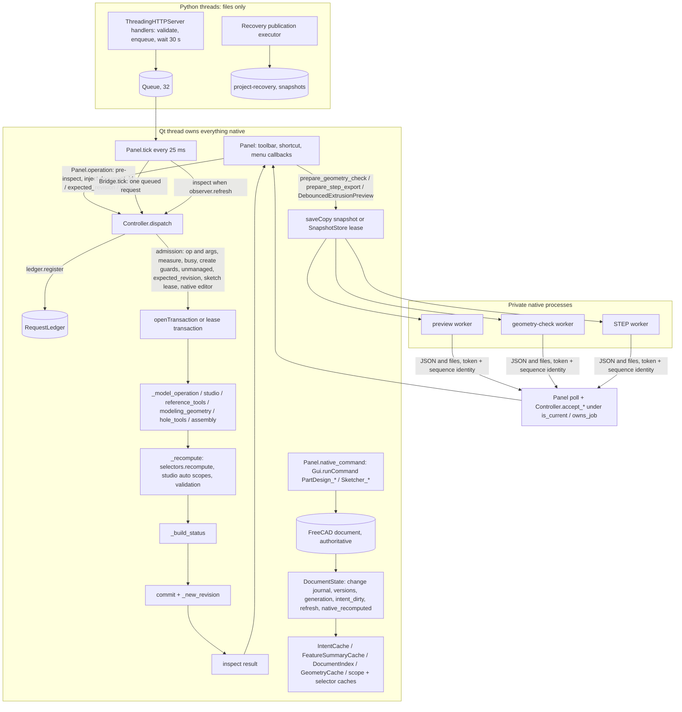

# KurtShape deep review — Fable, 2026-10-17

Independent review of the KurtShape checkout at `f57d592` (`main`): a native Windows Qt/PySide CAD application over portable FreeCAD 1.1.4 / OCCT 7.8.1 with an authenticated, revision-checked assistant bridge. The review covers appearance and viewport graphics, everyday modeling and interaction, architecture and code quality, responsiveness and scalability, reliability and data safety, testing, packaging and maintenance, and the assembly, import and document lifecycle. It is a review and roadmap; no application change was made.

Companion documents in this folder: [`IMPROVEMENT_BACKLOG.md`](IMPROVEMENT_BACKLOG.md) (ranked backlog with the full finding cards), [`visual-proposals/README.md`](visual-proposals/README.md) (annotated captures, concept mockups, quality presets, icon strategy and the icon audit), and [`evidence/README.md`](evidence/README.md) (the fresh regression run and benchmarks).

## Summary (read this first)

KurtShape is a real CAD application on unusually solid foundations: one authoritative native document, typed and revision-checked mutations with a replay ledger, native transactions with draft preservation, private worker processes, staged and verified saves, and an isolated test runner that passed 612 of 616 cases fresh at `f57d592` (four opt-in skips). What keeps it from feeling finished is surface consistency and a few structural seams: four icon languages on one shell, an unmanaged native Tasks dock in the most-used mode, status text that is wrong in common states, error details computed and then dropped, a viewport left at FreeCAD's defaults, no build identity anywhere, a bridge client that cannot reconcile a slow operation, and a handful of data-safety edges. None of it argues for a new framework, theme or model; it argues for a disciplined polish programme.

**Numbers.** Eight area reviewers produced 125 findings; 61 further claims were found already solved at HEAD (§12.6). 6 duplicates were folded into their primary and 1 claim was refuted, leaving 118 active findings. 79 carry an independent adversarial verdict. 43 findings never received one because the second pass was stopped to limit usage (four of those are merged duplicates, so 39 active rows read *not independently verified*); the completeness critic did not run. That label concerns the second opinion only: 14 of the 39 rest on a reproduction or measurement made in this review, and every row and card states its evidence basis.

### The ten highest-value improvements

Basis per finding: **R** reproduced or measured in this review · **C** dated capture in the repository · **S** source-only inference · **P** design preference or missing capability · **✓** independent adversarial verdict · **✗** not independently verified.

| # | Improvement | Findings and basis | Effort |
| --- | --- | --- | --- |
| 1 | **Build identity and agent reconciliation.** A `build` block in the title, Messages, `capabilities`, `diagnostics`, session file and export provenance; bridge errors as JSON with codes; the client polls `request_status` on `outcome_unknown` instead of reporting a slow fillet as failed. | G-01 S✓ (the running-build mismatch itself R) · F-03 R✗ · F-09 R✗ · F-04 S✗ (timings from the dodec build log) | S |
| 2 | **Feedback that tells the truth.** Error details composed into status and Messages with the failing feature selected; honest status wording for empty, sketch-only and editing states; hover labels with single-key shortcuts; Messages dot by severity; Enter in every owned editor. | C-03 R✓ · H-02 R✓ · A-10 C✓ · A-05 S✓ · A-08 S✓ · C-04 S✓ | S each |
| 3 | **A managed sketch mode** (visual). KurtShape's sketch box as the one status and acceptance surface; the native Tasks dock hidden by default and sized, title-less and wrapped when shown; no duplicate view buttons; decided Escape semantics; region fill gated while drawing; degrees in fields. | A-06 C✓ · A-11 R✓ · E-04 R✗ · C-05 R✗ · C-08 S✗ (hypothesis) | M |
| 4 | **A viewport that stops looking dated** (graphics). Draft/Standard/Presentation presets (anti-aliasing, 12° angular deflection, DPI-scaled line widths) applied without dirtying documents; the preview ghost tessellated with the model's rule; a decision on owning hover/selection colours; software-GL fallback. | B-01 R✓ · B-02 R✓ · B-03 C✓ · B-04 R✓ · B-08 R✓ · B-05 P✓ (documented decision) · B-09 P✓ | M |
| 5 | **The icon programme** (visual). One rule per surface: monochrome ink on command surfaces with colour for state, one policy on both object lists; originals for the ~25 fallbacks users meet, alpha-mask tinting for the rest, uniqueness asserted by the generator, the duplicate Boolean button removed. | A-01 R✓ · A-04 R✓ · A-03 R✓ · A-02 R✓ | M–L |
| 6 | **Data safety at the edges.** Locked-destination errors that name the file and clean their stage files; bridge `save` refuses another project's file without `overwrite:true`; `LastFailure` writes preserve the Modified flag; recovery checkpoints grouped, dated and pruned. | F-06 R✗ · F-05 R✗ · F-07 S✗ · H-07 R✓ (F-08 R✗ merged) | S–M |
| 7 | **Assembly and recovery repairs.** Workspace mode reset after Create Assembly; a Rebuild action on the Assembly toolbar; recovered documents keep their name and propose their original path; later, an explicit source-status check and update-from-source. | H-01 S✓ · H-05 R✓ · H-06 R✓ · H-04 P✓ | S, then L |
| 8 | **Honest dispatch and bridge transport.** Three-phase dispatch so a post-commit inspection failure answers `applied:true`; tick backoff with a log rate limit; socket timeout and connection cap; the ledger bounded by count and age; a `user_editing` lease so agent mutations stop closing the editor Kurt has open. | D-01 R✗ · D-02 R✗ (half) · F-02 R✗ · D-03 R✗ (F-13 merged) · F-14 S✗ | S–M |
| 9 | **Duplicate work and process growth** (performance). One managed recompute per Finish; one inspection per committed action and no refresh for bridge reads; the icon cache keyed by a stable signature and bounded (today ~1 MB per refresh on a multi-part studio); "Saving…" painted before the synchronous save. | E-02 R✗ · E-11 R✓ · E-05 S✓ (low) · E-08 S✓ (low) · E-13 S✓ | S each |
| 10 | **GUI reach for typed capabilities.** A Hole dialog on `hole_tools`, "match all like this" query fillets, Plane define-by modes and an `include_source` checkbox; then feature suppression starting with native-Body features. | C-19 P✓ · C-12 P✓ · C-15 P✓ | M, then L |

### Three recommended implementation slices (details in §11)

1. **"Know what is running, see what failed"** (about one week): items 1, 2, the S parts of 6 to 9. Modules: `core.py` dispatch phases and `capabilities`, `bridge.py`, `tools/assistant_client.py`, the `ui.py` status and error paths, a new `build_identity.py`. Validation: new native tests per finding; the messages, everyday-ui and assembly recipes; full `run-checks.ps1`.
2. **"Sketching feels finished"** (two to three weeks): item 3 plus the active-part caption and New-result row tone. Modules: the `ui.py` sketch session functions, `sketch_edit_panel.py`, `sketch_regions.py`, `shortcuts.py`, `core.py` units. Validation: the six sketch recipes with new assertions (solver label never elided, one accept/cancel pair, viewport width ≥ 60 % at 1440).
3. **"The viewport stops looking dated"** (two to three weeks): item 4 plus tab titles and layout memory. Modules: `viewport_actions.py`, `workspace_preferences.py`, `theme.py`, `extrusion_preview.py`, `preview_worker.py`, `hover_outline.py`, `history_selection.py`, `feature_panel.py`. Validation: the viewport-actions and view-selection macros re-registered and extended; framebuffer assertions; STL facet count unchanged.

Slices 2 and 3 touch different modules and can run in parallel.

### Missing evidence before implementing the three slices

- **Slice 1:** F-04's timeout figures come from the dodec build log, not re-measured; D-01, D-02, F-03 and F-09 are headless reproductions without a second opinion; no current-era capture of the status strings exists (newest 2026-10-06); §12.5 question 1 (which launcher Kurt runs) decides the build-identity fallback.
- **Slice 2:** C-08 (Escape with no active tool commits the sketch) is a hypothesis one GUI recipe settles; E-04's 1.1 s is headless; a capture of the Tasks dock at Kurt's 150 % scaling is needed to size the width policy; §12.5 question 4 decides whether the dock is owned or hidden.
- **Slice 3:** the `View/AntiAliasing` enum mapping and whether a live change needs a restart are unverified; B-06 is reproduced without a second opinion; Kurt's live profile colours were never read (the B-05 decision depends on them); MSAA cost on his Intel iGPU needs one bench-gui orbit measurement.

## 0. Baseline and method

| Item | Value |
| --- | --- |
| Checkout reviewed | `f57d59267857ad32c302d2ae6e6c1368ce3c6a68` on `main` (2026-10-17 03:27 PDT, "Let fillet and chamfer take query references that cover every match"); `origin/main` is the same commit |
| Working tree | Clean apart from the untracked `docs/fable-deep-review/` folder (this review). No application file was changed |
| Pinned runtime | `runtime/freecad-1.1.4/FreeCAD_1.1.4-Windows-x86_64-py311`: FreeCAD 1.1.4 (git `4fd3bf320`), OCCT 7.8.1, Python 3.11, PySide6 6.8.3; archive SHA-256 pinned in `install-runtime.ps1` |
| Running application | `freecad.exe` started 2026-10-17 01:28 (session file timestamp). Its live `capabilities` lists 71 operations and lacks `hole`, `add_polyline` and multi-edge references, so it runs a build at or after `3df4faa` (it has `add_arc` and arbitrary `create_plane`) and before `24bab02`; most likely `d95cc2e`. Everything in this review cites the checkout; where a finding touches code changed by `24bab02`, `1f0001e` or `f57d592` it says so |
| Evidence dates | Screenshots under `validation/` and `docs/` are dated 2026-10-02 to 2026-10-06; images from 2026-10-02/03 predate the 2026-10-04 theme repair and the 2026-10-14 toolbar change and are treated as historical. The newest tracked validation JSON is 2026-10-05. The newest user-facing docs are dated 2026-10-15 |
| Review date | 2026-10-17, 03:35 to 11:30 PDT |

**What was actually run.** (1) A fresh full regression run with `tools/run_native_tests.py` in a private session (see §12 and `evidence/native-regression-2026-10-17.json`). (2) Five fresh controller benchmarks with `tools/perf/bench_core.py` (`evidence/controller-benchmarks-2026-10-17.md`). (3) One read-only bridge call, `{"op":"capabilities"}`, to identify the running build. (4) Headless, isolated experiments with `kurtshape.core.Controller` and the bundled Qt, each under its own session, profile and temp folders, never touching `runtime/user-data` or an open document: sketch-continuity probes, expression and unit probes, transport probes against `bridge.py` with a dummy controller, controller probes for save/export failure modes, an icon audit (contact sheets, ink metrics, fallback resolution), and a shortcut-override probe. (5) Source inspection of every module named in the brief at current line numbers.

**What was deliberately not run.** No screenshot, click or keystroke on Kurt's desktop; no restart of his session; no GUI recipe (`tools/run_gui_recipe.ps1` launches a second FreeCAD GUI on the same machine, which the brief's constraints and the open session argue against); no hosted CI. Statements about GUI behaviour therefore rest on source logic plus the committed recipe receipts and dated images, and are classified accordingly.

**How findings were produced and checked.** Eight independent reviewers each took one area of the brief (the six areas plus a split of modeling into everyday interaction and assembly/import/document lifecycle) with the same evidence standard (current line numbers, quoted source, reproduction or the verification still needed). Each finding was then meant to go through two independent checks: an adversarial pass that tried to refute it against source, tests, docs and git history (including whether it was already fixed at HEAD), and a judge pass that re-rated classification and severity from Kurt's and a newcomer's point of view. That pass was stopped to limit usage after 79 of the 118 active findings; the remaining 39 are marked *not independently verified* and keep whatever reproduction evidence their reviewer produced (the Evidence column in §3 says which). The planned completeness critic did not run. Classification is strict: **verified defect** means reproduced in an isolated experiment or unambiguous in source; **design weakness** is an observed quality judgment; **hypothesis** names the verification still needed; **opportunity** is a missing capability or improvement, not a defect. Severity is impact if true; implementation priority is decided separately in the roadmap.

**Scope of claims.** Line numbers are at `f57d592`. Timings are from isolated headless processes on this machine (Intel, 32 logical processors, Windows 11), 5 repeats, with the review's own agents reading files concurrently; they are order-of-magnitude evidence for this fixture set, not GUI input-to-paint measurements and not Onshape comparisons.

## 1. Overall assessment

KurtShape is a real CAD application, not a themed FreeCAD. The foundations are the strongest part of it, and they are the kind that are hard to retrofit: one authoritative native document with typed, revision-checked, replay-protected mutations; native transactions with draft preservation and one-undo-step grouping; a change-journal observer with bounded, token-checked caches; private worker processes for exact previews, geometry checks and eligible STEP exports that only ever exchange files and JSON; staged, verified saves with recovery copies; an isolated test runner with a source-hash guard that passed 612 of 616 fresh cases at this revision (four opt-in performance skips, no failures); and documentation that is unusually honest about what is still synchronous and what the historical numbers do and do not prove. The modeling loop is already better than most FreeCAD-based workflows: Shift+S plane pick, continuous Line, exact previews whose verdict gates Confirm, in-place editing of extrusions and dress-ups, query-backed fillet references that survive rebuilds, a deliberate-drag rollback, and Alt+C search with aliases.

What keeps it from feeling finished is not any one subsystem; it is execution consistency at the surface and a handful of structural seams underneath. On the surface: four icon vocabularies on one shell, a native Tasks dock that is dropped into the sketch mode unmanaged (clipped solver text, three ways to leave a sketch, a third of the width), status text that is wrong in the two most common states, error payloads that are computed and then dropped before Kurt sees them, hover labels that hide every single-key shortcut, Enter that works in one editor family and not the other, radians where Kurt thinks in degrees, and a viewport left at FreeCAD's defaults (no anti-aliasing, 7-facet fillets, a preview finer than the result). Underneath: no build identity anywhere, so neither Kurt nor an agent can tell that the running app predates three commits; a bridge whose 30 s timeout is within 2× of real fillet times and whose client never reconciles an unknown outcome; a few data-safety edges (a locked destination leaves stage-file orphans and a raw `WinError`, a bridge save can overwrite another project, a rejected request flips the Modified flag); and three duplicated pieces of machinery (command metadata in seven places, two preview evaluators with different rules, two hand-copied job state machines) that have already produced reproducible defects. The assembly and recovery journeys show the same pattern in miniature: the adapter is careful (failed commands leave joints and undo untouched, solver acceptance checks residuals, snapshots reopen without their sources) while the GUI on top is unfinished (a modeled part can render as an empty assembly workspace, an assembly can be stuck in "Rebuild required" with no button to clear it, a recovered document loses its name and is offered `my-part.FCStd`).

None of this argues for a new theme, a new framework, a second model or the deferred authoritative-process migration. It argues for a disciplined polish programme: a week of small, high-confidence fixes that change what Kurt sees every hour, a sketch-mode slice, a viewport slice, and a steady structural clean-up behind the existing recipes.

### 1.1 Strongest existing foundations (preserve)

- Native FCStd authority with typed operations, opaque revisions, replay ledger and explicit admission chain (`core.py` `_dispatch`).
- Sketch lease with draft preservation, one-undo-step Finish and Cancel-restores-accepted semantics; query-backed references (`QueryInputs`, multi-edge references) re-evaluated on rebuild and fail-closed on ambiguity.
- Private worker processes with immutable snapshot leases, sequence/generation keys, confirmed-exit cleanup and ownership-guarded acceptance.
- Staged, ZIP-verified saves that keep undo; paired export publication with rollback; hash-verified recovery with a second-process proof in the test suite.
- The light compact shell: owned palette with a re-apply guard, icon-only rows with accessible names surviving in menus, search and hover labels, modeless editors with the verdict outside the scroll host, a contrast gate on the tokens.
- The test and validation machinery: isolated subprocess runner, static suite inventory, fixture receipts, worker-lifetime tests with injected failures, GUI recipes that require fresh reports and natural worker drain.
- Honest records: every milestone report separates fresh runs from retained receipts and refuses to turn microbenchmarks into application claims.

### 1.2 The five improvements with the highest user value

| # | Improvement | What Kurt notices | Findings | Effort |
| --- | --- | --- | --- | --- |
| 1 | **Build identity and agent reconciliation.** A `build` block (git head, dirty flag, source hash, started-at) in the title, Messages header, `capabilities`, `diagnostics`, the session file and export provenance; `assistant_client.send` polls `request_status` on `outcome_unknown` and returns typed JSON errors instead of raising on HTTP 400/503. | He can see at a glance that the running app predates the checkout; agent builds stop aborting on a 15 s fillet or a full queue and never report a finished feature as a failure. | G-01, F-03, F-04, F-09 | S |
| 2 | **Feedback that tells the truth.** Error details (failing feature, conflicting constraints, ambiguous matches) composed into the status line and Messages with the feature selected in history; status wording fixed for empty parts and active sketches; hover labels showing single-key shortcuts; Messages dot counting severity instead of lighting at every launch; one recompute per Finish; Enter confirming every owned editor. | Failures name the feature and a next step; the dock stops saying "Rebuild required" while he sketches; the toolbar teaches its own keys; Finish on a deep part takes half the time; Enter works in Fillet like it does in Extrude. | C-03, A-10, A-05, A-08, E-02, C-04 | S each |
| 3 | **A managed sketch mode.** KurtShape's sketch box becomes the single status and acceptance surface (full solver verdict with DoF count, counts of constraints and conflicts); the native Tasks dock hidden by default and sized, title-less and wrapped when shown; no duplicate view buttons; Escape semantics decided; region fill gated while drawing. | Sketching gets a third of the screen back, the one solver cue he needs is always complete, there is one way to finish and one to cancel, and dense sketches stop pausing after every placement. | A-06, C-08, E-04, A-11 | M |
| 4 | **A viewport that stops looking dated.** Draft/Standard/Presentation presets in the private profile (anti-aliasing, 12° angular deflection, DPI-scaled line widths) applied without dirtying documents, the preview ghost tessellated with the model's rule, owned hover/selection colours, the plane accent actually applied, Shift+T as a session-only effect, software-GL fallback. | Smooth silhouettes and round holes at the same cost as today's toggle, Confirm no longer coarsens the preview, the title no longer says Modified after Shift+R or Shift+T. | B-01 to B-09 | M |
| 5 | **Data safety at the edges.** Locked-destination errors that name the file and clean their stages; bridge saves that refuse to overwrite another project without `overwrite:true`; `LastFailure` writes that preserve the Modified flag; recovery checkpoints retired for saved-and-closed documents. | Save and Export stop failing with `WinError 5` and littering the project folder; an agent typo cannot replace the osteotome with a drill; the Recovery menu shows the checkpoints that matter. | F-05, F-06, F-07, H-07 | S–M |

Close behind: the icon programme (A-01 to A-04), GUI access to the typed Hole and query fillets (C-19) and the plane modes and pattern pickers (C-12), the command descriptor and error-code tables (D-04 to D-06), a `user_editing` lease so agent mutations stop cancelling the editor Kurt has open (F-14), the one-day assembly and recovery repairs (H-01, H-05, H-06, H-07) and the memory leak in the icon cache that grows the process on every refresh (E-11).

## 2. Architecture map and the principal sources of inconsistency, confusion, latency and risk

The module map, by responsibility (line counts at `f57d592`):

| Layer | Modules | Notes |
| --- | --- | --- |
| Shell and interaction (Qt) | `ui.py` (4,341; `Panel`, 178 methods), `feature_panel.py`, `sketch_edit_panel.py`, `history_model.py`, `history_selection.py`, `rollback_history.py`, `toolbar_labels.py`, `tool_search.py`, `shortcuts.py` + `shortcuts.json`, `theme.py`, `presentation_icons.py`, `workspace_preferences.py`, `startup.py`, `navigation.py`, `viewport_actions.py`, `general_actions.py` | One `Panel` owns toolbars, docks, editors, tick loop, job polling, sketch session flags and bridge dispatch |
| Sketch-mode helpers (Qt + Coin) | `sketch_tools.py`, `sketch_references.py`, `sketch_history.py`, `sketch_regions.py`, `sketch_colors.py`, `sketch_snapping.py`, `sketch_cursor.py`, `hover_outline.py`, `edge_picking.py`, `tool_session.py` | Overlays are unpickable and self-cleaning; `tool_session` is the ownership pattern to copy |
| Controller and operations | `core.py` (2,897; `Controller`), `studio.py` (1,749), `selectors.py` (1,736), `reference_tools.py`, `modeling_geometry.py`, `hole_tools.py`, `extrusion_edit.py`, `assembly.py`, `bodies.py` | Typed ops, admission chain, transactions, recompute, build status, save/export |
| Derived state | `document_state.py`, `document_index.py`, `incremental_intent.py`, `inspection_cache.py`, `geometry.py` | Change journal plus token-checked caches; no second model |
| Workers and files | `extrusion_preview.py`, `preview_worker.py`, `geometry_check_worker.py`, `step_export_worker.py`, `step_capture.py`, `snapshots.py`, `recovery.py`, `responsiveness.py`, `timing.py` | Process isolation with leases; recovery publication off-thread |
| Transport | `bridge.py`, `request_ledger.py`, `contract.py`, `tools/assistant_client.py` | Loopback HTTP, bounded queue, replay ledger |

### 2.1 Where visual inconsistency comes from

Three icon pipelines feed one toolbar (`presentation_icons.icon_for`: original SVG by label, original by command id, luminance-grayscaled native raster, generic fallback) and a fourth feeds the history (`obj.ViewObject.Icon` directly); the generator's stroke weight and the grayscale method were never reconciled against each other at 20 px (fallback weight is unrelated to its neighbours, 0.7× to 4.5×), the editor headers use Qt's own standard icons, and nothing asserts asset uniqueness. The native Tasks dock and the native status-bar widgets (notification bell, dimension readout, navigation indicator) are hidden or moved but not owned, so native chrome and KurtShape chrome meet without a policy. Nothing persists layout, so the shell resets itself at every launch and every editor open. The viewport inherits FreeCAD's defaults for everything the eye reads first (anti-aliasing, tessellation, selection colours, line widths), while the design system names tokens for them that are not applied.

### 2.2 Where user confusion comes from

State that is computed but not shown: error payloads (`features`, `constraints`, `matches`) dropped at `ui.py` line 1349; the active target part shown only as a bare combo and bold text; hidden-looking rows for the first feature of every part; "Rebuild required" during sketching; disabled tools with no reason. Semantics that differ by surface: Enter, Escape, the three ways to leave a sketch, radians in fields, a GUI Hole that is a different feature from the typed Hole. Missing identity: no build or version anywhere, so behaviour differences between the running app and the checkout are invisible.

### 2.3 Where latency comes from

Every O(model) native primitive runs on the Qt thread and cannot be threaded: committed kernel recompute (6.8 s for a plate60 upstream edit, all kernel), `saveCopy` on five capture paths (1.8 s on plate60, including the idle recovery capture Kurt did not ask for), `openDocument`, world-BRep fingerprinting for STEP. On top of that the controller repeats work: three inspections per committed action, three managed recomputes per Finish (two of them re-executing the dependent chain), six world fingerprints per STEP acceptance, a whole-sketch region fill after every geometry change, an extra inspect and full refresh per bridge read. On multipart studios the controller's own selector and auto-scope work (~1.2 s per tip edit at HEAD) dominates the kernel. The GUI stays responsive during exact previews, checks and eligible exports thanks to the workers, but Confirm still waits seconds on deep parts because each exact proposal reloads the clone and runs a whole-model boolean for display.

### 2.4 Where maintenance risk comes from

Seven sources of command metadata (reproduced drift: Alt+C cannot find Move face); 122 emitted error codes with ~26 documented; two preview evaluators and two job state machines kept in step by hand; seven Panel flags and a hand-ordered Escape chain for the sketch session; no build identity, no runtime integrity check at launch, four launchers and five checkouts sharing one live session folder; evidence that is stale (newest tracked validation 2026-10-05), untracked (0 of 300 screenshots) and unstamped (no git field), with eighteen different native test totals across the docs and documentation that contradicts code in four verified places; eleven GUI macros absent from the recipe runner; a CI file that has never been observed to run.

## 3. Findings

118 findings are in the active backlog (24 verified defects, 70 design weaknesses, 6 hypotheses, 18 opportunities; severity: 3 high, 60 medium, 55 low). 79 of them carry an independent adversarial verdict (46 confirmed, 33 downgraded with a corrected rating); 39 are marked *not independently verified* because the adversarial pass was stopped to limit usage. That label says nothing about reproduction: 14 of those 39 rest on a reproduction or measurement made in this review, and the Evidence column says which. 6 duplicate findings were folded into their primary (B-14→B-05, C-09→A-11, C-13→A-10, F-08→H-07, F-10→G-01, F-13→D-03), 1 finder claim was refuted; both lists are at the end of `IMPROVEMENT_BACKLOG.md`. The 61 issues the reviewers checked and found already solved at HEAD are in §12.6. Per area: A 15, B 13, C 17, D 16, E 17, F 13, G 14, H 13.

**Evidence column.** *reproduced* = an experiment, measurement or probe run in this review shows the behaviour; *captures* = a dated screenshot in the repository shows it; *source* = inferred from reading the code, not run; *preference* = a missing capability or a design judgment, not a defect claim. The second half states whether the finding passed an independent adversarial check (*verified*) or not (*not independently verified*).

The table below is the evidence-backed index; every row has a full card in `IMPROVEMENT_BACKLOG.md` with source and line numbers, quoted evidence, scenario, consequence, reproduction or the verification still needed, proposed change, acceptance criteria, dependencies, risk and the adversarial check's reasoning. Classification, severity and confidence shown here are the post-verification values (the refuter's correction when downgraded, never above the judge's rating). Severity is impact if true; the implementation order is decided in §10 and in the backlog's phase tables.

| ID | Category | Classification | Sev. | Conf. | Value | Effort | Evidence | Source | Finding | Verification |
|---|---|---|---|---|---|---|---|---|---|---|
| H-04 | assembly workflow / embedded-snapshot policy | opportunity | high | high | high | L | reproduced · verified | src/kurtshape/assembly.py `assembly.insert / assembly.inspect / Panel.refresh_assembly` assembly.py:377-395 (snapshot keyed by sha+object), 899-911 (inspect source/policy fields), 603-619 (cascade removal of joints on delete), 738-741 and 894-896 (in-document tamper signal only), 745-757 (validation checks references on suppressed joints too); ui.py:911 (only policy hint), 1787-1793 (tooltip id only); docs/assembly-workflow/WORKFLOW.md:9, 48 | No 'update from source' and no staleness signal: edited parts never reach the assembly, and re-insert silently creates a second snapshot | confirmed |
| E-01 | responsiveness | design weakness | high | high | medium | M | reproduced · not independently verified | src/kurtshape/recovery.py `RecoveryStore.capture / Controller.prepare_geometry_check / Controller.prepare_step_export / DebouncedExtrusionPreview._start_exact / Controller._save` recovery.py:40-46; core.py:390, 632, 1839, 1898, 2798; extrusion_preview.py:371, 876; ui.py:2854-2877 | Native saveCopy is the single largest avoidable-feeling GUI stall and is taken by five callers; SaveBinaryBrep/CompressionLevel are untested levers | not independently verified |
| E-02 | sketch | verified defect | high | high | medium | S | reproduced · not independently verified | src/kurtshape/core.py `Controller._dispatch (finish_sketch_edit) / Controller._commit_sketch_edit` L1633-1646, 1160-1191 | Finish sketch runs the managed recompute three times; with two or more native sketch commands the dependent chain is natively recomputed twice | not independently verified |
| A-06 | tasks-panel | design weakness | medium | high | high | M | captures · verified | src/kurtshape/ui.py `hide_native_panels / sync_edit_ui / tick` src/kurtshape/ui.py 96-108 (101-105), 1246-1247, 1267-1268, 3309, 3376-3383, 3385-3421 (3409-3419) | Native Sketcher Tasks dock is unmanaged during managed sketch edits: clipped solver verdict, duplicated accept/close controls (Close commits, floating X cancels), dead title bar, ~25% of the canvas lost | downgraded |
| B-02 | viewport | design weakness | medium | high | high | S | reproduced · verified | src/kurtshape/viewport_actions.py `toggle_high_quality (only control); no startup default` 231 (only control); ui.py:4311-4336 start() sets no Mod/Part default | Default tessellation leaves fillets and holes visibly faceted (7 facets per 90 deg, 26 segments on a 3 mm hole) | confirmed |
| C-03 | feature-editor | design weakness | medium | high | high | S | reproduced · verified | src/kurtshape/ui.py `Panel._operation` src/kurtshape/ui.py 656-666 (notify), 702-716 (append_message), 772-787 (native Report mirror), 849, 900, 1328, 1349 (notify sites), 1696-1704 (row tooltip); src/kurtshape/core.py 1310-1332 (_build_status), 1397-1399 (inspect payload), 1856 (preview failure flattening), 2199-2206 (constraint_conflict details); src/kurtshape/general_actions.py 263 | Controller error details (failing feature, conflicting constraints, ambiguous matches) are dropped before they reach the user | confirmed |
| C-04 | feature-editor | verified defect | medium | high | high | S | source · verified | src/kurtshape/ui.py `Panel.eventFilter / studio_tool` src/kurtshape/ui.py 4257-4272, 2176-2181, 2462-2478, 3811-3817, 4203; src/kurtshape/shortcuts.py 225-227; src/kurtshape/feature_panel.py 29-70, 105-108 | Enter confirms Extrude from its Depth field but does nothing in the Fillet/Chamfer/Revolve/Shell/Plane quantity fields | confirmed |
| C-15 | history | opportunity | medium | high | high | L | preference · verified | src/kurtshape/ui.py `Panel.history_menu` ui.py 3950-4003, 1789-1790; studio.py 257-302, 454-468, 1083-1096; core.py 1272 | Feature suppression is absent; Hide/Show and rollback are the only ways to take a feature out of the build | confirmed |
| E-09 | feature-editor | opportunity | medium | medium | high | L | reproduced · verified | src/kurtshape/extrusion_preview.py `ExtrusionEvaluator.evaluate` extrusion_preview.py:383 (clone load), 401 and 441 (before/after whole-body shape copies), 462 and 472-473 (display boolean), 191-196 (_world_shape copy); preview_worker.py:315; ui.py:2403, 3743 (Confirm gating) | Exact preview reloads the clone and runs a whole-model display boolean per proposal; Confirm waits on it (7.4 s first / 6.2 s update on Plate60) | confirmed |
| E-11 | icons | hypothesis | medium | high | high | S | reproduced · verified | src/kurtshape/presentation_icons.py `grayscale_icon / icon_for / Panel.refresh / HistoryModel.reconcile` presentation_icons.py:20-48 (no 'part' label), 72-73 (unbounded dicts), 107-118 (cacheKey keying + 36 rasterizations), 132-150, 153-156 (clear_cache has no callers); ui.py:1698, 1726, 1737, 1796, 1813; history_model.py:49-51 | Every refresh rasterizes a new grayscale Part icon per body into a never-evicted cache (~217 KB and ~1.5 ms per body per refresh) and re-sets every feature-row icon | confirmed |
| E-14 | architecture | opportunity | medium | high | high | L | reproduced · verified | src/kurtshape/selectors.py `selectors.recompute / Controller._recompute / studio._scope_parts_full / studio.sync_auto_scopes` selectors.py:1580-1600 (_refresh_feature_impl re-resolves every input), 1624-1672 (recompute: 1666-1668 per-object refresh + doc.recompute([obj]), 1670-1671 whole-document walk); core.py:867-895 (879-885 scope loop, worst case len(order)+1); studio.py:839-851, 854-925 (859-860 all-domain token key), 928-1057; ARCHITECTURE.md:53 | Managed rebuild re-resolves every selector consumer and recomputes object-by-object across the whole document per edit; studio tip-edit overhead (~1.0-1.3 s) is 5-6x the kernel time and grew with HEAD's query features | confirmed |
| G-01 | packaging | design weakness | medium | high | high | S | reproduced · verified | src/kurtshape/ui.py `Panel.make_toolbars (Help menu), start()` ui.py 528-531, 1756, 1828, 4311-4341; core.py 520-530, 1446-1463; bridge.py 97-98; contract.py 3-4; __init__.py 1 | No KurtShape build identity: window, bridge capabilities/diagnostics, Messages and STEP provenance cannot name the running source revision (also F-10) | downgraded |
| G-04 | testing | design weakness | medium | high | high | M | source · verified | .github/workflows/windows-ci.yml `jobs.lint, jobs.perf, jobs.gui-recipes` .github/workflows/windows-ci.yml 36-39, 59-67, 78-81, 143-150; tests/support.py 102-104; README.md 119, 121 | Hosted CI has failed on all 13 runs since the first push (Oct 13): 19 ruff errors at HEAD, native-tests cannot find runtime/test-tmp on a fresh checkout, 12/15 GUI recipes crash on the hosted runner, and README says CI is not running | confirmed |
| G-11 | docs | design weakness | medium | high | high | M | source · verified | src/kurtshape/core.py `Controller.dispatch (diagnostics op, operation_failed logging)` src/kurtshape/core.py 1461-1463, 1786-1793, 1402; src/kurtshape/ui.py 437, 731-734; src/kurtshape/general_actions.py 268-270; launch-kurtshape.ps1 41 | Support diagnostics are thin: no crash handler, kurtshape.log only sees unknown bridge exceptions, Copy all and the diagnostics op carry no identity or log context | confirmed |
| H-10 | assembly workflow / workspace switching clarity and identity | design weakness | medium | high | high | M | source · verified | src/kurtshape/ui.py `Panel.make_toolbars (mode_choice) / Panel.set_workspace_mode / Panel.create_assembly / Panel.save / GeneralActions._activate / GeneralActions.tab_manager` ui.py:523-526 (combo + tooltip), 796-838 (set_workspace_mode; switch/create at 807-820), 860-887 (create_assembly; unmodeled branch 879-884 keeps the document label, modeled branch 880-883 names a new document after the assembly), 1804 (features_title = assembly name), 1828 (window title = state name = doc.Label via core.py:1397), 2976-2980 (Save default my-assembly.FCStd regardless of label); core.py:1482-1485 (`new` sets doc.Label from name); general_actions.py:209 ('Active part studio:'), 232 ('Open part studios') | The 'Part Studio \| Assembly' combo reads as a mode of the current document but is a document switcher, and the assembly's name is not the document's name | confirmed |
| H-12 | assembly workflow / insert and document state | design weakness | medium | high | high | S | source · verified | src/kurtshape/ui.py `Panel.insert_assembly_part / assembly._source_document` ui.py:889-937 (no open-document/modified check before assembly_candidates); ui.py:910 (dialog text omits 'saved'); ui.py:1819 (hint only before an assembly exists); assembly.py:169-220 (_preflight_source), 304-343 (_source_document copies the on-disk file); core.py:1236-1242 (_modified available); docs/assembly-workflow/WORKFLOW.md:7, 9; NATIVE_API.md:29, 33 | Insert reads the saved file; unsaved changes in an open tab for that part are silently ignored | confirmed |
| A-01 | icons | design weakness | medium | high | medium | L | reproduced · verified | src/kurtshape/presentation_icons.py `icon_for / grayscale_icon / _gray_image` src/kurtshape/presentation_icons.py 87-118, 132-150; src/kurtshape/ui.py 1681, 1698, 1726, 1737, 1796, 1813; src/kurtshape/feature_panel.py 15-25, 241-245, 318; src/kurtshape/theme.py 301 | Icons mix four vocabularies (originals, grey native, colour native in history, Fusion standard); fallback weight is inconsistent (0.7–4.5x comparators, ~15x spread overall), not uniformly heavier | downgraded |
| A-05 | visual | verified defect | medium | high | medium | S | source · verified | src/kurtshape/ui.py `Panel.tool` src/kurtshape/ui.py 445 (tips at 549-550, 572, 586-588, 596-598, 607-608, 615, 620); src/kurtshape/toolbar_labels.py 72-75, 123, 187-190 | Hover labels drop every single-key shortcut because Panel.tool keeps a tip suffix only when it contains '+' (Fit F, Normal N, Planes P, Insert I, Fixed M, Line L, Rectangle G, Circle C, Arc A, Dimension D, Trim M, Construction Q) | confirmed |
| A-07 | feature-editor | design weakness | medium | high | medium | M | source · verified | src/kurtshape/feature_panel.py `FeaturePanel.show_compact / Panel.start` src/kurtshape/feature_panel.py 35-38, 123-155 (147-153); src/kurtshape/ui.py 2585-2586, 2678, 3235, 3417-3419, 3473, 3585, 4314-4324; src/kurtshape/startup.py 5-11 | Feature editors are re-floated to the canvas corner on every open and the shell layout (editor placement, history width, window/monitor) is rebuilt from constants each launch | confirmed |
| B-01 | viewport | verified defect | medium | high | medium | M | reproduced · verified | src/kurtshape/viewport_actions.py `ViewportActions.toggle_high_quality` L219-253 (loop 228-238, restore 244-249) | Shift+R quality toggle marks the document Modified, re-tessellates every visible object synchronously, skips objects created afterwards, and persists into the file if saved while on | confirmed |
| C-01 | sketch | design weakness | medium | high | medium | S | reproduced · verified | src/kurtshape/core.py `Controller._add_line / _anchor_points` src/kurtshape/core.py 2145-2166 (_add_line), 2174-2184 (_anchor_points), 2285+ (_add_polyline); docs/OPERATION_CONTRACT.md 42-44; tests/test_sketch_polylines.py 197-213 | add_line keeps line-to-line junctions as coordinate dimensions by documented contract; legacy add_line chains still open silently when a junction dimension is edited (add_polyline is the HEAD remedy) | downgraded |
| C-02 | history | verified defect | medium | high | medium | S | source · verified | src/kurtshape/ui.py `Panel.refresh / Panel.history_menu` src/kurtshape/ui.py 1683-1686, 1696-1704, 3800-3804, 3960-3961, 4009-4015; src/kurtshape/studio.py 526-529, 767-772, 1342-1359; src/kurtshape/core.py 886, 1357-1362 | New-result Studio operation rows render in the hidden-feature gray and offer 'Show', which reveals the neutral tool solid | confirmed |
| C-05 | feature-editor | design weakness | medium | high | medium | S | reproduced · not independently verified | src/kurtshape/core.py `native_parameters / Panel.parameter_value` 117-123 (core.py); 2687-2697 (ui.py) | Sketch angles are shown and edited in radians (Feature settings and bridge); a bare '30' becomes 30 rad | not independently verified |
| C-06 | feature-editor | design weakness | medium | high | medium | M | source · not independently verified | src/kurtshape/ui.py `Panel.parameters / parameter_value` L2590-2632, 2687-2697 | Finished-sketch dimensions appear as 'Constraints[4]' in the Feature settings combobox with no viewport cue | not independently verified |
| C-08 | sketch | hypothesis | medium | medium | medium | S | source · not independently verified | src/kurtshape/ui.py `Panel.cancel_task / sketch_lease_needs_finish / tick` L3819-3845, 3376-3383, 1246-1247, 1267-1268 | Escape with no active sketch tool most likely falls through to native Sketcher and silently commits the sketch | not independently verified |
| C-11 | feature-editor | design weakness | medium | high | medium | S | source · verified | src/kurtshape/ui.py `Panel.studio_tool` L2239-2247, 2260-2261, 2375-2388, 2435-2438, 2489-2519 | Sweep path and Split face are captured once at dialog open; picking afterwards has no effect | confirmed |
| C-12 | feature-editor | opportunity | medium | high | medium | M | preference · verified | src/kurtshape/ui.py `Panel.studio_tool (linear/circular pattern, create_plane)` ui.py 2274-2297; studio.py 29-33, 1139-1144, 1652-1659; modeling_geometry.py 21-26, 267-273, 302-314 | Pattern direction/axis take typed vectors only (in the bridge too), the Plane dialog is offset-only, and include_source has no checkbox; the bridge's extra plane modes and include_source are unreachable from the GUI | downgraded |
| C-19 | feature-editor | opportunity | medium | high | medium | L | preference · verified | src/kurtshape/hole_tools.py `hole_tools.handle / Panel.primary_feature_tool` hole_tools.py:420-500 (handle), 531-554 (set_parameter/set_expression); ui.py:2043-2051 (primary_feature_tool), 1886-1907 (history_double_click -> parameters for a Hole), 2298-2335 (fillet/chamfer edge field, picked references only); feature_tools.py:72; core.py:135-156 (native_parameters for PartDesign::Hole); reference_tools.py:60-111 | Typed Hole and query fillet groups are bridge-only; the GUI Hole opens the native Tasks panel and only Diameter/Depth/PointAngle are editable afterwards | downgraded |
| D-01 | architecture | verified defect | medium | high | medium | S | reproduced · not independently verified | src/kurtshape/core.py `Controller._dispatch` L1697-1701, 1731-1749, 1750-1798 (1784-1797) | Post-commit inspection failure is reported as a rejected request although the change was committed | not independently verified |
| D-02 | architecture | hypothesis | medium | medium | medium | S | reproduced · not independently verified | src/kurtshape/ui.py `Panel.tick, Controller._dispatch logging` 1245-1269 (tick), 1344-1345 (_operation error path); src/kurtshape/core.py:1786-1793 | Panel.tick has no backoff for a persistently failing inspect: 40 Hz silent failure loop with one traceback appended per attempt | not independently verified |
| D-03 | bridge | design weakness | medium | high | medium | S | reproduced · not independently verified | src/kurtshape/request_ledger.py `RequestLedger.register / RequestLedger.complete` L15, 38-39, 43-52 | Session retry ledger refuses every mutation after 4096 tracked requests per app session; evicted ids are never forgotten (also F-13) | not independently verified |
| D-05 | architecture | design weakness | medium | high | medium | M | source · not independently verified | src/kurtshape/ui.py `Panel.tool / Panel.make_toolbars / Panel.primary_feature_tool / ShortcutRouter / ToolbarLabels / tool_search` 430-446 (tool, key parsed from tip at 445), 548-551 and 607-608 (keys as literals), 2043-2051 (primary_feature_tool typed-vs-native map), 4195-4228 (shortcut_callbacks); shortcuts.json:39-44,110; src/kurtshape/tool_search.py:12-45; src/kurtshape/toolbar_labels.py:39-53,66-83,110-123; docs/ONSHAPE_SHORTCUTS.md:63 | Command metadata lives in seven places and has drifted: registry status/native_command disagree with the wired callbacks, keys are embedded in tooltip strings, hover labels ignore rebinding | not independently verified |
| D-06 | architecture | design weakness | medium | high | medium | M | source · not independently verified | src/kurtshape/core.py `OperationError / _error helpers / AssemblyError` 1437 (unsupported_operation) vs src/kurtshape/assembly.py:934 (unknown_operation); core.py:906-928 (_body translates studio missing_part to missing_body) vs modeling_geometry.py:506, hole_tools.py:429, reference_tools.py:130 (missing_body with 'part' messages); core.py:1470,1477,1481,1566,1573,1579,1820,1824 (sketch_edit_active); core.py:1785,1856 (operation_failed/preview_failed fallbacks); docs/OPERATION_CONTRACT.md (284 lines, no error table) | Error taxonomy: 122 emitted codes, about 26 documented, with synonyms and one code covering ten conditions | not independently verified |
| D-07 | architecture | design weakness | medium | high | medium | M | source · not independently verified | src/kurtshape/core.py `Controller._preview, ExtrusionEvaluator.evaluate` 1812-1884 (_preview; valid rule 1864-1867, one-solid rule 1851-1854); src/kurtshape/extrusion_preview.py:340-524 (evaluate; aggregate rule 398, acceptance 431-433, cleanup 505-524) | Two disposable-clone evaluators with different acceptance rules: Controller._preview vs ExtrusionEvaluator.evaluate | not independently verified |
| D-08 | architecture | design weakness | medium | high | medium | M | source · not independently verified | src/kurtshape/ui.py `Panel.check_geometry/_poll_geometry_check/_cancel_geometry_check/..., Panel.start_step_export/_poll_step_export/..., Controller.prepare_*/accept_*` 137-154 (12 fields, 2 timers), 1412-1628 (check family), 2999-3177 (STEP family), 3819-3823 (cancel_task returns None vs True); src/kurtshape/core.py:338-847 (prepare/accept pairs, _replace_export_pair) | Geometry-check and STEP-export background jobs are two hand-duplicated state machines in Panel; their controller halves live in core.py but are only used by ui.py | not independently verified |
| D-09 | architecture | design weakness | medium | medium | medium | L | source · not independently verified | src/kurtshape/ui.py `Panel.start_sketch/edit_sketch/finish_sketch/leave_native_sketch_edit/sketch_lease_needs_finish/cancel_task; Controller.sketch_edits` 155-165 (flags), 3190-3421 (start_sketch .. sync_edit_ui), 1236-1248 and 1267-1268 (tick forcing document and auto-finish), 3819-3845 (cancel_task chain), 4273-4276 (close guard only for main window); src/kurtshape/core.py:1106-1214, 1601-1646 (lease dict with optional keys created/use_sources/grouping_started) | Sketch session and modal interaction state are implicit: seven Panel flags, a tick auto-finisher, a hand-ordered Escape chain, and an untyped lease dict in the controller | not independently verified |
| E-03 | io | design weakness | medium | high | medium | M | source · not independently verified | src/kurtshape/core.py `Controller.prepare_step_export / Controller._step_export_current / Controller.accept_step_export` L594-646 (prepare), 669-693 (_step_export_current), 695-846 (accept), 2855-2881 (_replace_export_pair guards) | STEP acceptance re-exports the full world BRep of every target about six times (and preparation 2-3 times) on the GUI thread | not independently verified |
| E-04 | sketch | verified defect | medium | high | medium | S | reproduced · not independently verified | src/kurtshape/sketch_regions.py `region_faces / SketchRegionFill._rebuild` L30-75 (region_faces), 179-190 (slotChangedObject), 346-347 (timer), 371-432 (_rebuild) | Sketch region fill rebuild is unbounded per sketch and runs on the GUI thread after every geometry change: 1.1 s per rebuild on a 300-circle sketch | not independently verified |
| E-06 | architecture | hypothesis | medium | medium | medium | S | source · verified | src/kurtshape/core.py `Controller._dispatch error path / Controller._recompute` core.py:1750 (except Exception), 1775 (abortTransaction), 1780 (unguarded second _recompute), 1783 (_build_status), 1800 (busy released in finally); selectors.py:1624-1636 (re-raises); ui.py:184 (native status bar shown); ARCHITECTURE.md:101 (not 230) | Escape during a long native recompute may abort FreeCAD's sequencer and make the error path run a second full recompute | confirmed |
| E-07 | io | design weakness | medium | high | medium | S | source · verified | src/kurtshape/ui.py `Panel.tick / Panel._cancel_step_export / Panel._cancel_geometry_check` ui.py:1180-1196 (tick cancels on active-document change), 3088-3092 and 1509-1515 (context predicates require App.activeDocument() == doc), 3111-3123 and 1531-1543 (notify=False default -> restore_status only); core.py:669-694 and 411-430 (Controller predicates do not need the active document) | Switching the active document cancels an in-flight STEP export or geometry check by design, but without any notification | downgraded |
| F-01 | bridge | design weakness | medium | high | medium | S | source · not independently verified | src/kurtshape/bridge.py `Bridge.__init__ (session file write)` L97-98 | Session token file inherits a Modify ACL that includes the sandboxed-agent accounts and six orphaned SIDs; threat model does not match the machine | not independently verified |
| F-02 | bridge | verified defect | medium | high | medium | S | reproduced · not independently verified | src/kurtshape/bridge.py `Handler (BaseHTTPRequestHandler subclass), ThreadingHTTPServer` L27-29, 48-53, 90-93, 95-96 | Handler threads have no socket timeout and no concurrency cap; a local client can pin unlimited threads; some disconnects print tracebacks | not independently verified |
| F-03 | bridge | verified defect | medium | high | medium | S | reproduced · not independently verified | src/kurtshape/bridge.py `Handler.do_POST (queue.Full path), assistant_client.send` 74-79, 90-91; tools/assistant_client.py:25-26 | Queue-full and malformed-body both answer a bare HTTP 400 HTML page; assistant_client raises HTTPError instead of returning a typed error | not independently verified |
| F-04 | bridge | design weakness | medium | high | medium | S | source · not independently verified | src/kurtshape/bridge.py `Bridge.__init__ request_timeout, do_POST timeout branch; assistant_client.send` 16, 80-88; tools/assistant_client.py:16-26; projects/dodec-hub/ks.py:33-44 | 30 s request timeout is within 2x of measured dodec-hub operation times, and no client helper reconciles outcome_unknown | not independently verified |
| F-06 | data-safety | verified defect | medium | high | medium | S | reproduced · not independently verified | src/kurtshape/core.py `Controller._save, Controller._export, _replace_export_pair` L2793-2811, 2813-2853, 2855-2897 | Save/export over a destination another process holds open fails with a raw WinError and leaves stage-file orphans beside the project | not independently verified |
| F-07 | data-safety | design weakness | medium | high | medium | S | source · not independently verified | src/kurtshape/core.py `Controller._save vs Controller._adopt` L2793-2811 vs 1887-1889 | Bridge save can overwrite another project's FCStd (different DocumentId) and re-point the document at it; adopt has the check, save does not | not independently verified |
| F-11 | bridge | opportunity | medium | high | medium | S | preference · not independently verified | src/kurtshape/core.py `Controller._inspect, Controller._modified` 1353-1408, 1236-1243; src/kurtshape/ui.py:1770-1772 | inspect has no modified/unsaved flag although the controller already reads it and the GUI title shows it | not independently verified |
| F-12 | bridge | opportunity | medium | high | medium | M | preference · not independently verified | src/kurtshape/core.py `Controller.OPS, Controller.attach duplicate check` L247-252, 1020-1023 | No close_document (or feature-visibility) operation; with duplicate_document_id this blocks reopening relocated copies and cleaning up dry-run documents | not independently verified |
| F-14 | bridge | design weakness | medium | medium | medium | S | source · not independently verified | src/kurtshape/ui.py `Panel.tick (bridge dispatch and studio_dialog revision check); Controller._dispatch native-edit guard` 1216-1218, 1231-1235; src/kurtshape/feature_panel.py:39; src/kurtshape/core.py:1573-1580 | An agent mutation cancels the feature editor Kurt has open, and bridge requests are dispatched while modal GUI dialogs are up | not independently verified |
| F-16 | bridge | opportunity | medium | high | medium | L | preference · not independently verified | src/kurtshape/core.py `Controller.MODEL_OPS / studio.OPS / reference_tools.OPS / modeling_geometry.OPS` 248-252; src/kurtshape/studio.py:16; src/kurtshape/reference_tools.py:8; src/kurtshape/modeling_geometry.py:18 | Capability gaps ranked by the real projects they unblock: helix path, spline, typed sketch constraints, nth/created_by-through-Hole selectors | not independently verified |
| G-02 | packaging | design weakness | medium | high | medium | S | source · verified | tools/update-green-copy.ps1 `launcher generation` tools/update-green-copy.ps1 7-11, 31-53, 147-153; bridge.py 97-98, 121-128; launch-kurtshape.ps1 4-5; recovery.py 15 | Launcher and worktree sprawl: five launchers and five checkouts; KurtShape-green.cmd and KurtShape-sweep.cmd run other checkouts' code against main's live session folder and silently replace its bridge token | confirmed |
| G-05 | docs | design weakness | medium | high | medium | M | source · verified | .gitignore `validation/** ignore rules` .gitignore 13-15; tools/record_evidence.py 46-61; docs/EVERYDAY_UI.md 61-65; tools/perf/bench_core.py 103-107 | Validation evidence is local-only and unstamped: newest tracked content is Oct 5, 300 screenshots are gitignored, the Oct 15 stage-2 GUI receipts live in another worktree on an unmerged branch, and no runner except bench_core records the commit | confirmed |
| G-06 | docs | verified defect | medium | high | medium | S | reproduced · verified | README.md `status paragraphs` README.md 15, 71, 117, 119, 121; ARCHITECTURE.md 5; docs/INTERFACE_PASS.md 43; docs/architecture-responsiveness-upgrade/STATUS_REPORT.md 3, 87, 108 | Documentation contradicts current code or state in at least six verifiable places (426 vs 558 native tests, Hole as a primary button, --timeout 210, 'publication pending', 'no hosted CI', 'hosted GUI unverified') | downgraded |
| G-07 | docs | opportunity | medium | high | medium | M | preference · verified | README.md `document structure` LREADME.md 1-25, 104-129 | Build/test/evidence truth is fragmented across 76 tracked docs and a changelog-shaped README with no contributor entry point; only the bridge side has a current-state page (CADkz/AGENTS.md, outside the repo) | downgraded |
| G-08 | testing | design weakness | medium | high | medium | M | reproduced · verified | tools/run_gui_recipe.ps1 `$recipes table` tools/run_gui_recipe.ps1 2-4, 22-69; tools/toolbar-validation.FCMacro 116, 400; src/kurtshape/ui.py 501-504, 541-546 | Eleven GUI macros (navigation, named cameras, viewport actions, view selection, select-other, native-task guards, theme, layout) are unreachable from run_gui_recipe.ps1; their receipts are Oct 2 and toolbar-validation.FCMacro now KeyErrors on the Oct 13-14 toolbar layout | downgraded |
| G-09 | testing | opportunity | medium | high | medium | M | preference · verified | src/kurtshape/ui.py `Panel.eventFilter (QEvent.Close), Panel.shutdown, start()` ui.py 4273-4276, 4279-4309, 4328; settings.py 10-16; tools/run_gui_recipe.ps1 93-95; tools/geometry-check-lifecycle-validation.FCMacro 318-333; tools/step-export-validation.FCMacro 872-881 | Coverage gaps: real window-close path, extrusion-preview worker on shutdown, DPI matrix, settings schema and contract inventory have no automated tests (worker shutdown for geometry check and STEP export is already covered by GUI recipes) | downgraded |
| G-10 | shortcuts | verified defect | medium | high | medium | S | reproduced · verified | src/kurtshape/shortcuts.py `load_registry, ShortcutRouter.__init__` src/kurtshape/shortcuts.py 49-51, 92-96, 375-389 | One unknown id in shortcuts.user.json discards every user rebinding, the message does not name it, and the help dialog's Rebind/Reset cannot clear it | confirmed |
| H-01 | assembly workflow / workspace switching | verified defect | medium | high | medium | S | source · verified | src/kurtshape/ui.py `Panel.set_workspace_mode / Panel.create_assembly / Panel.refresh` ui.py:821-823 (stale write), 879-886 (create_assembly new-document branch), 1636-1639 and 1645-1650 (refresh honours remembered mode), 1818-1819 (empty-assembly status), 3405-3407 (Create Assembly enabled when no assembly), 1244-1256 (tick refresh on document switch), general_actions.py:198-210 (_activate -> tick); workspace_modes resets only at ui.py:813 | Stale per-document workspace mode: a modeled Part Studio renders as an empty Assembly workspace after the canonical Create Assembly path | confirmed |
| H-02 | assembly workflow / error presentation | design weakness | medium | high | medium | S | reproduced · verified | src/kurtshape/ui.py `Panel._operation (failure branch) / Panel.notify; core.Controller.dispatch error dict; assembly.solve / assembly._reference` ui.py:1343-1352 (failure branch), 656-666 (notify), 1220-1229 (bridge failure notification, also message-only); core.py:1794-1797 (error dict with details, last_failures); assembly.py:443 (reason), 826-827 (features), 849-856 (residuals) | Assembly failures reach the user as one sentence; residuals, feature names and native reasons in the error payload are discarded | confirmed |
| H-03 | assembly workflow / dialog pattern | design weakness | medium | high | medium | L | reproduced · verified | src/kurtshape/ui.py `Panel.assembly_joint / Panel.move_assembly_selection (vs feature_panel.FeaturePanel)` ui.py:980-1043 (assembly_joint: modal QDialog, exec_() at 1032, dispatch at 1040), 1045-1100 (move dialog, type-only pre-check at 1056-1058, instance branch 1074-1084); assembly.py:426-444 (_reference validation inside the mutation), 580-587 (move_instance rejects constrained occurrences); feature_panel.py:1-46 (modeless FeaturePanel) | Joint and Move dialogs are modal and validate only after closing; a rejected joint or a constrained-instance Move discards the form, with references recoverable only from the surviving viewport selection | downgraded |
| H-05 | document lifecycle / engine-mismatch flow | verified defect | medium | high | medium | S | reproduced · verified | src/kurtshape/core.py `Controller._rebuild_reason_on_open / Controller._build_status / dispatch ASSEMBLY_OPS branch; Panel.make_toolbars (assembly_bar); tool_search._context_reason` core.py:1281-1292 (reason only for ProgramVersion or FreeCAD/OCCT stamp change), 1339-1341, 1515-1517, 1647-1665, 1686-1687, 2815-2816; ui.py:584-598 (assembly_bar, no Rebuild), 183 (native menu bar hidden), 807-820, 1820-1821, 2765-2768 (tool search contexts), 2820-2822 (activate refuses 'Switch to' entries), 3408; tool_search.py:140-141 | Assembly documents opened with an engine/build rebuild reason stay 'Rebuild required' (Solve never clears it, export is blocked) and the Assembly workspace offers no Rebuild | downgraded |
| H-06 | document lifecycle / recovery | verified defect | medium | high | medium | S | reproduced · verified | src/kurtshape/core.py `Controller.dispatch (op == 'recover') / Panel.save / Panel.fill_recovery` core.py:1496-1502 (opens <uuid>.FCStd), 1528-1529 (FileName cleared; record name/source_file unused), 1397-1398 (name/native_file in inspect); ui.py:1756, 1772, 1828 (title/identity from state['name']), 2976-2981 (Save default); recovery.py:54-55 | Recovered documents are labelled with their UUID and Save proposes a generic 'my-part.FCStd' instead of the checkpoint's original name | downgraded |
| H-07 | document lifecycle / recovery menu usability | design weakness | medium | high | medium | M | reproduced · verified | src/kurtshape/recovery.py `RecoveryStore.available / RecoveryStore._publish / Panel.fill_recovery / Controller.attach` recovery.py:96-102 (previous pair written on every replacement), 154-166 (glob '*.json', source-mtime filter only, no open-document check, no pruning); ui.py:2843-2852 (label/tooltip, no date, no forget); core.py:1021-1023 (duplicate_document_id on recover of an open document) | Recovery menu lists both checkpoint generations with identical undated labels, never prunes abandoned checkpoints, and offers entries for documents that are still open (also F-08) | downgraded |
| B-03 | viewport | design weakness | low | high | high | S | captures · verified | src/kurtshape/theme.py `apply_native_light_preferences (sets no View/AntiAliasing); navigation.apply_navigation` theme.py 225-280 (apply_native_light_preferences) and 53-59 (apply_view_theme); ui.py 4311-4336 (start order) | No anti-aliasing: View/AntiAliasing is never set, so 2 px edges and sketch curves render stair-stepped (cosmetic, startup-only fix) | downgraded |
| A-03 | icons | verified defect | low | high | medium | S | reproduced · verified | src/kurtshape/presentation_icons.py `LABEL_ICONS` src/kurtshape/presentation_icons.py 28, 30, 36, 45-47; ui.py 553-560, 572, 588, 597, 2043-2050; feature_tools.py 177-178; tools/generate-presentation-icons.py 122-128 | Identical glyphs on different commands, including a redundant Boolean button in the model bar | confirmed |
| A-04 | icons | design weakness | low | medium | medium | M | reproduced · verified | tools/generate-presentation-icons.py `ASSETS / main` L45, 50-53, 56-57, 61, 63, 66, 98, 103, 127, 137 | Near-duplicate silhouettes (fillet/chamfer, loft/draft, point/pierce, cube+arrow trio) at 20 px; the hairline-stroke claim holds only at 100 % scaling, not at Kurt's DPR 1.5 | downgraded |
| A-08 | visual | design weakness | low | high | medium | S | source · verified | src/kurtshape/ui.py `append_message / make_messages` src/kurtshape/ui.py 702-718 (append_message), 736-787 (make_messages; startup backlog at 787, contentsChange hook 776-784), 656-666 (notify error channel), 4311-4324 (start() order: maximize_on_primary_screen before Panel); src/kurtshape/startup.py maximize_on_primary_screen (setGeometry); tools/messages-validation.FCMacro 174-200 | Messages unread dot counts the startup Report backlog and every native line regardless of severity, so it is already lit at launch | downgraded |
| A-09 | visual | design weakness | low | high | medium | S | captures · verified | src/kurtshape/ui.py `make_toolbars (status widgets) / make_messages` src/kurtshape/ui.py 629-632, 764-768 (also 771-787 Report-view mirror, 184 statusBar().show()); src/kurtshape/workspace_preferences.py 15-23; src/kurtshape/theme.py 140-141 | Status bar mixes KurtShape text with unexplained native widgets and a second notification channel | confirmed |
| A-10 | visual | design weakness | low | high | medium | S | captures · verified | src/kurtshape/ui.py `status_detail` src/kurtshape/ui.py 1388-1410 (status_detail, rebuild_reason_text), 299-300 (word-wrapped self.status), 1745-1753 (refresh applies it); core.py 1322-1324, 1341 (sketch_only / needs_rebuild derivation) | Status label copy lacks an empty-document state and shouts 'Rebuild required' while a sketch is being edited (also C-13) | downgraded |
| A-11 | visual | verified defect | low | high | medium | S | reproduced · verified | src/kurtshape/ui.py `make_message_copyable` src/kurtshape/ui.py 634-639, 631, 366, 2339; shortcuts.py 225-226, 271-280; tools/messages-validation.FCMacro 286-291 (validated StrongFocus contract) | Clicking a selectable status/verdict label parks focus and silences every single-key shortcut (also C-09) | confirmed |
| A-12 | visual | design weakness | low | high | medium | S | source · verified | src/kurtshape/ui.py `Panel.__init__ / make_history` src/kurtshape/ui.py 131-133, 240-251, 262-268, 275-281, 1658, 1710-1715, 1724-1727, 1747, 1763; src/kurtshape/theme.py 75, 81; src/kurtshape/rollback_history.py 78-88 | Left dock paints an inert "Feature history" title bar above the filter and "Features (N)" label; parts block repeats the active part in a combo and a bold row; marker caption wraps | confirmed |
| B-04 | viewport | design weakness | low | high | medium | S | reproduced · verified | src/kurtshape/extrusion_preview.py `render_mesh` 127-141 (render_mesh; 129 tessellate, 136 discretize), 179 (ProvisionalExtrusion), src/kurtshape/preview_worker.py:329 | Preview ghost is tessellated far finer than the committed model, so Confirm visibly coarsens geometry | confirmed |
| B-05 | viewport | design weakness | low | high | medium | S | source · verified | src/kurtshape/theme.py `COLORS['geometry_selected']; apply_native_light_preferences.view_names` src/kurtshape/theme.py:18 (dead token), 225-231 (docstring stating the preservation intent), 239-248 (view_names); src/kurtshape/hover_outline.py:154; src/kurtshape/workspace_preferences.py:51-66 (Restore path); tools/theme-startup-validation.FCMacro:128,153 (asserts preservation); DESIGN.md:162,166 | Geometry hover/selection/model-default colours are deliberately left to the native profile (DESIGN.md Model Color Rule), so they vary with profile history; the amber geometry_selected token is dead (also B-14) | downgraded |
| B-06 | viewport | verified defect | low | high | medium | S | reproduced · not independently verified | src/kurtshape/history_selection.py `PlaneHighlight.show` L105-128 | Selected-plane accent recolouring is skipped on the pinned build; only transparency changes | not independently verified |
| B-07 | viewport | verified defect | low | high | medium | S | source · not independently verified | src/kurtshape/ui.py `Panel.transparent` L4190-4193 | Shift+T transparency is a persistent 75 % ViewObject write that dirties the document | not independently verified |
| B-10 | viewport | opportunity | low | medium | medium | M | preference · not independently verified | src/kurtshape/viewport_actions.py `ViewportActions.section_view` L369-393 | Section view is the raw native Clipping dock: no capped faces, native widget styling, and a toggle that only ever opens | not independently verified |
| B-13 | sketch | opportunity | low | high | medium | S | preference · verified | src/kurtshape/theme.py `apply_native_light_preferences.view_names (ConstrainedIcoColor copied from the pack); SKETCH_STATE_COLORS` src/kurtshape/theme.py 23-37 (SKETCH_STATE_COLORS lacks ConstrainedIcoColor), 239-248 (view_names copies it from the pack; key on line 241), 266 (override order); src/kurtshape/sketch_colors.py 289-302 | Constraint icons keep the Light pack's #E03131 while dimensions and constrained geometry are black | confirmed |
| C-07 | feature-editor | design weakness | low | high | medium | S | reproduced · verified | src/kurtshape/extrusion_edit.py `EXPRESSION_PATTERN / Controller set_expression` extrusion_edit.py:14, 240-241; reference_tools.py:204, 375-376; core.py:2693-2694; GUI entry points ui.py:2332 (fillet/chamfer Formula), ui.py:2702 (Feature settings Formula) | Formula whitelist rejects valid FreeCAD syntax (function argument separators, <<Label>> references, ^, %, ?:) and reports only a generic sentence | confirmed |
| C-10 | feature-editor | design weakness | low | high | medium | S | reproduced · verified | src/kurtshape/tool_search.py `availability / Panel.show_tool_search.activate / Panel.sync_edit_ui` tool_search.py:125-131 (availability), 133-144 (_context_reason); ui.py:2764 (trigger = QAction.trigger), 2814-2827 (activate), 3395-3402 (sync_edit_ui disables for native task / unmanaged); toolbar_labels.py:122-127; ui.py:1753-1754 (reference-file status text already names 'adopt a copy') | Disabled tools give no reason on hover, and activating an 'Unavailable right now' search result closes the dialog without notifying or triggering | confirmed |
| C-14 | multipart | design weakness | low | high | medium | S | source · verified | src/kurtshape/ui.py `Panel.make_history (body_choice) / part_selection / extrude` L278-281, 1146-1147, 1335-1338, 1722-1727, 1872-1874, 1909-1918, 3205-3232, 3449-3455 | Active part is an unlabeled combobox; the history's Origin planes and the sketch placement help never say which part they belong to | downgraded |
| C-16 | viewport | design weakness | low | high | medium | S | source · verified | src/kurtshape/ui.py `Panel.toggle_sketches / show_hidden / isolate` L3892-3898 (toggle_sketches), 3918-3922 (show_hidden part-studio branch); isolate 4183-4187 iterates raw objects but does not expose helpers | Shift+H and Shift+Y reveal hidden hole-helper sketches and internal tool Bodies until the next operation (Isolate does not) | confirmed |
| C-17 | io | design weakness | low | high | medium | S | source · verified | src/kurtshape/ui.py `Panel.save / export / eventFilter (Close)` L3185 (export default name), 2980-2981 (unsaved-doc save default), 4273-4276 (Close auto-commit); 2924 is context only | Export always proposes 'my-part.step' (and lists the export under Recent projects); closing with an open sketch auto-commits rather than asking | downgraded |
| C-18 | feature-editor | hypothesis | low | high | medium | S | source · verified | src/kurtshape/ui.py `Panel.history_click / studio_tool.capture` ui.py 1879-1880 (history_click -> sync_native_selection), 2494-2516 (capture), 2511-2512 (skip already listed), 2571-2576 (edit-only re-add); history_selection.py 210-215 (not 470-475); feature_panel.py 298-322 | Clicking a history row during a Fillet/Chamfer session clears the picked edges' native highlight while the dialog keeps them | confirmed |
| D-04 | tool-search | verified defect | low | high | medium | S | reproduced · not independently verified | src/kurtshape/tool_search.py `tool_search.build_entries, feature_tools.MODEL_TOOLS('move_face')` 51-95 (build_entries, merge at 64); src/kurtshape/feature_tools.py:60,77,176-178; src/kurtshape/ui.py:548-555 | Alt+C cannot find 'Move face': toolbar actions are merged by native command id and Move face shares PartDesign_Pad with Extrude | not independently verified |
| D-10 | feature-editor | design weakness | low | high | medium | M | source · not independently verified | src/kurtshape/ui.py `Panel.studio_tool, Panel.primary_feature_tool` 2120-2590 (studio_tool), 2043-2051 (primary_feature_tool); src/kurtshape/hole_tools.py:3-33, 234-242, 473-474 | studio_tool is a 470-line method with 15 closures building 14 different dialogs; the GUI Hole is the native dialog, not the typed op | not independently verified |
| D-11 | data-safety | verified defect | low | high | medium | S | source · not independently verified | src/kurtshape/ui.py `Panel.isolate, Panel.set_workspace_mode, Controller.attach` 4171-4188 (isolate), 810-811 and 1641 (workspace_documents by Name); src/kurtshape/core.py:1021-1048 (attach), 1402 (inspect reports last_failed_attempt) | Per-document UI/controller state that is not keyed or reset: isolate visibility leaks across documents, stale last_failed_attempt after same-UUID reopen, workspace memory keyed by reusable document Name | not independently verified |
| D-12 | io | design weakness | low | medium | medium | S | source · not independently verified | src/kurtshape/snapshots.py `SnapshotStore, NativePreviewWorker.close, Controller._dispatch logging, Settings.grant_destination` 46-53 (__init__ no sweep), 55-60 (_delete), 135-147 (retire/close); src/kurtshape/preview_worker.py:141-196 (daemon reaper releases pins); src/kurtshape/core.py:1786-1793 (log append); src/kurtshape/settings.py:33-37 (grant_destination) | Resource leftovers without sweep or rotation: stale snapshot archives survive sessions, kurtshape.log is append-only, write grants accumulate | not independently verified |
| D-13 | responsiveness | hypothesis | low | medium | medium | S | source · not independently verified | src/kurtshape/ui.py `ui.start, Panel.checkpoint_projects` 4313-4317 (start sets RecoveryEnabled/AutoSaveEnabled/AutoSaveTimeout=1); docs/OPERATION_CONTRACT.md:118 ('Native recovery/autosave remains enabled at one minute in the app profile'); src/kurtshape/ui.py:2854-2877 (checkpoint_projects idle gate) | FreeCAD's own AutoSaver (every 60 s, GUI thread) runs alongside KurtShape recovery; a second writer that bypasses the idle gate and the responsiveness evidence | not independently verified |
| D-14 | packaging | opportunity | low | high | medium | S | preference · not independently verified | src/kurtshape/ui.py `ui.start, Settings, ShortcutRouter` 4311-4341 (start); exec_ in ui.py (8 sites), feature_panel.py, general_actions.py (2) vs .exec in shortcuts.py; shiboken6 imported in hover_outline.py, sketch_references.py, theme.py, toolbar_labels.py, ui.py; KURTSHAPE_SESSION_DIR read in core.py:1787, settings.py:10, shortcuts.py:44,91, ui.py:218, responsiveness.py:200 and the three workers | Runtime assumptions are implicit: no fail-fast version check, deprecated exec_ alongside exec, direct shiboken6 imports, nine independent session-dir computations | not independently verified |
| D-15 | architecture | design weakness | low | high | medium | S | source · not independently verified | src/kurtshape/core.py `core.number, assembly._number, selectors._measure, ExtrusionEvaluator._proposal` 53-72 (number: unit-aware, 1e6 limit, invalid_argument), 75-85 (write_path), 1922 (import path check); src/kurtshape/assembly.py:512-526 (_number: 1e7 limit, invalid_assembly_motion), 174 (source path check); src/kurtshape/selectors.py:714-719 (_measure: numbers only, invalid_selector); src/kurtshape/extrusion_preview.py:284-311 (_proposal per-key normalisation); src/kurtshape/modeling_geometry.py:39-41 (wrapper dropping unit) | Numeric and path validation is implemented four times with different limits and error codes | not independently verified |
| D-16 | architecture | design weakness | low | medium | medium | S | source · not independently verified | src/kurtshape/ui.py `Panel.reference_from_geometry, core.native_intent, Panel.make_messages` 2082-2097 (reference_from_geometry falls back to a literal reference), 772-787 (Messages mirrors the hidden Report view); src/kurtshape/core.py:192-197 (native_intent drops unreadable properties from the revision digest); grep: 48 `except Exception` sites, 26 `except ...: pass` across src | Exception-handling conventions: 48 broad catches, 26 silent passes, no logging layer, and two semantic fallbacks that silently change intent | not independently verified |
| E-05 | architecture | design weakness | low | high | medium | S | source · verified | src/kurtshape/ui.py `Panel._operation / Panel.tick / Controller._dispatch` ui.py:1326 (pre-op inspect), 1342 (dispatch), 1359 (refresh), 1245-1250 and 1266 (tick re-inspect and the only clear of the refresh flag); core.py:1731 (post-op inspect), 1558-1560 (expected_revision check); document_state.py:86 | GUI-committed actions run three inspections (bridge mutations two) plus a refresh; the two warm inspections are avoidable bookkeeping | downgraded |
| E-08 | bridge | design weakness | low | high | medium | S | source · verified | src/kurtshape/ui.py `Panel.tick / Bridge.tick` ui.py:1216-1218 (processed), 1245 (early return requires not processed), 1250 (inspect), 1255-1256 (refresh), 221-223 (25 ms timer), 1178 (no dequeue while busy); bridge.py:16 (timeout), 18 (maxsize 32), 56-64 (request_status bypasses the queue), 76-79 and 90-91 (queue_full -> HTTP 400), 102-118 (one dequeue per tick, True even when cancelled) | Every dequeued bridge request, including reads and already-cancelled ones, triggers a GUI inspect and full refresh; bridge throughput is capped at one request per 25 ms tick | downgraded |
| E-10 | feature-editor | design weakness | low | high | medium | M | reproduced · verified | src/kurtshape/preview_worker.py `NativePreviewWorker.poll / render_mesh / CoinExtrusionOverlay.show / DebouncedExtrusionPreview._poll` preview_worker.py:113-137 (json.loads at 119); extrusion_preview.py:127-139, 592-594, 664-665, 715-728, 957-960, 1014; hover_outline.py:37-39 | Exact-preview mesh transport is JSON parsed and flattened on the GUI thread at a fixed 0.15 mm deflection; the 8-entry exact cache is bounded by count, so large curved parts cost 0.4-1.8 s per exact result and up to ~2 GB resident | confirmed |
| E-12 | testing | design weakness | low | high | medium | M | source · verified | src/kurtshape/responsiveness.py `SketchStallDiagnostics.command / SketchStallDiagnostics.pulse / Timings / Panel.feedback_complete` responsiveness.py:99-101, 117-143 (124 gate), 160-165, 200-202, 212-222, 302-308; timing.py:10; core.py:1461-1463; ui.py:2879-2888; tests/test_responsiveness.py:56-74; docs/sketch-interaction-reliability/IMPLEMENTATION.md:27 | Stall diagnostics are scoped to Sketcher_Create* tools by design; outside sketching the app retains only ~13 s of event-loop samples and no record of what was running during a stall | confirmed |
| F-05 | data-safety | verified defect | low | medium | medium | S | reproduced · not independently verified | src/kurtshape/core.py `Controller._dispatch except branch; compare _build_status, _rebuild_reason_on_open, _restore_native_map_versions` L1794-1797 vs 1343-1347, 1276-1294, 1252-1261 | A rejected bridge request writes LastFailure into the document without the Modified guard used by every other metadata write | not independently verified |
| F-09 | bridge | verified defect | low | high | medium | S | reproduced · not independently verified | src/kurtshape/core.py `Controller._dispatch (open/recover/save/export branches), Controller._doc` L1493-1499, 1727-1730, 1057-1061 | Missing required fields and wrong-typed identifiers surface as operation_failed with a Python KeyError/TypeError message, a traceback in kurtshape.log and a persisted LastFailure | not independently verified |
| F-15 | data-safety | design weakness | low | high | medium | S | source · not independently verified | src/kurtshape/settings.py `Settings.__init__ roots; core.WRITE_ROOT` 17-18; src/kurtshape/core.py:37-38 | Default write roots include the whole CADkz\Codex tree, i.e. the checkout itself (tracked fixtures are writable by the bridge) | not independently verified |
| G-14 | testing | design weakness | low | high | medium | M | source · verified | tests/test_build_status.py `StatusPerformanceTests.setUp (support.perf_only)` tests/test_build_status.py 761-775; tests/perf_fixture.py 106-126; tests/support.py 30-32; run-checks.ps1 27; .github/workflows/windows-ci.yml 78-112; tools/perf/report.py 39-52, 80-81, 116; tools/ci/run-local.ps1 26-28; tools/perf/budgets.json | Performance checks are opt-in and record-only; the planned switch to --enforce never happened, and the existing rule cannot fail without a target miss confirmed by a second run | confirmed |
| H-09 | document lifecycle / tab close | design weakness | low | high | medium | M | source · verified | src/kurtshape/ui.py `Panel.eventFilter / Panel.tick / Controller._save / GeneralActions._can_switch` ui.py:4273-4276 (only main-window close, sketch leases only); ui.py:496-516 (Document menu has no Close); shortcuts.json (no close binding); ui.py:1231-1243 and 1270-1285 (tick teardown / reset after the document is gone, 25 ms timer at ui.py:223); ui.py:2976-2984 + settings.py:33-43 (Save -> grant_destination -> remember); core.py:2793-2811 (staged save, ZIP check, .recovery.FCStd); general_actions.py:180-191 (_can_switch guards switching only) | Closing a document tab is FreeCAD-native: the native Unsaved-document prompt's Save bypasses KurtShape's staged save, `.recovery.FCStd` sibling, Recent list and project-root grant | downgraded |
| H-11 | assembly workflow / insert dialog | design weakness | low | high | medium | S | captures · verified | src/kurtshape/ui.py `Panel.insert_assembly_part / assembly.candidates` ui.py:906-932 (dialog; row text 917-921; single selection, one insert per exec); assembly.py:356-361 (candidates fields), 320-322 (STEP solid labels) | Insert picker leaks internal type names, offers no way to tell solids apart, and has no 'insert all' | confirmed |
| H-13 | document lifecycle / inspect-or-adopt state | design weakness | low | high | medium | S | source · verified | src/kurtshape/ui.py `Panel.refresh (status) / Panel.sync_edit_ui / Panel.adopt / Panel._operation (open toast)` ui.py:1753-1754 (status text, only explanation; muted via theme.py:71), 1766-1772 (identity label has no reference marker), 1366-1367 ('Open complete' toast; 1368-1375 add nothing for unmanaged), 3401-3407 (model/assembly actions disabled with ordinary tips; toolbar_labels.py:124-127 shows a reason only via 'kurtshapeHelp'), 2971-2972 + 4197 + shortcuts.json:137 (Ctrl+S routes to adopt), 2994 (default 'adopted-part.FCStd'; core.py:1398 exposes native_file, core.py:1888-1889 rejects the source path), 844-846 / 2132-2133 / 3191-3192 / 3527-3528 / 4037-4038 / 4108-4109 (click-time guards only) | Reference-file (unmanaged FCStd) state is explained only by the muted status line; disabled modeling tools give no reason, Ctrl+S silently becomes Adopt, and Adopt proposes a generic filename | confirmed |
| A-02 | icons | verified defect | low | high | low | S | reproduced · verified | src/kurtshape/ui.py `make_toolbars / bind_tool_menu` src/kurtshape/ui.py 472-483 (478-479), 505, 512-513, 528-532; src/kurtshape/presentation_icons.py 20-48, 132-150; tools/generate-presentation-icons.py ASSETS (recent at 102, tools at 108) | Help button and the 'Repair leftover helpers' entry fall back to the generic cube-and-wrench 'tools' glyph (Recent projects has no icon at all, not the fallback) | downgraded |
| A-13 | visual | design weakness | low | high | low | S | captures · verified | src/kurtshape/theme.py `STYLESHEET QTabBar rules / Panel.refresh` src/kurtshape/theme.py 137-139 (QTabBar rules), apply_theme (clears the native stylesheet, sets Fusion); ui.py 1756, 1828 (main window title only), 1766-1772 (document-row Unsaved/Modified marker) | Document tabs leak FreeCAD MDI titles (': 1*') and a red close glyph | confirmed |
| A-14 | visual | design weakness | low | high | low | S | reproduced · verified | src/kurtshape/theme.py `STYLESHEET QToolButton rules` src/kurtshape/theme.py 95-99 (indicator/padding and inert ::menu-button rules), 163, 179; src/kurtshape/ui.py 472-481 (bind_tool_menu, setPopupMode at 477), callers 466/499/532/568; feature_panel.py 252 | Menu-trigger padding rule targets MenuButtonPopup while every trigger uses InstantPopup, so the chevron overlaps the 20 px glyph corner | confirmed |
| A-16 | visual | opportunity | low | high | low | S | captures · verified | src/kurtshape/ui.py `Panel.new / start` src/kurtshape/ui.py 2922-2927 (Panel.new), 4329-4335 (start fallback), 629 and 655-690 (footer text lifecycle), 549 and 1679 (existing tooltip hints), 3214-3234 (guidance that appears only after Shift+S); docs/onshape-design-audit/PLAN.md:194 | Empty new document offers no in-canvas guidance | confirmed |
| B-08 | viewport | design weakness | low | medium | low | S | reproduced · verified | src/kurtshape/hover_outline.py `FaceHoverOutline.show (lineWidth 2.5); CoinExtrusionOverlay.show (lineWidth 2)` src/kurtshape/hover_outline.py:157; src/kurtshape/extrusion_preview.py:604; src/kurtshape/sketch_references.py:365 | Overlay line widths and FreeCAD's default edge width are unscaled framebuffer pixels, so apparent edge weight varies with display scale | confirmed |
| B-09 | viewport | opportunity | low | high | low | S | preference · verified | launch-kurtshape.ps1 `launch environment (no QT_OPENGL); workspace_preferences.WorkspacePreferences` launch-kurtshape.ps1 44-54 (launch environment); .github/workflows/windows-ci.yml:152 (QT_OPENGL=software) | Preset work needs a renderer gate: nothing detects software OpenGL (CI, RDP) or the Intel iGPU, so a future MSAA/fine-tessellation preset would crawl there | downgraded |
| B-11 | docs | design weakness | low | high | low | S | source · verified | src/kurtshape/sketch_regions.py `SketchRegionFill.COLOR / TRANSPARENCY; _node` src/kurtshape/sketch_regions.py:99-100, 250-252, 334-335; DESIGN.md:164; README.md:7 vs 35; docs/EVERYDAY_UI.md:43 (correct) | Sketch region fill: DESIGN.md/README still say light gray (#ebebeb) and apply() comment still says Strict LESS after a558615 switched to blue tint + LEQUAL | confirmed |
| B-12 | viewport | design weakness | low | high | low | S | source · verified | src/kurtshape/ui.py `Panel.new; Panel.open_path` L2922-2927 (Panel.new); 2942-2961 (open_path); 1255-1263 (bridge-presented documents); 1356-1360 (CREATE_OPS routed through maximize_document_view at 1159-1164); 817 and 881 (direct operation("new") callers) | Only the toolbar New command shows the origin axis cross; Open, import, recover and bridge-created documents never do | downgraded |
| E-13 | io | design weakness | low | high | low | M | source · verified | src/kurtshape/core.py `Controller._save / Controller._export` core.py:2793-2811, 2813-2853, 1731-1744; ui.py:2968-2984, 3041-3078 (fallback with WaitCursor), 1218-1222 + bridge.py:102-116 (GUI-thread dispatch); recovery.py:64-84 (existing background pattern) | Save verifies the staged archive (testzip) and copies the recovery file synchronously on the GUI thread; STL and conservative STEP exports run BRepCheck, meshing, sha256 and full measurements synchronously too, a documented and deliberately deferred limitation | confirmed |
| E-15 | responsiveness | opportunity | low | high | low | S | preference · verified | src/kurtshape/responsiveness.py `Monitor.active_view_key / Monitor.frame_swapped / SketchRegionFill.apply / HistoricalSketchView.apply` responsiveness.py:232-240, 242-250, 302-307, 329-334; sketch_regions.py:304-311 (early return), 331-343 (placement read on presentation passes and the 0.5 s reconcile); sketch_history.py:118-139; ui.py:222-223 (25 ms tick) | Monitor.active_view_key walks the active subwindow's widget subtree per frame swap/paint; sketch fills and sketch history re-read placements/visibility on a 0.5 s reconciliation, not per 25 ms tick | downgraded |
| E-16 | testing | opportunity | low | high | low | M | preference · verified | tools/perf/bench_core.py `Benchmark.preview / evaluate_budgets` bench_core.py:138-161, 335-358, 417-427; report.py:22-32, 44-56; budgets.json:6-39, 41-50; bench_gui.FCMacro:133 (controller_timings dump); responsiveness.py:164-178 (existing input_to_* metrics) | Benchmark harness gaps (all already documented): headless preview phases not exported, studio budget inert under measure=false, regression gate never fails on absolute misses, inert 50 ms synchronous preview target, and no dense/assembly/imported/cold fixtures or input-to-paint budget | confirmed |
| E-17 | data-safety | design weakness | low | high | low | S | reproduced · verified | src/kurtshape/core.py `Controller.attach / Controller._prune_closed_sketch_edits / SnapshotStore / selectors._Context.world_shape` core.py:304-307, 1021-1033, 1050, 1078-1082, 1796, 1911, 1991-1992; document_state.py:188-200; snapshots.py:45-52, 142-147; settings.py:10; selectors.py:49, 290, 366-371, 1083-1090; document_index.py:17 | Closed-document entries are never pruned from Controller.documents/signatures/last_failures and orphan snapshot-*.FCStd files from crashed sessions are never swept; selector contexts are already capped at 16 (not a gap) | downgraded |
| G-03 | packaging | design weakness | low | high | low | S | reproduced · verified | launch-kurtshape.ps1 `exe existence check` launch-kurtshape.ps1 96; install-runtime.ps1 21, 26-28; tools/ci/check-runtime-layout.ps1 7-23; run-checks.ps1 12; core.py 102-103, 1279-1289 | Launcher only checks that freecad.exe exists; runtime layout and versions are verified at install (archive hash) and in CI, not at launch, and engine_stamp omits the engine build hash | downgraded |
| G-12 | testing | design weakness | low | high | low | S | source · verified | tools/run_native_tests.py `SUITES['workflows'], source_snapshot` tools/run_native_tests.py 67, 73-83, 168, 268-279; tools/validate_modeling_workflows.py 639-641; tests/test_shortcuts.py 122-128; tests/support.py 183; src/kurtshape/settings.py 17-18; tools/ci/run-local.ps1 12-14 | Test harness gaps: source snapshot omits validate_modeling_workflows.py and shortcuts.json, the workflows suite is a fixed six-case Oct 4 validator, the native-command check reads an Oct 3 probe JSON, and the ungranted scratch deliberately lands in CADkz | confirmed |
| G-13 | testing | design weakness | low | high | low | S | source · verified | tests/test_native_files.py `NativeFileBehaviorTests.setUp runtime path assertion` tests/test_native_files.py 39-40; tools/run_native_tests.py 286-289, 461-466, 473-474; tests/support.py 190 | Linux probe runs show five Windows-path test_native_files setUp failures that must be explained in prose each time; runner report.json has no platform field | downgraded |
| H-08 | assembly workflow / insert dialog aftermath | design weakness | low | high | low | S | source · verified | src/kurtshape/ui.py `Panel.insert_assembly_part / Panel.frame_import / Panel.isometric` ui.py:933-939 (fit + deferred frame_import after insert), 963-966 (frame_import: isometric + fit), 3857-3858 (isometric -> view_isometric_keep_sketch); navigation.py:200-207 | GUI Insert always re-frames the assembly in isometric fit-all, discarding the current view orientation | downgraded |

## 4. Professional appearance and viewport graphics

### 4.1 Where the shell stands

The bones are right. One owned palette and stylesheet with a re-apply guard keeps FreeCAD's dark preference pack from bleeding back in (`theme.py` `NativePaletteFilter`, lines 415–461); every toolbar button keeps an accessible name that survives in menus, Alt+C search and the delayed hover label; feature editors are modeless, keep Confirm/Cancel and the preview verdict outside the scroll host, and gate acceptance on a current valid preview; the design tokens have a contrast gate (`tools/theme-presentation-contract.py`, 18 pairs, minimum 4.7:1); rolled-back rows use a delegate so they stay gray and italic under the stylesheet. Nothing in this review argues for a new theme, framework or layout; the light compact Onshape-inspired baseline should stay.

What keeps it from reading as finished is execution consistency, and the review measured it rather than describing it.

### 4.2 Icons: three vocabularies, measured

The icon audit (`visual-proposals/icon-audit/`, regenerated from `icons_sheet.py` and `native_gray.py` under the bundled runtime) found:

- **Four visual languages on one shell.** Original shaded solids (alpha-weighted ink 0.15–0.23 at 20 px: `fillet` 0.219, `shell` 0.215), original hairline sketch glyphs (0.035–0.065: `construction` 0.035, `axis` 0.044, `line` 0.054), luminance-grayscaled native FreeCAD icons whose weight is simply unrelated to their neighbours (0.7× to 4.5× the ink of the original beside them: `Use` 4.5×, `Coincident` 3.6×, `Hole` 2.8×, `Sketch fillet` 0.7×; the originals themselves span ~15× from hairline to solid), and Qt's Fusion standard icons in the editor headers (`feature_panel.py` lines 15–26). See `native_gray_vs_original_2x.png`. The adversarial pass corrected one strand of the finder's claim: the "0.79 px hairline" figure holds at 100 % scaling; at Kurt's 150 % the same strokes render at ~1.2 px and ink values are similar, so the sketch glyphs read washed-out next to the shaded cubes because of their *design* (thin strokes, little fill), not because of a rasterization defect. The grayscale fallback is a documented policy (DESIGN.md "Shapes"), which makes this a design weakness to fix, not a bug.
- **63 of the 104 installed catalog tools fall back** to the grayscale path (`runtime_catalog_icon_resolution.json`): every constraint, most sketch geometry and edit tools, Hole, helix, binders, Use. The Help button and the Repair entry fall through to the generic cube-and-wrench `tools` glyph (`presentation_icons.py` line 150), and the Recent projects submenu has no icon at all although a `recent` asset already exists (A-02).
- **Eleven assets are shared across different commands** (`icons_sheet.log`): Plane and Show planes, Boolean and Boolean parts (which are the same command; the model bar has a literally redundant button, A-03), Fixed and Joints, Rebuild and Solve, Move/Transform/Multiple transforms.
- **Ambiguous silhouettes at 20 px** (`icons_20px_zoom3x.png`, `toolbar_strip_3x.png`): fillet vs chamfer differ by one corner; loft vs draft are both tapered tents; extrude, move-face, transform and export are all "cube plus arrow"; pierce vs point are both "cross plus circle" (A-04).
- **History rows bypass the icon layer entirely** (`ui.py` line 1698 uses `obj.ViewObject.Icon`) while Parts rows go through `icon_for` (line 1726), so the same Body is colored in one list and gray in the other (annotated image 01, callout 2).

Recommended strategy, which the visual proposals illustrate: one rule per surface. Command surfaces (toolbars, menus, editor headers) are monochrome ink with color reserved for state (armed/active blue, failed red, pending amber, valid green). Object surfaces (history and parts) use one policy on both lists. Get there by (1) raising original stroke weight so hairline glyphs match the solids and making the generator assert asset uniqueness, (2) authoring originals for the ~25 fallbacks users actually meet (constraint family, slot/polygon, Hole, helix, binders, Use, Help), (3) replacing luminance grayscale with alpha-mask tinting to `icon_ink` plus a 2 px inset so remaining fallbacks match weight, (4) replacing the editor header's Qt standard icons (`feature_panel.py` lines 15–26) with the toolbar's own check/cross. Acceptance is measurable with the audit scripts: ink spread across toolbar glyphs ≤ 2.5× (today ~15×), no fallback above 0.30, no shared asset within one bar.

### 4.3 The native Tasks dock during sketching

The newest shell capture in the repository (2026-10-06, annotated image 03) shows the solver line cut to `Under-constrainec 3 Degrees of Free`, ~400 px of empty Constraints list, and the dock taking ~30 % of the width. `hide_native_panels()` (`ui.py` lines 96–108) only forces the dock to the right area and hides it when no dialog is active; there is no width policy, no title-bar handling, no label wrap. Three ways to leave a sketch are visible at once: the toolbar check/cross, the floating box's check/cross, and the native **Close**, whose effect is a reset of native edit followed by an automatic Finish in `tick()` (`sketch_lease_needs_finish`, lines 1246–1247 and 3376–3383), i.e. commit, not cancel; `docs/M1_PROGRESS.md` records that as intended and it matches stock FreeCAD, so the problem is the ambiguity, not the semantics. The solver verdict is mirrored nowhere in KurtShape's own widgets, so the clipped native line is the only on-screen DoF readout. The floating box also carries **Normal to sketch** and **Isometric view** push buttons (lines 382–385) that duplicate toolbar tools. This is finding A-06, rated a medium design weakness after verification (the dock is an ordinary `QDockWidget` the user can widen, and Close-commits is undoable) and still the single largest visual/interaction issue during the most common mode; bridge-driven sketches never open native edit mode, so it is confined to manual sketching.

The restrained proposal (`concepts/sketch-restrained.png`) keeps native Sketcher as the editor and makes KurtShape's box the one status and acceptance surface: solver verdict wrapped and complete with the DoF count and a plain-language cause, constraint/dimension/conflict counts, the native dock hidden behind *Native panel ›*, no duplicate view buttons. When the native dock is shown, give it a width policy (`resizeDocks`), drop its title bar (`setTitleBarWidget(QWidget())`), wrap the solver label and hide the native Close while the lease is owned. Effort M, Qt only.

### 4.4 Status, messages, tabs, layout memory

- **Status is split and sometimes wrong.** Solid count far left, native DimensionWidget and notification bell in the centre, transient "Extrude complete" text, Messages far right (annotated image 01, callout 4; A-09). `status_detail()` says `Sketches only · mm` on an empty part and `Rebuild required · pending model changes` during ordinary sketch editing (A-10, C-13), because any Touched sketch sets `needs_rebuild` (`core.py` lines 1325–1326). The proposal zones the bar: model truth left, view context centre, Messages right, and reserves "Rebuild required" for engine/build-stamp reasons.
- **The Messages dot carries little signal.** It is lit at every launch (the startup Report backlog is appended as one unread entry after the dock is hidden, `ui.py` lines 761 and 787, and a real launch always leaves at least a `setGeometry` warning there) and by every later native line regardless of severity (`append_message`, lines 702–718), so a genuine recompute failure looks exactly like startup noise (A-08; counting every line is the documented design, which is why this is a design weakness rather than a defect). Count severity, not lines.
- **Tabs leak native MDI titles** (` : 1*`) and a red close glyph; nothing sets tab text (A-13).
- **Nothing about layout persists.** `show_compact()` re-floats every editor at the canvas corner on each open; there is no `saveState`/`restoreState` anywhere in `src` (A-07). Opening on the primary monitor is a deliberate choice in `startup.py`; the editor placement and dock widths are the unintended losses. The workspace never becomes Kurt's.
- **Hover labels omit every single-key shortcut** because `Panel.tool` keeps a shortcut only when the tip contains `+` (`ui.py` line 445): Fit, Normal, Line, Rectangle, Circle, Dimension show no key (A-05). This directly undermines the icon-only toolbar's discoverability premise and is a one-line fix.
- **Clicking a selectable status label parks focus** and the router then swallows single-key tools (A-11, reproduced with a headless Qt probe: after one click on the footer message F, N and Shift+S reach no handler while Ctrl+S still saves; C-09 covers the read-only search field): a clicked error message, the exact flow README recommends for reporting problems, makes the keyboard feel dead until the viewport is clicked.
- **The NaviCube is native default** (no `NaviCube` parameter is set in `src`): the heaviest element on a light shell. `CubeSize`, `BaseColor` and `InactiveOpacity` are available keys.

### 4.5 DPI, small windows, multiple monitors, keyboard

Verified: startup maximizes on the primary screen (`startup.py`), the hover label clamps to the monitor, pick apertures use `devicePixelRatioF()` (`ui.py` lines 3293, 4063), and the only tested scale is 150 % (`docs/INTERFACE_PASS.md`). Overlay line widths are unscaled framebuffer pixels (2.5, 2 and 3 px constants in `hover_outline.py`, `extrusion_preview.py` and `sketch_references.py`), so at 150 % the face-hover outline wins only a 1 px fringe over the model's 2 px edge (B-08, measured in the captures). A suspected mixed-DPI softness of the raster grayscale fallbacks was tested and **refuted**: Qt builds the cache at the desktop's highest device pixel ratio and the 150 % entry is bit-exact. Not verified anywhere: 100/125/200 % layout behaviour and keyboard reach of the history tree (Tab passes ~28 toolbar stops before reaching it; there is no visible focus cue on panes). These are evidence gaps, not reproduced defects; the testing section proposes a `-ScaleFactor` option for the GUI runner so they stop being gaps.

### 4.6 Viewport graphics: what the pinned renderer does, and what KurtShape leaves at default

Established from the runtime by offscreen probes (a fresh isolated FreeCADGui profile, scene-graph and parameter-string inspection, tessellation counts), not from familiarity with another engine:

- **Renderer.** Coin3D fixed-function Gouraud/Phong lighting: three directional lights (0.9 white, 0.6 warm, 0.4 cool) and a specular default material (ambient 0.33, diffuse `#ADB5BD`, specular 0.53, shininess 0.9, two-sided). Anti-aliasing is `View/AntiAliasing` (none, line smoothing, MSAA 2×/4×/8×). Transparency is sorted-object, sorted-triangle blending. Tessellation is per-ViewObject `Deviation` 0.2 % and `AngularDeflection` 28.65°, inherited from `Mod/Part MeshDeviation` / `MeshAngularDeflection` at view-provider creation and stored in the FCStd. Selection is `SoFCUnifiedSelection` with `View/HighlightColor` (`#007A00` green) and `View/SelectionColor` (`#3B5BDB` blue). Available but unused: `Std_DrawStyle`, `Std_ToggleClipPlane`, `Std_AxisCross`, NaviCube size/corner/colour/font, `viewer.setOverrideMode`. **Not available in this main view:** shadows, SSAO, PBR, image-based lighting, order-independent transparency, capped clip planes, screen-space constant-width silhouettes, per-pixel specular. Whether the headlight/backlight keys still drive the three-light rig on 1.1.4 is unverified.
- **What KurtShape sets.** Navigation keys, 24 sketch/annotation colours copied from the Light pack, white background per view, DPI-scaled pick radius inside sketches, and three well-behaved unpickable overlays (face-hover outline, sketch region fill, extrusion ghost). Nothing for anti-aliasing, tessellation defaults, lights, selection colours, line widths or the NaviCube.

Findings that follow from that:

- **Shift+R marks the document Modified, re-tessellates every object synchronously and skips objects created afterwards** (B-01, verified: `viewport_actions.py` lines 229–238; the Gui `Modified` flag flips on `Deviation`, `AngularDeflection` and `Transparency` writes). Shift+T transparency has the same persistent-write problem and is saved into the file (B-07).
- **Default tessellation leaves fillets and holes visibly faceted** (B-02, measured): 7 facets per 90° on fillets up to r = 2, 26 segments on a 3 mm hole; angular deflection, not deviation, is the binding limit.
- **No anti-aliasing** (B-03, rated low because it is cosmetic, with high value for fixing): both current-era captures show hard 2 px stair-stepped edges at ×8; the shipped `View.cfg` template records `AntiAliasing=0` and nothing in `src` writes the key. The startup write is trivial; the verifier's caveat is that FreeCAD's MSAA path replaces the viewer's GL widget, and KurtShape keys about ten event filters (navigation, hover outline, sketch cursor, regions, snapping, edge picking, responsiveness) on that widget instance, so a live change needs the filters re-installed or a restart.
- **The preview ghost is far finer than the committed model** (B-04, confirmed): `render_mesh` calls `Shape.tessellate(0.15)`, and on this build that call's output is governed by an internal angular cap near 0.05 rad (126 rim segments on a cylinder whether the argument is 0.05 or 2.0), while the committed feature draws with the display rule (26–28 segments on a 3 mm hole, 7 facets on a 90° r=2 fillet). Confirm visibly coarsens what Kurt just approved. Changing the number passed to `tessellate` cannot fix it; the preview must use a mesher that takes the model's angular deflection (`MeshPart.meshFromShape(..., AngularDeflection=…, Relative=False)` reproduces the committed counts).
- **Selection colours are deliberately left to the native profile** (B-05, B-14): DESIGN.md's Model Color Rule names "geometry selection" as native-owned and the theme-startup recipe asserts those keys are preserved, so this is a documented decision with a cost, not an oversight. The cost on Kurt's machine is concrete: the verifier found his live profile still carrying the Dark pack's View colours (selection green `#35A047`, edge hover blue `#246EAB`, default part colour `#727980`) under the forced white background, and **Restore light appearance** cannot bring the Light values back because those keys are excluded by design. The amber `geometry_selected` token has no reader; the face-hover outline colour is a hard-coded literal that merely coincides with his profile's hover blue. The selected-plane accent recolouring is skipped on the pinned build because `App::Plane` view providers no longer list `ShapeColor`/`LineColor`/`PlaneColor`; only transparency changes (B-06, reproduced in an offscreen probe; not independently verified).
- **Line widths are unscaled framebuffer pixels** (B-08, measured): 2 px model edges at 150 % are 1.33 logical px; the 2.5 px hover outline renders as 3 px and shows only as a 1 px fringe beside the edge; nothing scales widths by `devicePixelRatioF` although the pick radius is scaled.
- **No renderer detection** (B-09, an opportunity that becomes a requirement once presets exist): nothing adapts to software OpenGL or Remote Desktop. The GL vendor and renderer strings are readable from Python under the bundled PySide (probe: Intel iGPU by default, `llvmpipe` via the bundled `opengl32sw.dll` with `QT_OPENGL=software`); Kurt's daily GPU is an Intel iGPU and hosted CI runs every GUI recipe with software GL, so an ungated MSAA default would hurt both.
- **Section view is the raw native Clipping dock** with hollow interiors and a Shift+X that only opens (B-10). Region-fill colour in code (blue tint since 2026-10-14) disagrees with DESIGN.md and README line 35, README is self-contradictory, and the `apply()` comment still describes the old depth test (B-11, a documentation defect). Only the toolbar **New** shows the origin axis cross; Open, import, recover and bridge-created documents never do, so Kurt's bridge-created parts start on a blank canvas (B-12; origin planes themselves follow one policy and are shown only during placement). Constraint glyphs stay the Light pack's red beside the black dimensions the project chose (B-13).

Recommendation, in order of value for cost: (1) replace the Shift+R toggle with persistent Draft/Standard/Presentation presets written to KurtShape's private profile (`Mod/Part MeshDeviation`/`MeshAngularDeflection`, `View/AntiAliasing`, `DefaultShapeLineWidth` per DPI bucket), applied to open documents per visible object with the Modified flag preserved and batched through a timer, with a software-GL fallback to Draft (B-01, B-02, B-03, B-08, B-09; effort M in total); (2) tessellate the preview with the display rule so preview and result match at every preset (B-04; S); (3) decide, with Kurt, whether the Model Color Rule should keep excluding hover/selection colours; if not, own `HighlightColor`/`SelectionColor` in the theme and derive the hover outline from the same token, and in any case fix the plane accent through `ShapeAppearance` and let Restore reset the model-default colours (B-05, B-06, B-14; S plus a design decision); (4) make Shift+T a session-only presentation (B-07; S); (5) an owned Section editor on the native clip plane first, capped sections via the preview worker only if Kurt wants them for captures (B-10; S then L). The preset table with measured facet counts is in `visual-proposals/README.md` §3. Export tessellation is already independent (STL 0.05 mm / 0.1 rad absolute, STEP exact) and must stay so.

## 5. Everyday modeling and interaction

### 5.1 The journey as it stands

New → Shift+S → plane or face click → draw (continuous L, G, C, D) → Finish (one Undo step) → Shift+E with an exact preview whose verdict gates Confirm → fillet/chamfer with edge-only picking and in-place editing that never resends an untouched value → patterns, planes, multipart operations with explicit merge scope → Save (staged, verified) → STEP/STL with provenance. That loop is in much better shape than a FreeCAD wrapper usually is, and most of what the October 2–3 reviews flagged has landed: open-profile diagnostics with coordinates, deliberate-drag rollback with Escape, Alt+C search with aliases and an availability column, draft preservation on failed Finish, dependency-previewed deletion, idle recovery.

The remaining friction concentrates in three places: invisible state and dropped feedback, inconsistent keyboard semantics between the owned editors, and parametric depth of bridge-made sketches. Each was reproduced or traced to source.

### 5.2 Invisible state and feedback

- **Error payloads are dropped before they reach Kurt** (C-03). `Panel._operation` shows only `error.message` (`ui.py` line 1349). A reproduced `build_failed` carried `features:[{feature:'S4', message:'Over-constrained sketch … conflicting constraints: 1, 3, 4, 5, 6, 7'}]`; the user would see "Native feature rebuild failed". The same happens for `constraint_conflict` (constraint list), `ambiguous_reference` (matches) and build errors from `_build_status`, which `ui.py` never reads. Fix: compose the status line from the first detail, append the JSON to Messages, select the failing feature in history and put the native status in its tooltip. Effort S; the payloads already exist.
- **New-result Studio rows look hidden** (C-02). `refresh()` colors a row with `disabled_ink` when `obj.ViewObject.Visibility` is false (lines 1703–1704); for an Extrude·New the representative is a hidden neutral `Part::Extrusion` that `studio.hide_internal` keeps hidden, so the first feature of every part reads as inactive and its context menu offers **Show**, which reveals the neutral tool solid. Derive visibility from the logical outputs instead.
- **Active part vs selected part** is carried by an unlabeled combo and bold text (C-14). Viewport selection never changes the target, but a selected face does: Shift+S with a face selected sketches on that face's owner (lines 3203–3212), so the wrong-part path is narrower than it first looks and verification lowered the severity to low. It remains real: choosing Top/Front/Right from the history (lines 1146–1147, 1872–1875) or creating a Plane while the combo names another part sends the sketch or plane to that part, and extrude then derives New/Add from the sketch's owner (3449–3455). Body origins usually coincide, so the slip is invisible until a part has been moved, when the sketch lands at the wrong origin. Caption the chooser, echo the target in the placement help, and highlight the active part's origin planes during placement.
- **"Rebuild required" during sketching** (C-13, A-10) and **"Sketches only" on an empty part** are the two most common status lines and both are misleading.
- **Disabled tools say nothing about why** (C-10); search's "Unavailable right now" activation closes silently because it triggers a disabled `QAction` (verified: under the bundled Qt 6.8.3 a disabled `QAction.trigger()` emits nothing). The usual cause is an open native Tasks dialog from More, which grays the whole model bar without saying so.
- **Sweep path and Split face are captured once at dialog open** (C-11); picking afterwards has no effect, unlike every other dialog's blue receiving field.
- **Shift+H and Shift+Y reveal hidden helpers** (C-16; Isolate does not): the hole bridge sketches and the internal tool Bodies that studio booleans create have no history row, yet both shortcuts show them until the next operation re-hides them, so a ghost solid or stray circles appear and then vanish, which reads as nondeterminism. `studio.hide_internal` already has the right predicate.
- **Export always proposes `my-part.step`, and every export lands in Recent projects**, where clicking it re-imports the STEP as a fresh document; closing the window auto-commits an open sketch rather than asking (C-17, low: the native overwrite confirmation and the save-on-close prompt still stand between the user and data loss).

### 5.3 Keyboard semantics

- **Enter confirms Extrude from its Depth field but does nothing in Fillet, Chamfer, Revolve, Shell or Plane fields** (C-04): `Panel.eventFilter` handles Return only for `depth`, `value` and `formula` (`ui.py` lines 4257–4272); the router returns False for any key in a text input except Escape and Ctrl+S/N/O (`shortcuts.py` line 226). The two owned editor families feel like different products. One filter on every `QuantityField` in `studio_tool` fixes it.
- **Escape with no active tool most likely leaves the sketch and commits it** (C-08, hypothesis): `cancel_task()` returns False in a plain sketch, the key reaches native Sketcher, whose `LeaveSketchWithEscape` default is true and is not overridden in the profile; `tick()` then auto-finishes the lease. An Onshape user pressing Escape to deselect would get a committed sketch (recoverable with Ctrl+Z). Decide the semantics and consume the key.
- **Angles are radians everywhere** (C-05): `native_parameters` reports `rad` (`core.py` line 117), Feature settings shows `0.7854 rad`, and a bare `30` through `set_parameter` becomes 30 rad (1719°), reproduced. Report degrees, accept both.
- **Formula entry rejects `,`, `<<Label>>`, `^` and `;` with a generic message** (C-07) because of a character whitelist (`extrusion_edit.py` line 14, copied verbatim into `core.py` and `reference_tools.py`), so `max(a, b)`, `<<Label>>` references, `^` and `%` are impossible although the engine accepts every one of them (headless probe: `max(Box.Length; 5 mm)` → 10 mm, `<<Base Plate>>.Length / 2` → 5 mm, `Box.Length ^ 2 / 10 mm` → 10 mm). The engine's own `ParserError` text is more useful than the generic sentence and could simply be surfaced.
- **Finished-sketch dimensions appear as `Constraints[4]`** in the Feature settings combobox with no viewport cue (C-06): the Apply-dimension panel is dead weight for GUI-drawn sketches.

### 5.4 Parametric depth of bridge-made sketches (the brief's add_line question)

Reproduced headlessly at HEAD (C-01): after `add_line (0,0)→(10,0)` and `add_line (10,0)→(10,5)` the junction has two independent `DistanceX` dimensions (`EndX`, `StartX`) and a `PointOnObject`, not a `Coincident`; `set_parameter EndX = 12` moves the first line only and opens a 2 mm gap (two open wires). `_add_line` deliberately anchors only to non-line curves (`core.py` lines 2152–2154). `add_polyline` (added in `24bab02`, not yet in the running app) does create native coincidences: `P2X 10→12` moved both segments. A line appended with `add_line` to a polyline's free end still gets its own coordinates. `sketch_circle … center_on` is associative (`Width 20→30` moved the centre to 15 and a numeric edit of the driven centre is refused with a clear message).

The adversarial pass reclassified this from defect to design weakness: `docs/OPERATION_CONTRACT.md` documents that line-to-line junctions keep their coordinates, `tests/test_sketch_polylines.py` pins the difference, and `24bab02` chose a new operation rather than changing `add_line`, with `AGENTS.md` already steering agents to it. What survives is the trap: every sketch built with `add_line` before the restart (the bone-mallet profiles, for instance) keeps coordinate-only corners forever, a trailing `add_line` on a polyline is easy to get wrong, and nothing in `inspect` or `set_parameter` warns when a dimension on a coordinate-matched junction is edited. Recommendation: keep `add_line`'s semantics (changing them would break scripts and saved sketches that edit `StartX`/`EndX` on joined ends), add an opt-in `join:true` for callers who want the coincidence, flag coordinate-matched junctions in `inspect`, and have `set_parameter` warn when the edited dimension belongs to one. Effort S.

### 5.5 Capability map

| Class | Examples at HEAD |
| --- | --- |
| Absent | Feature suppression (C-15; only Hide/Show and contiguous rollback exist), feature-level patterns (only whole-part patterns), thin/offset/up-to-next ends, named variables/configurations, sketch spline and helix as typed ops, Enter-to-confirm in generic dialogs |
| Present but hard to discover | Shift+E from inside a sketch, double-click Top/Front/Right to start a sketch, backquote select-other, Ctrl-select centre + edge then D, U on a hovered edge, Shift+Enter accept-and-repeat, S palette, Parts right-click Split/Transform/pattern/Delete, Menu → Repair leftover helpers, every single-key shortcut (hover labels omit them, A-05) |
| Present only through native FreeCAD UI | Hole (More → Cut opens FreeCAD's 30-field Tasks panel; C-19), Draft, helical sweeps, primitives, datum axis/point/CS, binders, Part tools, sketch slot/polygon/trim/extend/offset/array/spline |
| Present only through the bridge | Typed `hole` with preview-able parameters, `create_plane` point-normal / three-point / line-angle (the GUI Plane dialog is offset-only; C-12), `add_polyline` / `add_arc`, multi-edge query references for fillet/chamfer, `include_source` patterns, `resolve_selector`, disposable `preview` |

High-value additions tied to real parts: (1) a GUI Hole dialog on `hole_tools` with the shared preview adapter, and "Match all like this" in Fillet/Chamfer that turns a picked edge into a query reference (C-19; the dodec-hub needed both); (2) the Plane define-by modes and an `include_source` checkbox in the GUI, then edge/face pickers for pattern axis and direction, which verification showed are vector-only on the bridge as well as in the GUI (C-12; every tilted dodec feature was scripted because the GUI only offers offset planes); (3) feature suppression starting with native-Body features where FreeCAD already has `Suppressed` (C-15); (4) typed `create_helix`, `add_constraint`, `add_spline`, an `nth` selector and Hole-aware `created_by` parsing for the bridge (F-16; the drill and osteotome were built headless because helix and spline are missing live).

Two judgments for the roadmap: an expert (Kurt) is hurt most by C-03, C-01/C-12/C-19 and the angle/formula rules; a newcomer is hurt most by C-14, C-08, C-04, C-10 and the status wording. Both groups meet A-06 every time they sketch.

### 5.6 Assembly, import and document lifecycle (area H)

A separate pass covered the parts of the journey the other reviewers touched thinly, with a headless lifecycle probe against the real controller (`scratchpad/area-h-assembly/exp_assembly.py`). The assembly adapter itself holds up: failed commands abort the native transaction and leave placements, joints and undo untouched; solver acceptance checks per-joint residuals rather than trusting the native return code (reproduced: native code 0 with a 2.2 rad rotation residual); embedded snapshots reopen without their source files with SHA-256 provenance and a mesh-free BRep fingerprint; source preflight rejects scripted objects, external links and nested assemblies before any native restore. STEP import communicates its nature well (`Imported solid N` bodies, a "geometry only" toast, Save defaulting to the STEP stem), and reference (unmanaged) files are safely read-only with Save routed to Adopt.

The weak layer is the GUI journey on top:

- **A modeled Part Studio can render as an empty Assembly workspace** after the canonical Create Assembly path (H-01, verified defect): choosing *Assembly* writes `workspace_modes[doc] = 'assembly'` before any assembly exists, Create Assembly then creates a new document and never resets the original, so tabbing back to the part (or Ctrl+Space) shows an empty Instances/Joints workspace with the model toolbar hidden and Create Assembly enabled again; the GUI recipe returns to the part only through the combo, which is the one path that resets the mode, so the tab path is untested. One-line fix in `create_assembly` plus a guard in `refresh`.
- **Assembly failures reach the user as one sentence** (H-02): the residuals per joint, the out-of-range face index and the native reason are all in the error payload (the bridge receives them in full) and all discarded by `Panel._operation`, the same path as C-03; STEP open failures lose their native reason the same way.
- **Joint and Move dialogs are modal forms that validate only after they close** (H-03, medium after verification): `QDialog.exec_()` blocks viewport picking, references are free-text `Face1`-style fields pre-filled from the selection, and a rejected joint or a Move of a grounded or jointed instance discards the form. The viewport selection survives, so references re-populate on reopen; the name, type and the chance to re-pick a face mid-dialog are what is lost. Extrude and Fillet already use the modeless `FeaturePanel` with viewport picking; the joint editor should too, with a read-only reference check before Confirm.
- **No update from source and no staleness signal** (H-04): the embedded-snapshot policy is documented in `docs/assembly-workflow/WORKFLOW.md`, which lists automatic source updates as deferred, but it is invisible in the GUI beyond "Its geometry is stored in this assembly"; after a part is edited and saved the assembly shows nothing, and re-inserting creates a second snapshot while the old occurrences keep the old geometry and joints. This is the largest expectation gap for an Onshape/SolidWorks user. Phase 1 surfaces the policy and a "source changed" marker on explicit check; phase 2 is a `replace_assembly_source` operation that re-links occurrences and reports broken `FaceN` joint references by name.
- **An assembly can be stuck in "Rebuild required"** (H-05, reproduced): with an engine/build rebuild reason set, Solve succeeds but the status never clears, export is refused, and the Assembly toolbar has no Rebuild; tool search answers "Switch to Part Studio", which leaves the document; only the bridge `rebuild` op clears it. Verification narrowed the trigger: the sticky reason is set only when the file's FreeCAD version or the recorded engine stamp differs from the running runtime, so a KurtShape source update does not cause it, a runtime upgrade does.
- **A recovered document is labelled with its UUID and Save proposes `my-part.FCStd`** (H-06, reproduced; medium after verification): the recover branch opens `<uuid>.FCStd` and never applies the record's name, so the tab, title and identity label read a UUID. Clearing the file name is intended (a recovered document must choose its destination, so nothing is written silently), but the Save dialog then proposes a generic name in the last-used folder, and the one moment the user is stressed is the moment a duplicate file is one Enter away.
- **The Recovery menu shows duplicate, undated, never-pruned checkpoints** (H-07, reproduced; design weakness, the same root as F-08): the previous checkpoint pair is retained deliberately as a corruption fallback, but both generations are listed with the identical `name · checkpoint` label and no date, untitled documents never age out, and picking the entry for a document that is still open errors with `duplicate_document_id`.
- **Every GUI Insert snaps the camera to isometric and refits** (H-08, low) because it reuses the STEP-import framing helper; bridge inserts keep the camera.
- **Closing a tab is entirely FreeCAD-native** (H-09, low after verification): the native prompt's Save bypasses KurtShape's staged save, its `.recovery.FCStd` sibling, the Recent list and the project-root grant (FreeCAD's own `.FCBak` backups still apply, so this is not "no backup"), and KurtShape editors on that document are torn down one tick after the document is gone. There is no Close entry in KurtShape's own Document menu, so the native tab "x" is the only way.
- **The Part Studio | Assembly combo is a document switcher that looks like a mode** (H-10): the assembly's name is not the document's name, the tab says `Untitled part : 1*`, Save proposes `my-assembly.FCStd`, and switching "mode" jumps to another tab or creates an empty part; this is the root of H-01.
- Smaller: the Insert picker leaks `Part::Feature`/`PartDesign::Body` type names and cannot tell solids apart or insert all (H-11); Insert reads the saved file while an unsaved tab for that part is open, silently embedding stale geometry (H-12); the reference-file state explains itself only in the status line and Adopt proposes a generic filename (H-13).

What an Onshape/SolidWorks user expects and does not find: mates with live update from source, modeless joint creation by clicking faces, an obvious "this occurrence is out of date" signal, and a document switcher that reads as one. What Kurt (mostly bridge-driven) would notice first: H-05 after the next runtime upgrade, H-06/H-07 the first time he needs recovery, and H-01 the first time he assembles two of his own parts in the GUI; the bridge path is unaffected by H-02, H-03 and H-08 because it already receives the full error payloads and never reframes.

## 6. Architecture and code quality

### 6.1 Request flow and ownership (verified at `f57d592`)

This flow is sound and better guarded than most Qt/FreeCAD layers: one writer thread; a bounded queue with a cancel-before-start gate; a replay ledger; an explicit, ordered admission chain in `Controller._dispatch` (`core.py` lines 1436–1444, 1473–1481, 1555–1581); native transactions with draft preservation and rollback; a change-journal observer whose caches re-validate their tokens after every build (`inspection_cache.py` lines 46–50, `incremental_intent.py` retry loop); worker processes that only ever receive file snapshots and return JSON under ownership guards; children that exit when the parent's pipe closes. The reviewers went looking for the catastrophic modes (shutdown ordering, worker orphaning, same-UUID lease reuse, preview temp leaks, external native recompute as a second writer) and found each handled; the suspected shutdown-ordering hazard was disproved with the bundled PySide (`destroyed` fires before child timers are deleted).

### 6.2 Where state can diverge

1. **Post-commit inspection failure is reported as a rejected request** (D-01, reproduced): `_dispatch` runs the final `inspect` inside the mutation's `try`; an exception while building the payload after `commitTransaction` and `_new_revision` yields `ok:false, operation_failed, rejected:true`, persists `LastFailure`, and an identical replay returns the failure forever while the feature exists and the revision advanced. This is the one place where the native document and the wire contract disagree about what happened. Fix: three phases (admit, mutate, report) with separate exception scopes and an `inspection_failed { applied:true }` answer.
2. **The GUI tick has no backoff for a persistently failing inspect** (D-02, headless half reproduced): `tick` re-dispatches every 25 ms, appends a traceback per attempt to `kurtshape.log` (~140 KB/s) and shows nothing.
3. **Per-document state that is not keyed or reset** (D-11): `isolated_visibility` is a flat dict applied to whatever document is active; `last_failures` survives a same-UUID reopen so `inspect` reports a phantom failure; `workspace_documents` is keyed by the reusable document `Name`.
4. Native GUI tools and `viewport_actions` commit transactions outside dispatch and are reconciled lazily at the next sync (at most one tick stale); presentation-only changes set `refresh` but `Panel.refresh()` runs only on revision/status/document change, so row colors can lag.
5. Native tab close / Ctrl+F4 is not intercepted (only the main-window close is), while FreeCAD itself refuses to close a document in edit mode.

### 6.3 Duplication with a cost

- **Command metadata lives in seven places and has drifted** (D-05): `shortcuts.json` says `feature.fillet` and `feature.revolve` are native commands while `shortcut_callbacks` wires them to typed studio tools; keys are literals embedded in tooltip strings and re-parsed by three consumers; hover labels ignore rebinding. One reproduced consequence: **Alt+C cannot find "Move face"** because toolbar actions are merged by native command id and Move face shares `PartDesign_Pad` with Extrude (D-04); "fillet" yields three rows.
- **Error taxonomy** (D-06): 122 distinct codes are emitted; about 26 appear in the contract; synonyms (`unsupported_operation`/`unknown_operation`, `missing_body`/`missing_part`) and one code (`sketch_edit_active`) covering ten different blockers, so a client cannot pick the right remedy or know the retryable set.
- **Two disposable-clone evaluators with different acceptance rules** (D-07): `Controller._preview` accepts `valid` or `sketch_only` and applies the one-solid rule only outside studios; `ExtrusionEvaluator.evaluate` requires `valid` except planes and skips the rule whenever an operation is given. Bridge preview and GUI preview can disagree on the same proposal, and only the GUI path exercises the worker.
- **Two hand-duplicated job state machines** for geometry check and STEP export in `Panel` (~200 lines each, already diverged in small ways; D-08), with their controller halves in `core.py` used by nobody else.
- **Numeric and path validation implemented four times** with different limits and codes (D-15): `'22 mm'` is accepted by pad and assembly moves but rejected by selector filters.
- **Exception conventions** (D-16): 48 broad catches, 26 silent passes, no logging layer; two fallbacks silently change intent (a GUI pick whose selector authoring fails is stored as a literal reference; an unreadable property is dropped from the intent digest).

### 6.4 Extraction boundaries worth their cost (and the ones that are not)

Each boundary below is tied to a named testing or lifecycle problem; file size alone is not the argument.

| Extraction | Problem it solves | Evidence required before promotion |
| --- | --- | --- |
| `jobs.py` + `WorkerJobController(kind, …)` replacing the twin geometry-check/STEP state machines (D-08) | The S17/S18 fence order is encoded by position in two 200-line methods and cannot be unit-tested without a QApplication and FreeCAD; fixes must be applied twice | Headless phase tests with fake workers (cancel during prepare, document switch during poll, stale generation at accept); `test_geometry_check_jobs.py`, `test_step_export_jobs.py` and the 91-check STEP recipe unchanged |
| `preview_clone.py` with one `DisposableClone` context and one `evaluate_proposal(rules)` (D-07) | Two acceptance rule sets for the same proposal; two cleanup paths | A parity test over a proposal matrix (pad/pocket/plane/fillet × studio/non-studio × valid/invalid) from both entry points |
| `errors.py` frozen `CODES` table with category, retryable flag and remedy (D-06) | Undocumented and synonymous codes; clients cannot branch | A scanning test that fails on any emitted code absent from the table or the contract |
| `commands.py` descriptor table generating toolbars, menus, search, help and the shortcut doc (D-05) | Seven sources of truth, reproduced drift, Move-face defect | A drift test (registry backend == wiring), hover label equals current binding after a rebind, no icon/label change in the theme-repair captures |
| `SketchSession` + `ModalStack` in the UI and a `SketchLease` dataclass in core (D-09) | Seven Panel flags, a hand-ordered seven-way Escape chain, an untyped lease dict with implied phases; no headless state-machine test is possible today | Pure refactor landed step by step behind the sketch-lifecycle, sketch-edit-state, sketch-behavior and line-endpoint-freeze recipes; **high risk if rushed** because this code embodies the October 5–6 interaction repairs |
| `studio_forms.py` specs + one `StudioDialog` replacing the 470-line `studio_tool` with 15 closures (D-10) | Proposal construction cannot be unit-tested; the GUI Hole is the native dialog while the typed Hole is structurally different | Spec-built proposals equal today's dialogs' proposals (captured once as fixtures); dress-up-edit, u2-part-model and everyday-ui recipes |

Smaller alternatives first: the search-merge id (D-04) and the drift test are a day's work and remove the reproduced defects before any registry; `selectors.py` and `studio.py` get no extraction proposal because no concrete lifecycle or consistency problem was found in them in this pass (said rather than padded).

### 6.5 Redesign versus smaller change

The authoritative-process migration (S13/S13B), resident clone reset (S05), staged recompute (S06) and summary reuse (S12) remain correctly deferred: their gates are incomplete or failed, and nothing in this review found a defect that only they would fix. The smaller changes above (phase-separated dispatch, job controller, clone evaluator, error table, descriptor table) each have a rollback that is a file revert, keep the wire contract additive (`applied`, `inspection_failed`, aliases for one revision), and can be promoted one at a time behind existing recipes. Runtime assumptions (FreeCAD 1.1 element maps, PySide6 6.8, Python 3.11, Assembly module path) should fail fast at startup with one readable message instead of inside a tick (D-14); nine independent session-dir computations and eleven `exec_` sites are the same class of drift.

## 7. Responsiveness and scalability

### 7.1 Fresh numbers at HEAD (headless, isolated, 5 repeats; full table in `evidence/controller-benchmarks-2026-10-17.md`)

| Metric (median ms, `measure=false` unless noted) | plate20 (m=true) | plate60 | studio | Budget |
| --- | --- | --- | --- | --- |
| tip edit total / controller overhead / native recompute | 96 / 38 / 58 | 481 / 65 / 416 | 1463 / 1298 / 236 | overhead 150 (phase 0), 50 (phase 1) |
| upstream edit total / native recompute | 529 / 486 | 6917 / 6845 | 1060 / 286 | |
| inspect warm / after change | 6.6 / 31.5 | 16.5 / 56.9 | 58.7 / 310 | after change 20 |
| checkpoint (native `saveCopy` + verify) | 293 | 1756 | 327 | 16 (phase 1) |
| synchronous exact preview first / update | 811 / 565 | 8715 / 7192 | 1482 / 1249 | first 50 (phase 1) |
| open (KurtShape / native) | 206 / 166 | 2214 / 2185 | 462 / 283 | |
| studio: selector evaluation / auto-scope per tip edit | | | 711 / 491 | |

Repeat of plate60 fifteen minutes later agreed within 0–13 % (second run uniformly slower while more agents were active). Readings: (1) on the plate fixtures the kernel dominates every committed edit and the controller's own overhead is within the phase-0 budget; (2) on the studio fixture the controller dominates: a tip edit spends ~1.3 s outside the kernel, of which selector re-evaluation (~0.7 s) and auto-scope synchronization (~0.5 s) are the bulk, and these paths grew by ~500 lines in `selectors.py` since October 16 without new measurements (E-14); (3) `checkpoint_ms` (1.8 s on plate60) is the synchronous `saveCopy` the GUI still runs on the Qt thread at idle, the one stall Kurt meets without asking for anything; (4) the synchronous preview numbers bound what the worker must hide and show why Confirm waits seconds on deep parts; (5) all four phase-1 budgets remain open, as the project's own records say.

Caveats: these are controller timings in a bundled-Python process, not input-to-paint; no dense-sketch, assembly, imported-model or cold-process fixture was timed except where noted in E's probe; the running app predates the exact-boolean and multi-reference commits, so its studio numbers may differ.

### 7.2 Remaining synchronous paths (what cannot move to a thread, and what can be avoided)

Every O(model) native primitive still executes on Qt's thread and cannot be threaded (live document, GIL): the kernel recompute at commit, `Document.saveCopy` for five capture paths (recovery, first exact preview, geometry check, STEP, Save/adopt/wire preview), full world-BRep fingerprinting for STEP admission and acceptance, and `openDocument` on open/import. The honest proposals are therefore about duplicate work, bounds, one platform lever, and painted feedback:

| Path | Finding | Avoidable? | Proposal |
| --- | --- | --- | --- |
| Finish sketch runs the managed recompute three times; with two or more native commands the dependent chain is natively recomputed twice (`core.py` lines 1633–1646, 1160–1191) | E-02, reproduced headlessly; not independently verified | Yes, effort S | One recompute site in `_commit_sketch_edit`; acceptance = exactly one `native_recompute` event per Finish, Plate60 base-sketch Finish about halves |
| Three inspections per GUI-committed action (pre-op, post-op, next tick; two for bridge mutations) plus a full refresh; verification rated this low, about 6–7 % of a tip edit | E-05, verified | Yes, S | Skip the pre-op inspect when the revision is current; clear the observer refresh flag after the op's own refresh |
| STEP acceptance re-exports the world BRep of every target about six times (preparation 2–3×) | E-03 | Yes, M | One fingerprint per phase guarded by the pure observer fence already used by `step_capture`; extend the one-use digest ticket to multi-target |
| Sketch region fill rebuilds the whole sketch 80 ms after every geometry change; 1.1 s at 300 circles (probe) | E-04, reproduced; not independently verified | Yes, S | No rebuild while a drawing tool is active; a per-sketch budget; component-wise incremental rebuild later |
| Every processed bridge request, including reads, forces an extra inspect and full refresh; one request per 25 ms tick | E-08 | Yes, S | Refresh only for non-read ops or state changes; drain several reads per tick within a budget |
| Native `saveCopy` on five paths (1.3–1.8 s on plate60) | E-01 | Partly | Measure `SaveBinaryBrep`/`CompressionLevel` (strings confirmed in the bundled `FreeCADApp.dll`; the 12-hole probe saved 29 % faster with binary BRep); paint "Saving recovery…" before the call; share own-captures through `SnapshotStore` |
| Save does `testzip` (full decompress) + copy + replace on the GUI thread after `saveCopy`, with no status text, although the recovery checkpoint already runs the same verification on its executor | E-13 | Partly, S–M | Paint "Saving…" before the call; move verification to the recovery executor as the checkpoint does; "Saved" reported on completion. On a 12.8 MB project the avoidable part is a minority of the freeze, so the missing feedback is the bigger gap |
| Exact preview reloads the clone and does a whole-model boolean per proposal | E-09 | Partly, M | Take displayed material from the feature's `AddSubShape`; retain the clone across depth edits as a forward parameter edit (not the S05 abort-reset) |
| Exact-preview JSON mesh parsed on the GUI thread (probe: `json.loads` 0.2 s at 100k vertices, 1.2 s at 500k, plus the Coin index build); caches bounded by count not bytes | E-10 | Yes, S | Model-scaled deflection, binary transport, byte-bounded cache |
| Committed kernel recompute of deep histories (6.8 s plate60 upstream) | E-06 | No | Per-feature attribution and a decided cancellation semantics: Escape may reach FreeCAD's sequencer and today's error path then runs a second full recompute (hypothesis; GUI recipe described) |

### 7.3 Cancellation, stale results, document switching, memory

- Cancellation of child work is a real process kill that returns without waiting; S17 stops later preparation work after an observed ownership loss; neither can interrupt a non-yielding native call. Whether Escape aborts FreeCAD's recompute sequencer inside KurtShape's event filters is unverified (E-06) and worth one recipe; the adversarial pass found the structural half holds (the error path at `core.py` line 1780 runs a second unguarded recompute, and the bundled binaries carry the `FreeCADAbort` type and a "Press ESC to cancel" string), so the trigger is the only open question.
- Stale-result protection is layered and correct (sequence, accepted-state key, geometry generation, UI ownership); `flush`/`current_result` never block.
- **Switching documents silently cancels an in-flight STEP export or geometry check and kills its worker** (E-07, verified in source: `tick` lines 1180–1199 call the cancel paths with `notify=False`; the adversarial pass found the cancel-on-switch lifecycle is documented and tested, so the defect is the missing notification, a design weakness). Pass `notify=True` at the two call sites now; binding jobs to their document is the M-sized follow-up.
- **In-app stall diagnostics cannot answer "what stalled"** (E-12): records only while a `Sketcher_Create*` tool is active, keep 12.8 s of event-loop history, and measure feedback at UI update rather than paint. Record any ≥100 ms pulse delay with the current command and last native label.
- Memory: caches are bounded (summaries 4096, verdicts 1024, scope 64, selector contexts 16, previews 8), but the preview cache is bounded by count not bytes (eight large meshes can hold hundreds of MB), the grayscale icon cache is keyed by a per-access `QIcon.cacheKey()` and never evicted (E-11, now verified on both halves: `ViewObject.Icon` yields a new cache key on every read, so every refresh re-rasterizes ~0.2 MB per part into an unbounded dict and re-sets every row icon; a four-part studio grows ~0.9 MB per refresh, and refresh runs after every bridge mutation), closed documents' controller entries are never popped, and snapshot archives orphaned by killed sessions are never swept (E-17, D-12).

### 7.4 Measurement plan someone can execute with the existing harness

1. Fixtures: plate60 (archive growth, deep history), a 300-circle sketch (dense sketch), the U2 studio fixture at HEAD with query fillets, the acceptance-plate STEP import (imported multi-solid), the assembly recipe fixture, and one copy of a real project (dodec hub) under a private session.
2. For each: `bench_core` sections at `measure=false` (controller phases, export `preview_phase_*` which the harness currently drops, E-16), `bench-gui` for `recovery_snapshot_gui`, `preview_snapshot_gui`, `event_loop_delay` p95 and, once added, `input_to_frame_swapped`.
3. Separate whole-action time (click to enabled Confirm) from phase time; separate pending state from painted feedback by asserting a paint marker before each unavoidable stall (S15 pattern).
4. Cold versus warm: one fresh process per run plus a first-call column; repeat 5; report medians and p95 with all samples; note concurrent load.
5. Regression gate: `bench_core --baseline --enforce` in `run-checks -Full` with the existing 1.2× + 5 ms rule and the second-run confirmation, re-baselined at HEAD, plus an opt-in absolute gate for the user-facing provisional latency.

## 8. Reliability, bridge and data safety

### 8.1 Threat model, stated

The code and docs assume one local Windows user. Verified facts: the bridge binds loopback on a random port, requires a bearer token, rejects any `Origin` header and any non-JSON media type, caps bodies at 64 KiB, bounds the queue at 32, and keeps a replay ledger; the write authority of every `save`/`export` is bounded by `write_path()` (resolved paths; junctions pointing outside a root, UNC paths and `..` escapes are rejected, reproduced) to the configured roots plus GUI grants, and the bridge cannot grant roots. Browser CSRF is therefore blocked (a page cannot omit `Origin` or set a bearer header).

What the model does not cover: the loopback port is reachable from every local account, the **header stage needs no token** (any local process can hold connections open), and the session file `runtime/assistant-session.json` is written with no explicit ACL (`bridge.py` line 98) so it inherits the parent folder's permissions. On this machine that inheritance grants Modify rights to local accounts other than Kurt's, including the ones that run sandboxed agents (F-01; checked with `icacls`, read-only; the account names are deliberately not reproduced here because the repository is public). That is probably intentional so sandboxed agents can use the bridge, but nothing states the trust decision, and any process under those accounts (or a bug in one) can drive the live app. Recommendation: write the session file with an explicit DACL (owner + SYSTEM, plus an opt-in reader list) and add a "Threat model" section to the operation contract.

### 8.2 Transport findings (reproduced against `bridge.py` with a dummy controller)

- **No socket timeout and no connection cap** (F-02): 200 idle sockets pinned 202 threads; 50 sockets with a lying `Content-Length` pinned 252, unchanged after 15 s; the app still answered legitimate requests, so this is resource exhaustion and log noise, not lockout. A pathological `[[[[…` body raised `RecursionError` out of `do_POST` with a traceback. Fix: `Handler.timeout = 15`, a `BoundedSemaphore(64)` in `process_request` answering 503 JSON, widen the `except`. Effort S.
- **Queue-full and malformed bodies answer a bare HTTP 400 HTML page** (F-03): the 33rd concurrent request during a long recompute makes `assistant_client.send` raise `HTTPError: 400`, indistinguishable from a bad request, while the ledger knows the real reason (`queue_full`, cancelled). Return JSON with a code and `Retry-After`; have the client parse it.
- **The 30 s request timeout is within 2× of real operation times** (F-04): the dodec-hub build log shows a 15.1 s fillet, 9.8 s socket breakouts, 7.9 s `transform_part`, 3.0 s save of a 9.7 MB file; neither `assistant_client.send` nor the project helpers reconcile `outcome_unknown`, so a slow fillet completes in the viewport while the agent reports failure and restarts. Fix in the client: poll `request_status` (the fast ledger path) until completion. Effort S; this is the most valuable bridge change for Kurt's daily agent workflow.
- **Agent mutations cancel the editor Kurt has open** (F-14): `tick()` dispatches queued bridge requests unconditionally; the owned `FeaturePanel` is `NonModal`, so the controller's native-edit guard does not apply; a revision change then closes his editor with "Feature canceled because the project changed". Expose a `user_editing` lease (reject mutations with a retry hint while a KurtShape editor, placement task or modal dialog is up).
- **Session retry cap of 4096 IDs** (F-13, hypothesis): ~70 tracked mutations per dodec build, failures included; 60–100 iterations in one app session exhaust it and the only remedy is a restart. Bound tombstones by count and age instead.
- **Missing required fields surface as Python `KeyError` text** (`operation_failed: 'path'`) with a traceback in `kurtshape.log` and a persisted `LastFailure` (F-09). Add a required-field table beside `ARGS`.

### 8.3 Data safety (reproduced with the headless Controller in an isolated session)

Save is staged (`.saving.FCStd`), ZIP-verified, replaced atomically and keeps `.recovery.FCStd`; it uses `saveCopy`, so undo survives (UndoCount 20 → 20, reproduced). Export publication is paired with rollback and recovery copies, and the STEP worker never publishes on a nonzero exit; corrupt checkpoints are refused with the previous pair readable; duplicate project UUIDs are refused on open. These are real strengths and are tested (`test_core_safety.py`, `test_review_followup.py`, `test_step_export_jobs.py`, `test_native_files.py`).

The gaps are specific:

- **A destination held open by another process** (routine on Windows: an agent re-reading the file, OneDrive, antivirus) makes save/export fail with a raw `[WinError 5] Access is denied` and leaves `.saving.FCStd` / `.exporting.step` / `.json.saving` orphans beside the project (F-06, reproduced). Map to a `destination_locked` error naming the file, retry the replace briefly, and unlink stages in `finally`.
- **Bridge `save` can overwrite another project's FCStd** and re-point the open document at it (F-07): `_save` only copies the victim to `.recovery.FCStd`; `_adopt` has the existence check, `save` does not; the projects folder already holds stray `Untitled part.FCStd` files, so path mistakes happen. Read the destination's `DocumentId` from `Document.xml` and refuse unless `overwrite:true`.
- **A rejected bridge request sets the GUI Modified flag** (F-05): `LastFailure` is written to the document without the `_modified`/`_restore_modified` guard every other metadata write uses (`core.py` lines 1796–1797 vs 1343–1347), so a clean saved document shows "· Modified" after one bad request, and the rejected request text (with absolute paths) is persisted into the FCStd on the next save.
- **Recovery checkpoints are never pruned** (F-08, reproduced): three throwaway `new` documents left three permanent pairs listed in the Recovery menu forever; agents create documents per dry run, each ~10 MB for the hub.
- **Default write roots include the whole `CADkz\Codex` tree**, i.e. the checkout and its tracked fixtures (F-15; the October 3 proposal to narrow roots is still open).

### 8.4 Assistant ergonomics, confirmed in source

- **No build identity** in `capabilities`, `diagnostics`, the session file, the window title or export provenance (F-10, G-01). This is exactly why the review had to date the running app by diffing operation names. One module computing git HEAD (with a launcher-written fallback) plus a source hash, surfaced in all five places, is a small change with daily value for Kurt and every agent.
- `capabilities` lists operation names only; `ARGS` (73 entries) and required fields are not exposed (F-10).
- `inspect` has no `modified`/unsaved flag although `_modified()` already exists and the title uses it (F-11); `AGENTS.md` tells agents to ask Kurt before restarting for this reason.
- No `close_document` and no `set_feature_visibility` op (F-12); with `duplicate_document_id` this blocks reopening relocated copies and cleaning up dry-run tabs.
- Errors mostly carry structure (`matches`, `maximum_depth`, `features`), but the GUI drops it (C-03) and the client raises on transport errors (F-03).
- Capability gaps ranked by the projects they unblock (F-16): `create_helix` (drill), `add_constraint` and `add_spline` (osteotome, mallet grip), `nth` selector and Hole-aware `created_by` (dodec notch fillets), `set_feature_visibility`.

## 9. Testing, packaging and maintenance

### 9.1 What the tests protect (fresh run and static inventory agree)

The fresh isolated run at `f57d592` passed 612 of 616 cases with the four opt-in performance skips and no failures or errors in 363 s (native 554/558, bridge 19/19, shortcuts 33/33, workflows 6 cases / 415 checks); source hashes were unchanged across the run; no TestCase class is unassigned. A static AST inventory gives the same totals. Coverage of consequential behaviour is real and deep: element identity after edits (holes bound by sketch geometry id survive renumbering, `test_holes.py`; de-duplicated literal edges, `test_multi_edge_references.py`; used edges report missing until undo, `test_part_studio.py`), parameter propagation, rollback, cancellation, worker lifetimes with injected timeouts and kill failures, recovery with a second-process proof, and real Qt key/mouse routing (`test_shortcuts.py` `QtRoutingTests`). The runner itself is unusually careful: a fresh bundled-Python subprocess per suite with private profile and temp, network denial for the native suite, a source-hash guard, fixture receipts with junction checks, opt-in evidence writing, and a GUI runner that demands a fresh report, an allow-listed exit code and natural worker drain.

The coverage map (G-09, narrowed by verification) shows where nothing protects behaviour today. `ui.py` is never imported by a unit test, but the GUI recipes are its test layer: eleven macros start the panel, forty call `shutdown()`, and the geometry-check and STEP recipes assert that children exit and release their archives on shutdown. What remains uncovered is the real window-close path (the `QEvent.Close` guard that commits an open sketch and the single `destroyed` → `shutdown` trigger), tab close during running workers, any DPI other than 150 %, a capabilities-versus-contract inventory check, and the toolbar after the October 14 change: eleven macros are absent from the recipe runner, six of them the October 2–3 UI-era recipes for appearance, theme, toolbar, navigation, viewport actions and view selection (G-08), and the toolbar macro asserts New/Open/Undo/Redo buttons the unified toolbar no longer has, so it would fail on its first guard. Their receipts date from October 2 and the docs already mark them superseded; what is genuinely unprotected on the current shell is the mouse-gesture, named-camera, clipping, quality and N/Y view checks they used to carry. The workflows suite is a frozen October 4 validator that exercises none of the operations added since (G-12). Performance checks can never fail a run: the budgets are recorded, never asserted (G-14).

Missing tests that would protect consequential behaviour, in priority order: (1) a `window-close` GUI recipe (open sketch + preview child + STEP child, then `QMainWindow.close()`: the sketch guard runs, every child exits, no traceback, the recovery pair is published); (2) `tab-close-during-worker`; (3) a `-ScaleFactor` option for the GUI runner and one layout recipe at 100/125/150/200 %; (4) registering the orphaned macros or retiring them; (5) native tests for the new findings here (add_line anchoring, locked destination, save-over-other-project, LastFailure guard, required-field table, bridge timeouts).

### 9.2 Packaging and identity

- **No build identity anywhere** (G-01, F-10): no version, no git SHA in the title, Messages, `capabilities`, `diagnostics` or export sidecars. Kurt's running app predates three commits and nothing tells him or an agent.
- **Launcher and worktree sprawl** (G-02): four `.cmd` launchers and five checkouts, two of which run other code against `main`'s live session folder (shared `settings.json`, `shortcuts.user.json`, recovery, and the session file, which the second instance overwrites). The "green" rollback copy is 24 commits behind what Kurt uses daily; his desktop shortcut targets `main`, so the exposure is a sibling launcher double-clicked while the app is running, which silently replaces the live session file.
- **Runtime integrity is checked only at extraction** (G-03, low after verification): the launcher checks that one executable exists and `install-runtime.ps1` extracts over an existing tree without a manifest, so a partially upgraded or hand-patched `runtime/` starts normally. The saved-by-other-build detection already keys on the engine build stamp, so wrong geometry is not the risk; a failed launch without a readable message is. Any manifest check must stay optional for the existing extraction or it blocks today's install.
- **One stale id in `shortcuts.user.json` discards every rebinding** (G-10, reproduced): `load_registry` raises on any unknown id and the router falls back to defaults with one message that does not name the id, and the help dialog's Rebind and Reset then refuse until the typo is found.
- **Support diagnostics are thin** (G-11): no `faulthandler`/`excepthook`, `kurtshape.log` sees only unknown bridge exceptions, Copy-all carries no identity or log tail, problem reports go to a gitignored folder outside the session.

### 9.3 Evidence and documentation

- Evidence is stale, local-only and unstamped (G-05): the newest tracked validation content is 2026-10-05; 0 of 300 screenshots are tracked; the 2026-10-15 Windows validation exists only as prose; receipts carry no git field except the October 3 upgrade folder and the benchmarks.
- Documentation contradicts code in four verified places (G-06, downgraded from the finder's eight): README and ARCHITECTURE quote "426 native passes" (inventory: 558); `INTERFACE_PASS.md` says Hole is a visible button (it is not, `feature_tools.py` `PRIMARY_TOOLS`); the status report recommends a `--timeout 210` that now aborts a native suite taking 320 s, and says publication is pending while `origin/main` equals HEAD. `CONTRACT_REVISION` is still 0 after about ten new operations, but the contract document itself was updated with them, which makes that an unversioned-contract weakness rather than a contradiction. All 32 README links resolve.
- Truth is fragmented across 76 tracked markdown files; README has no heading before "Launch" and opens with eleven dated status paragraphs; eighteen distinct native test totals appear across the docs; there is no contributor entry point inside the repository, so `CADkz/AGENTS.md` outside it is the de-facto guide (G-07).
- Hosted CI is a file, not a gate (G-04): no local artifact records a hosted run; the GUI matrix lists 15 of 46 recipes and none of the stage-2 ones; `perf` and `gui-recipes` cannot fail the workflow; `ruff` is not installed locally so `-Lint` only warns.

### 9.4 A manageable maintenance process

Keep four documents current (README, ARCHITECTURE, OPERATION_CONTRACT, a generated `docs/CURRENT.md`) and archive the rest under `docs/archive/<date>-<name>/` with a banner. `docs/CURRENT.md` is generated, never hand-edited: HEAD SHA and date, engine hash, suite totals from the last run report, a GUI recipe table with last-run commit/date/result, and a hand-maintained "open limitations" block. A `tools/check_docs.py` run by `run-checks.ps1` asserts that every test total quoted outside the archive equals the static inventory, every path mentioned exists, and the contract's operation table equals `Controller.OPS` (bumping `CONTRACT_REVISION` becomes mandatory when OPS changes). Every runner stamps reports with git HEAD, dirty flag, source hash, engine, platform and UTC time through one helper in `kurtshape_evidence.py`. One launcher stays; `update-green-copy.ps1 <tag>` makes "green" mean "last tagged release". Track one downscaled reference PNG per GUI recipe.

## 10. Roadmap: quick wins, the next coherent release, longer-term experiments

Severity (impact if true) and implementation priority are kept apart: several medium-severity items rank first because they are one-day changes with daily visibility, and some high-value items (icons, suppression, helix) wait because they need design or kernel work. Every phase names its success measure and its regression gate; `IMPROVEMENT_BACKLOG.md` carries the full ranked table with IDs.

### Phase 1 — Quick wins (about one week, all effort S, no architecture change)

| Finding | Change | Success measure |
| --- | --- | --- |
| G-01 (F-10 merged) | `build_identity.py`; surfaced in title, Messages header, `capabilities.build`, `diagnostics`, session file, export provenance; launcher warns on dirty/mismatch | Title and `capabilities.build.git_head` match `git rev-parse HEAD`; AGENTS.md check becomes one call |
| F-03, F-04, F-09 | JSON 503/400 bodies with codes; client polls `request_status` on `outcome_unknown`; required-field table | A 60 s fillet through `send()` returns the stored result once; no `HTTPError` in build scripts |
| C-03 | Status line from the first error detail; JSON detail to Messages; failing feature selected with tooltip | A forced build failure names the feature in the status bar |
| A-10 (C-13 merged) | `status_detail()` states for empty, sketch-only, editing; "Rebuild required" reserved for engine reasons | The three states assert in a recipe |
| A-05 | Hover label shows the router's current key, not a `+`-filtered tip fragment | `Fit  (F)`, `Circle  (C)` in the design-surface recipe |
| A-08 | Messages dot counts errors/warnings only; no startup backlog count | Dot off after startup; on after an error |
| E-02 | One managed recompute per Finish | One `native_recompute` event per Finish; Plate60 base-sketch Finish about halves |
| E-05, E-08 | Skip the pre-op inspect when the revision is current; refresh only on non-read bridge ops | One inspection per committed action; 100 bridge reads cause 0 refreshes |
| F-05 | Guard the `LastFailure` write with the Modified pattern | Rejected bridge request leaves the title clean |
| F-06 | `destination_locked` error naming the file; stage files unlinked in `finally`; brief replace retry | Held-open destination: typed error, no orphan files, original intact |
| F-07 | Bridge `save` refuses another project's file without `overwrite:true` | Test: save B over A rejects; A's bytes and FileName intact |
| D-01, D-02 | Three-phase dispatch with `inspection_failed { applied:true }`; tick backoff and log rate limit | Committed feature + honest answer; one traceback per second at most |
| C-04 | Return/Shift+Return in every `QuantityField` of `studio_tool` | Fillet radius + Enter commits one feature |
| C-01 | `add_line` gains an opt-in `join:true`; `inspect` flags coordinate-matched junctions; `set_parameter` warns when it edits one (semantics otherwise unchanged) | Editing a legacy junction dimension returns a warning naming the free end; `join:true` moves both segments |
| E-11 | Grayscale icon cache keyed by a stable signature and bounded; `part` added to `LABEL_ICONS`; row icons set only when the signature changes | Working set flat across 1,000 refreshes on the studio fixture |
| H-01, H-05 | `create_assembly` resets the source document's workspace mode and `refresh` treats a remembered assembly mode as valid only when an assembly exists; a Rebuild action on the Assembly toolbar | A part never renders as an empty assembly workspace; an assembly opened under a new build can be rebuilt without the bridge |
| H-02 | Assembly error details (residuals per joint, failing instance, native reason) composed into Messages through the same path as C-03 | A failed Solve names the joint and its residual |
| H-06 | Recovered documents keep their name and source path; Save proposes the original file behind the native overwrite confirmation | Recover → title shows the project name; Save proposes `<name>.FCStd` in its folder |
| C-07, C-11, C-16, C-17, C-18, A-02, A-03, A-14, B-07, B-11, B-13, G-10 | Small fixes: one shared expression validator that surfaces the engine's parser error, live Sweep/Split pickers, `hide_internal` predicate for Shift+H/Y, export default name from the project and exports kept out of Recent, a close prompt for open sketches, picked-edge highlight kept across history clicks, Help/Repair icons, remove the duplicate Boolean button, chevron padding on InstantPopup triggers, session-only Shift+T, region-fill docs/token, constraint glyph colour, tolerant shortcut overrides that name the bad id | Each has a one-line recipe or native assertion in its finding |

Gate for the phase: full `run-checks.ps1` green; messages, everyday-ui, sketch-behavior, dress-up-edit and step-export recipes green; new native tests listed per finding.

### Phase 2 — The next coherent release ("Polish release", 4–6 weeks)

1. **Sketch mode owned** (A-06, C-08, E-04, A-11, C-05, C-06, C-02, C-14): the sketch box as the single acceptance and status surface; Tasks dock sized, title-less, wrapped and hidden by default; Escape consumed; region fill gated; degrees in fields; described dimensions; New-result rows and the active-part caption. Gate: sketch-lifecycle, sketch-edit-state, sketch-behavior, line-endpoint-freeze, part-studio recipes; viewport width ≥ 60 % at 1440 asserted.
2. **Viewport presets, parity and shell polish** (B-01 to B-06, B-08, B-09, B-12, A-13, A-07, A-09, A-16, NaviCube settings): presets in the private profile, preview tessellated with the model rule, owned selection colours and plane accent, DPI line widths, renderer detection, one origin policy, tabs and layout persistence, the status bar zoned, a restrained empty-canvas hint. Gate: viewport-actions and view-selection recipes re-registered and extended; framebuffer-grab assertions for AA and selection colour; Modified flag unchanged after any preset change.
3. **Icon programme** (A-01, A-04): stroke-weight pass, originals for the ~25 fallbacks users meet, alpha-mask tinting for the rest, uniqueness assertion, the editor header on the SVG set, one policy for history and parts rows. Gate: audit scripts (ink spread ≤ 2.5×, no fallback above 0.30, no shared asset per bar); theme-repair captures diff only where intended.
4. **GUI reach for typed capabilities** (C-19, C-12, D-10 first step): a Hole dialog on `hole_tools`, "Match all like this" query fillets, pickers for pattern axis/direction and plane define-by modes, `include_source` checkbox. Gate: native parity tests between GUI proposals and typed ops; u2-part-model and dress-up-edit recipes.
5. **Bridge ergonomics and structure** (F-02, F-11, F-12, F-14, D-03, D-04, D-05, D-06, D-13, D-15, G-11): socket timeout and connection cap, `modified` in inspect, `close_document` and `set_feature_visibility`, `user_editing` lease, soft ledger ceiling, search merge by stable id then the descriptor table, the error-code table, a decided AutoSaver policy, shared validators, diagnostics bundle. Gate: bridge suite, drift test, code-scan test, contract revision bump with changelog.
6. **Evidence and docs process** (G-04 to G-09, G-12 to G-14): stamped receipts, `docs/CURRENT.md`, `check_docs.py`, archived milestone reports, the six UI-era recipes repaired and registered or retired, a window-close recipe and a DPI matrix option, CI matrix generated from the runner, lint installable offline, platform column. Gate: `check_docs.py` green; every recipe has a HEAD-dated receipt.
7. **Responsiveness duplicates and workers** (E-03, E-07, E-09, E-10, E-12, E-13, E-15, E-16, E-17, D-07, D-08, D-11, D-12): one fingerprint per STEP phase, jobs bound to their document, material from `AddSubShape`, binary mesh transport, stall diagnostics for every context, "Saving…" painted and verification off-thread after Save, benchmark phase export and new fixtures, the shared clone evaluator and job controller, per-document state keyed and swept. Gate: bench-gui and bench_core on the measurement plan in §7.4 with re-baselined budgets; S17/S18 recipes unchanged.
8. **Assembly and document lifecycle** (H-03, H-04 phase 1, H-07, H-08, H-09, H-10, H-11, H-12, H-13): the joint editor rebuilt on `FeaturePanel` with viewport picking and pre-Confirm reference checks; the snapshot policy surfaced on every instance with an explicit source-status check; the Recovery menu grouped per document with dates, open documents marked and abandoned pairs pruned (never the only checkpoint of unsaved work); Insert keeps the camera, names solids by size and can insert all; native tab close routed through KurtShape's save prompt and staged save; the assembly named after its document and the combo relabelled as a document switcher; Insert warns about an unsaved open tab; reference files explain themselves. Gate: the assembly recipe extended per finding; `test_assembly.py` cases for the workspace-mode reset and the source-status op; a recovery test that the previous pair stays reachable.

Release success measures: sketch viewport width, one accept/cancel pair, AA on by default, Modified flag never set by display actions, one inspection per action, `check_docs.py` green, zero orphaned recipes, ink spread ≤ 2.5×, Finish recompute count 1, bridge build scripts complete a dodec-hub rebuild with no `HTTPError` and no restart, a joint created by clicking two faces without a modal dialog, an assembly reopened after an app update rebuilt from its own toolbar.

### Phase 3 — Longer-term experiments (each needs its own evidence before promotion)

- **Feature suppression** (C-15): start with native-Body features where FreeCAD already has `Suppressed`; studio lineage later.
- **Typed `create_helix`, `add_constraint`, `add_spline`, `nth` selector, Hole-aware `created_by`** (F-16): ranked by the projects they unblock (drill, osteotome, dodec notches).
- **`SketchSession` + `ModalStack` and `SketchLease` dataclass** (D-09) and **`studio_forms.py`** (D-10): pure refactors behind the sketch recipes; high risk if rushed.
- **Affected-consumer selector scheduling** (E-14): keep the full traversal as the oracle; needs the S06 counterexamples as regression inputs.
- **`SaveBinaryBrep` / `CompressionLevel` for snapshots and saves** (E-01): measure on plate60 and a real project; prove archive equivalence for the snapshot validator first.
- **Capped section views and the ambitious visual direction** (B-10 phase 2, right view rail, part cards, state chips): worth a design pass with Kurt after the restrained polish lands.
- **Update from source for assemblies** (H-04 phase 2): a `replace_assembly_source` operation that re-links occurrences to a new snapshot and reports broken `FaceN` joint references by name; needs the policy decision in §12.5 first.
- **Escape cancellation of a committed recompute** (E-06): one recipe decides whether it is possible; if not, painted "Recomputing…" feedback.
- **Authoritative-process migration, resident clone reset, staged recompute, summary reuse**: stay deferred; nothing found here needs them.

## 11. The first three implementation slices

Each slice is sized for one person, touches a bounded set of modules, and ends with a validation step that already exists or is named here. They can start in order; slices 2 and 3 do not depend on each other and could run in parallel in separate worktrees because they touch different modules.

### Slice 1 — "Know what is running, see what failed" (about one week)

Scope: G-01/F-10 build identity; C-03 and H-02 error detail surfacing (model and assembly payloads through one path); A-10/C-13 status wording; A-05 hover-label keys; A-08 Messages severity; D-01/D-02 three-phase dispatch and tick backoff; F-03/F-04/F-09 bridge JSON errors, client reconciliation and required fields; F-05/F-06/F-07 save guards; H-06 recovered documents keep their name and propose their original path; H-01/H-05 workspace-mode reset after Create Assembly and a Rebuild action on the Assembly toolbar; E-02 one recompute per Finish; E-05/E-08 inspection dedupe; E-11 stable icon cache keys; C-04 Enter in studio dialogs; C-01 `add_line` `join:true` and the junction warning.

Modules: `core.py` (`_dispatch` phases, `capabilities`/`diagnostics`, `_save`/`_export`, `_commit_sketch_edit`, `_add_line`, the `recover` branch, a `REQUIRED` table beside `ARGS`), `bridge.py` (`send_json(status)`, session file), `tools/assistant_client.py`, `ui.py` (`notify`, `_operation`, `status_detail`, `append_message`, `tool`, `tick`, `studio_tool` key filter, `create_assembly`, `refresh`, `save`, assembly toolbar), `presentation_icons.py` (cache key and bound), new `build_identity.py`, `contract.py` (revision 3.1), `docs/OPERATION_CONTRACT.md`, `AGENTS.md`.

Out of scope: any toolbar or icon change beyond the one Rebuild action, any Tasks-dock change, any refactor beyond the dispatch phase split, the joint editor.

Validation: new native tests per finding (post-commit inspect failure, required fields, locked destination, save-over-other-project, LastFailure guard, add_line `join:true` and the junction warning, Finish recompute count, recover keeps name and source path, workspace-mode reset, Rebuild clears an engine reason on an assembly); `tests/test_bridge.py` cases for 503 JSON and client reconciliation; messages, everyday-ui and assembly recipes extended for status text, hover label and error detail; full `run-checks.ps1`. Rollback: each change is a small independent commit.

### Slice 2 — "Sketching feels finished" (two to three weeks)

Scope: A-06 Tasks dock management and the sketch box as the single acceptance/status surface (no Normal/Isometric buttons; wrapped solver verdict with DoF count; counts; *Native panel ›*), C-08 Escape semantics, E-04 region-fill gating and budget, A-11/C-09 focus parking, C-05 degrees, C-06 described dimensions, C-02 New-result row visibility, C-14 active-part caption and placement echo, A-12 single header in the left dock.

Modules: `ui.py` (`sync_edit_ui`, `hide_native_panels`, `start_sketch`, `edit_sketch`, `cancel_task`, `status_detail`, `make_history`, `refresh`, `parameters`), `sketch_edit_panel.py`, `sketch_regions.py`, `shortcuts.py` (`_text_input`), `core.py` (`native_parameters` units, `set_parameter` degrees), `theme.py` (left-dock header rules).

Out of scope: inline dimension entry, constraint badges, DoF badge (ambitious sketch concept); any Sketcher patch.

Validation: sketch-lifecycle, sketch-edit-state, sketch-behavior, line-endpoint-freeze, sketch-regions and part-studio recipes; new assertions: solver label never elided, exactly one accept/cancel pair outside the toolbar, viewport width ≥ 60 % at 1440, Escape with no tool keeps the lease, no region build during an active `Sketcher_Create*` command; native tests for degree reporting and the `add_line` change from slice 1. Rollback: the Tasks-dock changes are behind one function (`sync_edit_ui`) and can be reverted independently of the status/angle changes.

### Slice 3 — "The viewport stops looking dated" (two to three weeks)

Scope: B-01/B-02/B-03/B-08/B-09 display presets (Draft/Standard/Presentation) in the private profile with per-object apply that preserves the Modified flag and batches through a timer, software-GL detection; B-04 preview tessellated with the display rule in both the provisional and the exact worker; B-05/B-06/B-14 owned hover/selection colours and the plane accent via `ShapeAppearance`; B-07 session-only transparency; B-12 one origin policy for new and opened documents; NaviCube size/colour keys; A-13 tab titles and close glyph; A-07 editor placement memory and `saveState`/`restoreState`.

Modules: `viewport_actions.py` (presets replace `toggle_high_quality`), `workspace_preferences.py` and `theme.py` (profile keys), `extrusion_preview.py` (`render_mesh`, `ProvisionalExtrusion`), `preview_worker.py`, `history_selection.py` (`PlaneHighlight`), `hover_outline.py` (width and colour tokens), `ui.py` (`transparent`, `new`/`open_path` view preparation, tab titles, `start()` layout restore), `feature_panel.py` (`show_compact`), Settings dialog.

Out of scope: capped sections, a right view rail, part colour defaults, any renderer beyond Coin parameters.

Validation: viewport-actions and view-selection macros registered in the recipe runner and extended (preset switch leaves Modified unchanged; new objects inherit the preset; framebuffer grab shows ≥ 2 intermediate grey levels across a silhouette; selected plane diffuse equals the accent; overlay rim segments equal the committed mesh ±1); bench-gui orbit frame time within 10 % of the no-AA baseline on Kurt's GPU; STL export facet count unchanged (30,492 on plate60 at 0.05 mm / 0.1 rad). Rollback: presets are profile keys; removing them restores FreeCAD defaults.

### What to preserve while doing this

Icon-only persistent toolbars with names in hover, menus and search; SolidWorks navigation; the light palette and 2 px corners; the modeless editor pattern with the verdict outside the scroll host; native Sketcher as the editor; per-part appearances; export tessellation independent of display; the admission chain, replay ledger and transaction grouping; the worker isolation rules (files and JSON only, confirmed-exit cleanup); the opt-in evidence policy and source-hash guard in the test runner.

### Attractive proposals not yet worth their cost

- Upright dimension text (needs a native `SoDatumLabel` change or an overlay re-draw).
- Inline dimension entry, constraint badges and a DoF badge as Coin overlays (ambitious sketch concept) before the managed sketch mode exists.
- A full command-descriptor registry before the one-day search-merge fix and drift test have landed.
- Capped section views in the preview worker before an owned section editor exists.
- Replacing the native constraint list with a KurtShape list.
- Binary BRep archives before archive-equivalence proofs for the snapshot validator.
- Any of the private authority/recompute experiments.

## 12. Tested facts, tests run, unverified assumptions, unavailable evidence, questions

### 12.1 Tested facts (reproduced in this review, isolated from Kurt's session)

- Full regression at `f57d592`: 616 cases, 612 passed, 4 opt-in performance skips, 0 failures/errors, source unchanged, 363 s (`evidence/native-regression-2026-10-17.json`). Native 554/558, bridge 19/19, shortcuts 33/33, workflows 6 cases / 415 checks. The static suite inventory agrees (558/19/33).
- Controller benchmarks at `f57d592` on plate20, plate60 (×3 runs) and studio (×2) fixtures, 5 repeats each (`evidence/controller-benchmarks-2026-10-17.md`): plate60 tip edit 481 ms (65 ms controller), upstream edit 6.9 s (kernel), checkpoint `saveCopy` 1.8 s, synchronous preview 8.7 s, open 2.2 s; studio tip edit 1.46 s with 1.3 s outside the kernel (selectors 0.7 s, auto scope 0.5 s). The second plate60 run agreed within 0–13 %.
- Running app identity: live `capabilities` lists 71 operations without `hole`, `add_polyline` or multi-edge references; the checkout has them. The app therefore runs a build between `3df4faa` and `24bab02`.
- `add_line` chains are coordinate matches only; editing `EndX` opens a 2 mm gap; `add_polyline` joins natively; `sketch_circle center_on` is associative (C-01).
- Angles are reported in radians and a bare `30` becomes 30 rad (C-05); the expression whitelist rejects `,`, `<<>>`, `^`, `;` (C-07).
- A mutation on a document with an over-constrained sketch returns a `build_failed` payload naming the feature and the conflicting constraints; the GUI shows only the message (C-03).
- Bridge transport: 200 idle sockets pin 202 threads indefinitely; a lying `Content-Length` pins more; a 32-deep full queue answers the 33rd request with HTTP 400 HTML; a pathological JSON body escapes `do_POST` with a traceback (F-02, F-03).
- Save over a destination held open fails with `[WinError 5]` and leaves `.saving.FCStd`/`.recovery.FCStd`; export likewise leaves `.exporting.step` and `.json.saving` (F-06). A rejected request persists `LastFailure` without the Modified guard (F-05). Three throwaway `new` documents leave three permanent recovery pairs (F-08). Missing `path` yields `operation_failed: 'path'` with a logged traceback (F-09). Save keeps the undo stack (UndoCount 20 → 20).
- The session ledger refuses the 4,097th distinct tracked request and never forgets evicted ids (D-03/F-13). A post-commit inspection failure is reported as a rejected request while the feature exists and the revision advanced (D-01). `destroyed` fires on the main window before child timers are deleted (shutdown hook is sound). Alt+C has no "Move face" entry and three "fillet" rows (D-04).
- Icons: 63 of 104 installed catalog tools fall back to grayscale rasters; fallback ink is 1.5–4.5× the originals; 11 assets are shared across commands; original hairline glyphs use a 0.79 px stroke at 20 px (A-01, A-03, A-04). The Help button resolves to the generic `tools` glyph (A-02).
- Viewport: a fresh 1.1.4 profile already carries the Light pack colours; three directional lights and a specular default material; no anti-aliasing (captures show 2 px stair-stepped edges); display tessellation gives 7 facets per 90° on fillets and 26 segments on a 3 mm hole while the preview ghost uses ~126; `Deviation`, `AngularDeflection` and `Transparency` writes flip the Gui Modified flag; `App::Plane` view providers do not list `ShapeColor`/`LineColor`/`PlaneColor` on this build (B-01 to B-06).
- Region fill rebuild on a 300-circle sketch costs ~1.1 s (E-04). The bundled `FreeCADApp.dll` carries `SaveBinaryBrep`/`CompressionLevel`; the 12-hole plate saved 29 % faster with binary BRep (E-01). `ViewObject.Icon` yields a different `cacheKey()` on every read, so `icon_for('Part')` misses its cache on every call and stores ~0.2 MB per entry in a dict that is never cleared (E-11). `json.loads` of a preview mesh costs 0.2 s at 100k vertices and 1.2 s at 500k on the GUI thread (E-10).
- A stale id in `shortcuts.user.json` discards every override and blocks Rebind/Reset in the help dialog (G-10). Eleven GUI macros are not registered in the recipe runner and the toolbar macro asserts New/Open/Undo/Redo buttons that no longer exist; README, ARCHITECTURE, INTERFACE_PASS and the status report contradict code in four verified places (G-06, G-08). `App.Version()` on the pinned build reports `1.1.4`, build stamp `20260928 (Git shallow)` and hash `4fd3bf320…`; nothing in KurtShape exposes its own revision (G-01, G-03).
- One click on the footer message label takes focus; F, N and Shift+S then reach no handler while Ctrl+S still saves (A-11). A disabled `QAction.trigger()` emits nothing under the bundled Qt 6.8.3, so search's "Unavailable right now" row is a silent no-op (C-10). The engine accepts `max(a; b)`, `max(a, b)`, `<<Label>>`, `^` and `%` in expressions the whitelist rejects (C-07). Three of 75 icon SVG files are byte-identical copies of another (A-03).

### 12.2 Tests actually run and their results

| Run | Result |
| --- | --- |
| `tools/run_native_tests.py --require-native --timeout 3600` (all suites) in a private session | PASS: 612/616, 4 opt-in skips, source unchanged |
| `tools/perf/bench_core.py` plate 60 (`measure` true, false, false again), plate 20, studio (true, false) | All `passed:true`; timings in the evidence table |
| Headless experiment scripts under the review scratchpad (continuity, units/expressions, transport probe, controller save/export probe, ledger capacity, post-commit inspect failure, PySide destroyed order, tool search merge, icon audit, tessellation counts, offscreen Gui defaults, region-fill timing, shortcut override, assembly lifecycle: solver residuals, stuck rebuild state, recovery naming and duplicates) | Each reproduced the result cited in its finding; artifacts retained in the review scratchpad, icon audit copied to `visual-proposals/icon-audit/` |
| Second-pass verification probes under the bundled runtime (label focus parking, disabled `QAction`, expression parser, mesh JSON parse timing, icon cache keys, shortcut override, `App.Version()`) | Each settled the claim it was written for; results are quoted in the finding cards' adversarial-check paragraphs |
| `{"op":"capabilities"}` against the running app (read-only) | 71 operations; no build identity field |

Not run: GUI recipes (`tools/run_gui_recipe.ps1`), hosted CI, any desktop automation, the planned completeness critic, and the adversarial second opinion for 39 of the 118 active findings (stopped to limit usage; those rows say *not independently verified* and keep their own reproduction evidence where it exists).

### 12.3 Unverified assumptions (each names its verification)

- Escape with no active sketch tool commits the sketch via native `LeaveSketchWithEscape` and the tick auto-finish (C-08): GUI recipe.
- The native Tasks "Close" commits rather than cancels (A-06, inferred from `tick`): GUI recipe.
- The read-only search field actually receives focus after the described click (C-09): GUI recipe; the router logic is verified and the label half (A-11) was reproduced headlessly.
- Escape can abort FreeCAD's recompute sequencer inside KurtShape's event filters (E-06).
- The `View/AntiAliasing` enum mapping (B-03); the verifier reports from FreeCAD's source that a live MSAA change replaces the GL widget, which was not probed here; whether the headlight/backlight keys drive the three-light rig (B-05).
- GUI Modified flips after a rejected bridge request (F-05): the unguarded write is verified headless; the flag itself needs the GUI.
- The 4096-request ceiling is reached in Kurt's real sessions (F-13): needs his session length and request counts.
- DPI behaviour at 100/125/200 % and keyboard reach of the history tree (the suspected mixed-DPI softness of raster icon fallbacks was tested and refuted).
- Any hosted CI run has ever executed.

### 12.4 Unavailable evidence

- Kurt's live session: no screenshots, profile values, open documents or recovery folder were read, by instruction.
- No current-era screenshot exists for the October 14–17 toolbar and features; the newest shell capture is 2026-10-06.
- No input-to-paint, cold-process, dense-sketch, assembly or imported-model GUI measurement exists at HEAD; the private S15 paint helper is not installed.
- The 1,000-solid S09B STEP fixture and other private runtime fixtures were not re-run.
- `selectors.py` and `studio.py` were outlined but not read deeply enough to propose extractions; no defect was found there in this pass, which is not evidence that none exists.
- No independent second opinion exists for the architecture (D) and reliability/bridge (F) findings, for E-01 to E-04, C-05/C-06/C-08 or B-06/B-07/B-10; the completeness critic that would have named topics the finders missed did not run.

### 12.5 Questions whose answers would change the roadmap

1. Which launcher and checkout do you actually run day to day, and may the green/sweep/design-update launchers and the extra worktrees be retired or re-pointed to a tagged release? (Decides G-02 and the build-identity fallback.)
2. Are the other local accounts that can read the session folder (the ones sandboxed agents run under) meant to read the bridge token and drive the live app? (Decides whether F-01 is a documented trust decision or an ACL change.)
3. Do you keep one KurtShape instance open for days while agents model through it, and roughly how many mutations does a day send? (Sizes the ledger ceiling, F-13/D-03, and the `user_editing` lease, F-14.)
4. In sketches, do you use the native Constraints/Elements lists or only the solver line? (Decides between owning the dock and hiding it, A-06.)
5. History icons: keep FreeCAD's coloured type glyphs on both lists, or monochrome everywhere with colour only for state? (Decides the icon programme's object-surface rule, A-01.)
6. Angles in degrees everywhere, accepting a bare `30` as degrees, even though bridge scripts pass radians today? (C-05; a dual-accept release keeps scripts working.)
7. Which of your real models feel slow, and would a copy of one of them (the dodec hub) be acceptable as the benchmark fixture? (Decides whether the plate/studio fixtures are representative, §7.4.)
8. Should feature suppression be scheduled before the pattern/plane pickers, or is rollback enough for variants and debugging? (C-15 vs C-12.)
9. For assemblies: is "embedded snapshot, no automatic update" the policy you want to keep, with an explicit "update from source" command added, or do you want linked parts that follow their files? (Decides the size of H-04.)

### 12.6 Issues the reviewers checked and found already solved at `f57d592`

These were explicitly tested against source, tests, docs and git history so that they are not re-reported as current problems. Several appear in the October 2–6 screenshots and in `PRELIMINARY_REVIEW.md`'s leads.

**Shell and visual**

- Dark native profile bleeding into the light shell (unreadable text): fixed Oct 4 by apply_native_light_preferences + Settings 'Restore light appearance' (theme.py 225-280, workspace_preferences.py 47-67; docs/onshape-design-audit/THEME-REPAIR.md; validation/onshape-theme-repair/light-shell-after-dark-profile.png).
- Messages opening by itself / no unread indication: Messages stays closed until opened, quiet unread dot with count tooltip (ui.py 720-726; commit eb3baf1, docs/M1_PROGRESS.md:300).
- Toolbar Undo/Redo arrows and separate Extrude/Remove buttons: removed Oct 14 (commit a558615; ui.py 541-546). Oct 4-6 screenshots still show them, so they are historical for that element.
- Numeric rollback slider: replaced by the in-tree draggable boundary with adjacent feature names (rollback_history.py; commit df26c91 / U2). model-workspace-1440.png (Oct 4) shows the old slider.
- Startup on the wrong/secondary monitor: maximize_on_primary_screen (startup.py 5-33, Oct 6 interaction repair).
- Native NavigationIndicator clutter in the status bar: hidden including late construction (workspace_preferences.py 15-23).
- Native floating quantity editors and notifications showing their own dark CSS: scoped local styles with deferred polish (theme.py 308-341, 402-413).
- Colored native command icons in toolbar menus (validation/appearance-pass/shape-tools-overflow.png, sketch-menu.png, Oct 2-3): replaced by the grayscale fallback on Oct 4 (presentation_icons.py 103-118). The remaining problem is weight, not color.
- Tooltips covering the hovered symbol: replaced by a below-symbol label with an above-symbol fallback only at the screen edge (toolbar_labels.py 143-150; validation/onshape-theme-repair/hover-label-below-1440.png).

**Viewport**

- Face hover no longer paints the native dark-green highlight fill; hover_outline.py disables SoFCUnifiedSelection preselection rendering over faces and draws a blue boundary line set, publishing a type-0 preselection so N/U/tools still work (docs/SOLIDWORKS_NAVIGATION.md:31-36).
- Sketch solver colours (blue free / black fixed / red invalid, black dimensions) are applied via theme.SKETCH_STATE_COLORS and sketch_colors.py point correction; validated Oct 5 (docs/M1_PROGRESS.md:48,64).
- Gradient-background flash is a non-issue on this build: a fresh 1.1.4 profile already has View/Simple=1 and BackgroundColor #F7F7F7 (exp2 fresh-profile dump), and apply_view_theme forces pure white per view (theme.py:53-59, ui.py:1159-1161).
- Closed sketch regions render as an unpickable, depth-write-off fill pulled toward the viewer with SoPolygonOffset so it no longer z-fights with a coplanar face (sketch_regions.py:247-256; commit a558615).
- Native snapping pick radius is DPI-aware (sketch_snapping.py:45 multiplies PickRadius by the device pixel ratio) and restored after the edit.
- Named cameras persist in KurtShapeProject.NamedViews with strict validation (viewport_actions.py:14-82); 40-check validation recorded in validation/viewport-actions-test-result.json.

**Modeling and interaction**

- Parametric continuity for bridge profiles: add_polyline (commit 24bab02, core.py:2285-2370, tests/test_sketch_polylines.py) joins consecutive segments natively; reproduced in experiment 1 §2. Not loaded in Kurt's running app yet.
- Open-profile endpoint diagnostics and untouched-depth preservation (050c25d; docs/EXTRUSION_EDIT.md).
- Reverse choice retained when switching Add↔Cut; face extrusions default outward/inward (a558615; docs/EVERYDAY_UI.md).
- Search dialog 'Internal C++ object already deleted' on reopen (5490cb4; ui.py:2773-2779).
- Accidental rollback on row clicks/gap clicks; drag threshold + Escape (52b50b8; rollback_history.py).
- Leftover helper objects after deleting a Studio operation; Repair leftover helpers (52b50b8; ui.py:2723-2749).
- Second-endpoint snap freeze and ghost circle after drag (Oct 6; docs/sketch-interaction-reliability).
- Continuous Line (L) drawing with ContinuousCreationMode restored afterwards (sketch_tools.py:377-400).
- Undo/Redo removed from the toolbar but kept in Document menu, shortcuts and search (ui.py:541-546).

**Architecture**

- Suspected shutdown-ordering hazard (panel.shutdown connected only to main.destroyed, ui.py:4328): NOT a defect. Experiment 3 with the bundled PySide 6.8.3 shows `destroyed` fires on the main window before its child dock and the dock's child QTimer are deleted, and the slot's `status_timer.stop()` succeeds. The GUI recipes exit via QApplication.quit (tools/gui-validation.FCMacro:27,311) and the STEP recipe calls panel.shutdown() first, so the production path is at least partially covered.
- Preview worker temp directories: runtime/exact-preview-workers is empty (TemporaryDirectory with ignore_cleanup_errors plus the reaper thread in preview_worker.py:141-196 works).
- Reopen with the same project UUID while the old instance is closed: attach() pops the stale lease (core.py:1024-1028) and rejects a live duplicate (1021-1023); snapshots are retired per instance_id (document_state.py:188-200).
- External native recompute / native GUI tool commits as a second writer: observer marks native_recomputed and intent_dirty; Controller.sync consumes the boundary once and rotates the revision only when the intent digest actually changed (core.py:1084-1104). Visibility/QueryHealth are excluded from intent (document_state.py:11-13), so presentation edits do not churn revisions.
- Replay with non-finite JSON is rejected before dispatch (core.py:1413-1416); queue_full and timeout/outcome_unknown are distinguished (bridge.py:78,86).
- Alt+C honours a user's rebound key in the shortcut column (tests/test_tool_search.py:49 test_user_binding_overrides_tip_shortcut_and_toolbar_trigger_is_kept). The gap that remains is the toolbar hover label, see finding on command metadata.
- AGENTS.md known gaps (hole, add_polyline, describe_dress_up, multi edge references) are implemented in the checkout (1f0001e, 24bab02, f57d592); only the running app predates them.
- The 60-hole/1000-solid responsiveness work (S14-S18) is accepted with receipts; I did not re-measure and make no latency claims (concurrent CPU load on this machine).

**Responsiveness**

- Recovery file verification/hash/publication moved off the GUI thread (Oct 5 responsive-modeling upgrade): recovery.py:60-66 executor, 118-130 poll; tests/test_responsiveness.py RecoverySchedulingTests.
- Parts refresh re-reading presentation/icon per solid (S08): ui.py:1730-1744 now reads Visibility/Icon once per nonempty body.
- Stale exact results after native recompute, same-proposal failure blocking retries, reentrant worker completion during normalization: extrusion_preview.py:689-713 (_sync_generation), 736-744 and 823-829 (normalizing/snapshotting guards), 944-948 (sequence/generation checks).
- Windows result-file read/delete locks turning a completed exact result into a failure: preview_worker.py:117-132 retries on PermissionError.
- Deep worker session paths exceeding native serializer limits: worker folders under runtime/exact-preview-workers (preview_worker.py:39-43).
- request_status blocking behind the CAD queue (S14): bridge.py:56-64 answers canonical status from the ledger in the HTTP thread.
- Redundant native capture for compatible previews/checks/exports (S01/S02): SnapshotStore leases (snapshots.py:107-124) borrowed at extrusion_preview.py:861-873, core.py:380-388, 618-630.
- Repeated scope-membership booleans during idle inspection (S03/S03B): studio.py:854-925 bounded cache with full-domain token; idle inspection reads cached auto-scope diagnostics only (studio.py:818-836).
- Open without rebuild for UseHasher=false managed files (559e034): core.py:1493-1527 and test_open_does_not_rebuild.
- Single-target STEP admission digest reuse (S16/S16C): step_capture.py:70-163; early preparation cancellation at safe boundaries (S17): core.py:538-646 require_current_request.
- Orphaned worker folders: runtime/exact-preview-workers, geometry-check-jobs and step-export-jobs were empty on Kurt's machine at review time, so TemporaryDirectory cleanup is working in practice.
- Hover repeated boundary tessellation when moving back and forth: hover_outline.py:74-99 keyed boundary cache (REVIEW.md Finding 4 is addressed).

**Reliability and bridge**

- Content-Type parameters (application/json; charset=utf-8) accepted, any Origin rejected: bridge.py:44-47, tests/test_bridge.py:120-171 (Oct 3 P2-15).
- Request status readable while the owner is busy or the queue is full: bridge.py:56-64, tests/test_bridge.py:248-312 (S14).
- Successful save/open clears the GUI Modified flag without rewriting the file or clearing undo: core.py:1771-1778 (dispatch epilogue), OPERATION_CONTRACT.md:122, SKETCH_PLANE_CONTRACT.md:43; probe B2 confirms undo survives.
- Export over a read-only sidecar restores both outputs and the retry hash is correct: tests/test_core_safety.py:97-128.
- Relocated copy with the same UUID is refused while the original is open: tests/test_core_safety.py:71-95.
- Bridge cannot self-grant a write root; GUI grants persist: tests/test_review_followup.py:393-402.
- Corrupt checkpoint rejected, previous pair readable: tests/test_review_followup.py:454-466; async publication serialized, forced checkpoint durable: tests/test_responsiveness.py:324.
- STEP worker: nonzero exit never delivers a result, tampered snapshot fails before launch, timeouts keep leases: tests/test_step_export_jobs.py:89-170.
- Native FCStd truncation/CRC/missing Document.xml facts documented and tested: tests/test_native_files.py:233-304.
- Contract constants shared by capabilities and the session file: src/kurtshape/contract.py, tests/test_bridge.py:173.

**Testing and maintenance**

- Test isolation and stray-profile writes: fixed by Q00a (259a61b) and hardened by Q24b (77af50c); tests/test_native_files.py 306-329 now guard the fixture mechanism itself.
- GUI runner exit codes and stage-2 recipe fixes on Windows: 617c537 (Oct 15); docs/EVERYDAY_UI.md 61-65 records everyday-ui 46/46, sketch-regions 34/34, run-checks 522 passed + 4 skips on Windows.
- The 'expected failure' for rotated-Body Studio preview was a test defect, corrected on Windows (docs/EVERYDAY_UI.md 69); the stale vertex-summary assertion was updated in 24bab02 (its message explains the single 531/536 failure seen in runtime/test-tmp/regression-run-20261017-021118).
- Messages 'Copy all' exists (69dc29c; src/kurtshape/ui.py 747-748) and selected messages copy with Ctrl+C.
- Feature Copy fingerprint ignores ZIP timestamps (docs/OPERATION_CONTRACT.md 81; tests/test_review_followup.py 138).
- The 'running app keeps old code' footgun is at least documented (README 31, 47, 73) even though not solved in software.
- ruff configuration exists with a pinned version and FCMacro inclusion (ruff.toml), and the CI lint job matches it.
