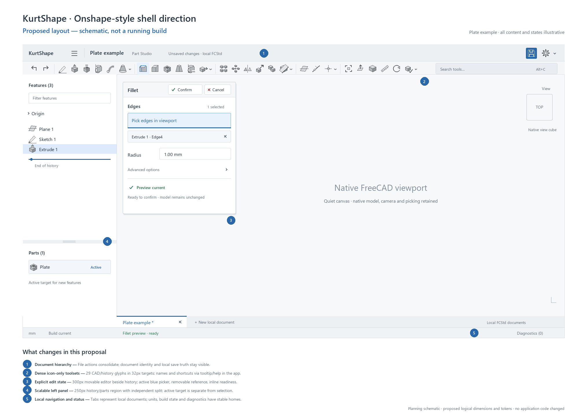

# KurtShape: close Onshape design alignment

Prepared October 4, 2026, America/Los_Angeles. Revised after Kurt's Onshape workspace screenshot: **dense icon-only top modeling and sketch toolbars**. Status: implementation plan; no application changes made by this audit.

Kurt confirmed the target: **closely match Onshape's layout, density, colors, and editing feel**. The primary surface is the Windows desktop modeling workspace. This is an Operate interface: the model and the current modeling task lead; chrome supports precise repeated work.

The supplied [Onshape workspace screenshot](onshape-reference/onshape-user-workspace-2026-10-04.png) is now the primary visual reference. Kurt explicitly wants a dense row of symbols, without labels beside toolbar icons. This replaces the first schematic's labeled command buttons and visible category headings. Command names belong in tooltips, menus, search and accessible names. Document titles, search input and editor/history text remain readable.

The strongest recommendation is to retain the existing native CAD shell and give it one coherent presentation system. KurtShape already has the correct broad composition. The largest remaining differences are the command hierarchy, inherited colorful icons, oversized selection widgets, several editor styles, and unclear ownership of the next geometry pick. A coordinated change to those surfaces will produce more benefit than a new frontend framework.

## Evidence and boundaries

Two independent assessments informed this plan: design review (`/root/design_assessment`) and implementation/evidence review (`/root/implementation_evidence`). A third agent researched current official Onshape documentation. The design assessment completed before the implementation findings entered synthesis.

- Application: portable FreeCAD **1.1.4**, OCCT **7.8.1**, PySide Qt widgets, native Coin/Open Inventor viewport. Editable FCStd remains authoritative.
- Canonical source: `Codex/kurtshape/src/kurtshape`. `Codex/kurtshape-green` is a separate tested checkout, not the current workflow upgrade.
- Existing project context: `PRODUCT.md`, `DESIGN.md`, `docs/long-run/STATUS.md`, and `docs/onshape-workflows/IMPLEMENTATION.md`. Their existing decisions are respected; this plan does not overwrite them.
- Today's functionality work already provides modeless feature panels, tool-first reference picking, outline-only face hover, and new modeling workflows. These are the behavioral foundation of the design pass.
- Today's `validation/onshape-workflows/gui-result.json` was observed passing **44 checks**, with captures around 18:51–18:54 PDT. The observed view-interaction report also passed. These are existing reports, not tests run by this audit. The functionality chat was still editing source; its final frozen-source validation was pending at inspection.
- Older October 2–3 screenshots help explain the evolution, but older modal forms and historical contrast results do not describe the latest source completely.
- No live user window was inspected or manipulated. No CAD process or user profile was launched or changed. Keyboard comfort, screen-reader use, all DPI settings, and typical large-model responsiveness remain unverified here.
- The revised toolbar direction uses Kurt's attached 1909×913 image of his Onshape workspace. It is preserved byte-for-byte in `onshape-reference/`; its image dimensions are not evidence of logical-pixel sizes or Windows scaling.

The scoped Impeccable detector returned exit 0 and `[]` on the native Python source. It returned no findings; its HTML/CSS coverage does not establish native Qt quality. Treat this as a **coverage limitation**, not a clean accessibility/design verdict. Browser overlays are not applicable to the application. Official Onshape screenshots were inspected in a temporary browser tab.

The source/report hashes and references in [EVIDENCE.json](EVIDENCE.json) identify the audit snapshot. Shared files can continue changing after that snapshot; line references below are navigational aids, with symbol names the durable locator.

## What the visual evidence says

| Current evidence | What is already good | Remaining design gap |
|---|---|---|
| [Current Fillet panel](../../validation/onshape-workflows/fillet-pick-after-command.png) | Modeless viewport picking, explicit references, quantity entry, valid-preview acceptance | Picking button + large list + full-width removal button use excessive space; the active picker is visually weak |
| [Current compact workspace](../../validation/onshape-workflows/compact-workspace.png) | Persistent history/parts, context toolbar, real native tabs | Many equal-weight document actions compress the title; colorful native icons dominate; trailing utilities depend on overflow |
| [Current Plane editor](../../validation/onshape-workflows/plane-editor.png) | Task-specific controls and pending preview state | Generic form hierarchy; old completion feedback can compete with the current task |
| [Current Revolve editor](../../validation/onshape-workflows/revolve-profile-line-axis.png) | Separate profile and axis references | Single-reference fields are represented by comparatively large collection controls |
| [Historical Extrude panel](../../validation/ui-refinement/extrusion-preview-1600.png) | Clear acceptance, unit-aware depth, meaningful native preview | Another editor layout; full-height right panel consumes horizontal viewport space |

Do not judge typical zoom/framing from the compact workflow fixture: its camera and geometry are deliberately arranged for tests. Do not diagnose an old modal form as a current defect: the new `FeaturePanel` already solves that interaction problem.

## Onshape reference: what to match

Kurt's screenshot shows a shallow, continuous row of many neutral CAD symbols, narrow separators, small toolset chevrons, Undo/Redo at the left, and tool search at the right. It uses recognizable silhouettes with some subtle fill/shading rather than abstract generic line symbols. The label next to Sketch in the reference is an observed exception, not an exception to Kurt's explicit request: **KurtShape's modeling/sketch tool buttons should all be icon-only, including Sketch**. No Create/Modify/Pattern/Reference/View headings or text-labeled More button should occupy this row. Grouping is communicated by spacing, separators and dropdown arrows.

Current official references verify a compact light shell, strong document identity, context-sensitive toolbars, separate history and parts, movable feature dialogs, and consistent visual selection states. The inspected full document-header image is **light**, not a dark navy band. Exact general chrome RGB values and shell dimensions are not documented in these sources; the proposed values later in this plan are KurtShape targets.

| Pattern | Official evidence | Planned adaptation |
|---|---|---|
| Document hierarchy | [Document Toolbar](https://cad.onshape.com/help/Content/Document/document_toolbar.htm), [header image](https://cad.onshape.com/help/Content/Resources/Images/icons/titleTB-docpage.png) | Compact document menu, bold local project name, truthful saved/unsaved state, utilities at the far right |
| Main workspace | Kurt's supplied screenshot; [Part Studios](https://cad.onshape.com/help/Content/PartStudio/part_studios.htm), [shell image](https://cad.onshape.com/help/Content/Resources/Images/concepts/partstudioannotatedmodeling3.png) | Dense icon-only context toolbar above a large quiet canvas; history/parts on the left; compact tabs below |
| History/parts | [Features and Parts Lists](https://cad.onshape.com/help/Content/PartStudio/features_and_parts_lists.htm) | Consistent feature rows, independently scrollable parts, resizable split, discoverable visibility actions |
| Editing | [Feature Basics](https://cad.onshape.com/help/Content/PartStudio/feature_basics.htm), [Extrude image](https://cad.onshape.com/help/Content/Resources/Images/feature-tools/extrudedialog1-03.png) | Bounded modeless editor; accept/cancel in its header; compact operation choices; blue active geometry field; quantities and inline status |
| Semantic colors | [Colors](https://cad.onshape.com/help/Content/Home/colors.htm) | Geometry selection amber; sketch solve status blue/black/red; keep UI focus, hover, and preview visually distinct |
| Picking | [Selection](https://cad.onshape.com/help/Content/Home/selection.htm) | Audit feedback for hover, selected, active picker and preview; coordinate mechanics with the functionality work |
| Sketch mode | [Sketch Basics](https://cad.onshape.com/help/Content/Sketch/sketch_basics.htm) | Obvious active sketch and solver state, contextual toolbar, persistent finish/cancel controls |
| View commands | [View Navigation and the View Cube](https://cad.onshape.com/help/Content/View/view_navigation_and_the_view_cube.htm) | Quiet top-right cube and compact view controls while preserving native camera state |
| Context/search | [Context Menus](https://cad.onshape.com/help/Content/Home/context_menus.htm), [Search Tools](https://cad.onshape.com/help/Content/Home/search_tools.htm) | Short relevant menus; consistent command labels, icons and shortcut presentation |
| Keyboard | [Keyboard Shortcuts](https://cad.onshape.com/help/Content/Home/keyboard_shortcuts_and_hotkeys.htm) | Keep existing registry; align visible help and editor actions with the actual context |

Onshape's combination tools are a useful presentation model for the existing New/Add/Remove/Intersect operations. Its cloud collaboration, workspace/version model, Drawing and Feature Studio tabs are not current KurtShape product truth. Visual similarity must not introduce controls that promise those capabilities.

## Priority findings

### P1: Document actions compete with the document itself

`Panel.make_toolbars` in `ui.py` currently exposes New, Open, Save, Export, Recent, Example, Adopt copy, Recovery, Undo/Redo, Search, Shortcuts, Settings, the name, and the workspace selector in one row. The compact fixture truncates the title.

Move New/Open/Export/Recent/Recovery into a compact document menu. Keep Save directly reachable and show a truthful dirty/saved indicator. Offer Adopt copy in its relevant unmanaged-document context. Place examples under Help/Samples. Reduce the wordmark and reserve elastic width for the project name. Keep Undo/Redo and search in stable locations. Utilities can collapse into an overflow menu before the title or essential commands become unusable.

### P1: The editor interaction works better than its presentation suggests

`ReferencePicker.pick` is a checkable **QPushButton**, but `theme.py` provides checked styling for **QToolButton**, not QPushButton. Today's active "Select edges" and "Select axis line" fields can therefore look like ordinary white buttons.

Give geometry fields explicit empty/active/filled/invalid/disabled states. Active picking uses a blue field outline/fill and names the accepted entity type. A single axis/plane reference should occupy one compact row; multiple references grow to a bounded list. Put a removable reference affordance on each row, plus Clear all in the field menu. Preserve the current IDs, selection signals, removal semantics and native reference ownership.

Unify the generic Extrude/dimension dock, new typed feature panels, and native Tasks visually. Keep native tasks available wherever owned panels do not cover the command. The final target is a compact movable panel initially placed beside the history at the upper-left of the canvas, with optional right docking. This placement is a KurtShape proposal to bring the task closer to its inputs; it is not a measured Onshape coordinate.

### P1: Inherited icon assets make the app feel like a FreeCAD skin

The modeling row mixes saturated shaded red/yellow/blue native icons with plain text and weak group boundaries. Onshape's inspected toolbar is much quieter and visually consistent.

Add an original restrained SVG presentation layer mapped to stable command IDs. Match the reference's familiar CAD silhouettes, controlled gray fill/shading and optical weight; do not reduce every tool to a generic thin outline. Keep native fallback assets. Change the optical style without changing callbacks. Cover the existing supported command catalog, beginning with Sketch, Extrude, Revolve, Sweep, Loft, Fillet, Chamfer, Shell, patterns, Mirror, Plane, Boolean/Transform, Undo/Redo, Fit and Measure. Use the same family in toolbars, history and menus.

Render modeling/sketch buttons without adjacent text. Keep their names and shortcuts on hover/focus, and in dropdown menus and search. The target is many directly accessible symbols in a single compact row, not a small set of generously spaced labeled actions.

### P2: History, rollback and active part need clearer relationships

`make_history` combines a tree, detached numeric rollback slider, active-Body combobox and a parts tree capped at 145 logical pixels. A longer multipart project will outgrow this layout. Selection, active feature target, hidden state, failed state, and rollback-held state need separate signals.

Use a resizable feature/parts split and a stable row template. Preserve existing object/feature identities. A later feature-relative rollback marker belongs inside the history sequence, but this is a functional enhancement to coordinate with Q12/Q23 rather than disguise as theme work. The first wave can improve the current slider label and the appearance of held rows.

### P2: Feedback from prior commands competes with the current task

Current captures pair an updating or valid feature preview with footer messages from previous operations. Routine messages can produce large counts that resemble urgent diagnostics.

Current tool state belongs beside its title or fields. The footer should show durable local-document/build/unit state and short-lived feedback. Errors/warnings need severity and an actionable entry; ordinary activity remains copyable in the log without an alarming persistent count.

## Proposed visual system

These are initial **logical-pixel targets**, not values extracted from Onshape. Validate readability and density together at real Windows scaling. Preserve Segoe UI and native quantity widgets.

| Token/role | Proposed target | Rationale |
|---|---|---|
| Base text | 13 logical px equivalent, system-scaled | Slightly more readable than the global 12px rule; density comes from better grouping and smaller containers |
| Section/title text | 13px semibold / 14px semibold | Clear hierarchy with minimal size changes |
| Spacing | 4, 8, 12, 16px | Tight related controls, stronger separation between groups |
| Document bar | 40–44px | Identity and local file actions without a large brand area |
| Modeling/sketch bar | 32–36px | One dense icon-only context row; toolsets stay in predictable positions |
| Toolbar glyph/target | 18–20px glyph in 28–32px pointer target | Many directly accessible CAD symbols; names/shortcuts in hover/focus help |
| Tree row/icon | 24–26px / 16px | Scan dense history without tiny text |
| Standard fields | 28–32px | Compact quantities, selectors and dropdowns |
| Left column | 250px default, adjustable | Fits meaningful names; not a fixed percentage of a large monitor |
| Tool editor | 280–320px wide, content-sized height | Remove permanent full-height inspector space for short operations |
| Document tabs/footer | 28–32px / 22–24px | Distinct navigation and status without duplicated control bars |
| Dividers/radius | 1px / 2px | Precise native-tool character |

Start with these proposed neutral tokens and tune against side-by-side native captures:

| Semantic token | Initial value | Use |
|---|---|---|
| `surface` / `viewport` | `#FFFFFF` | White work surfaces; geometry carries visual weight |
| `chrome` / `chrome_subtle` | `#F5F6F7` / `#FAFAFA` | Document bar, toolbars and unobtrusive grouping |
| `ink` / `muted_ink` | `#2D3338` / `#59636C` | Neutral text instead of a pervasive blue-gray tint |
| `divider` / `control_border` | `#D6DADF` / `#9AA4AE` | Quiet separators; stronger boundaries for interactive fields |
| `accent` / `active_field_fill` | `#185FA5` / `#E6F1FA` | UI action, focus and active geometry picking |
| `error` / `success` | `#BD3039` / `#247A43` | Errors and valid acceptance state, paired with text/symbols |
| `geometry_selected` | `#FFC107` | Documented Onshape selection color; renderer tuning still needs native verification |

Neutral/accent values are proposals, not official Onshape tokens. `#FFC107`, sketch blue `#0000FF`, fully constrained black `#000000`, sketch error `#BD3039`, and inactive sketch `#949BA0` are documented Onshape conventions. Blue fill must not make white text unreadable; use explicit foreground/background pairs. Disabled controls remain legible but visibly unavailable. Palette active/inactive/disabled groups and QSS must agree.

### State contract

| State | Visual signal | Required behavior |
|---|---|---|
| Pointer hover | Boundary emphasis without selected-face fill | Preserve the new unpickable outline overlay; never modify document geometry/colors |
| Selected geometry | Amber selected boundary/fill | Persistent native selection; mechanics remain those confirmed with Kurt |
| Active geometry field | Blue field + entity type + count | Clearly identifies which field receives the next viewport/tree pick |
| Filled geometry field | Compact reference row; remove action | Maintain identity, ordered references where relevant, and explicit removal |
| Missing reference | Red row + missing-reference label | Explain replacement/removal; no apparently valid acceptance |
| Preview updating | Short inline pending label; acceptance gated | Clear stale ghost when necessary; retain cancellation |
| Valid/invalid preview | Ready state / field-specific error | Accept only the current valid generation; preserve the edit on recoverable input errors |
| Added/removed material | Distinct labeled translucent previews | Keep current native BRep overlay and non-pickability; do not conflate ghost with selection |
| Failed/held/hidden feature | Dedicated marker/text in addition to hue | Failure is actionable; held means beyond rollback; hidden remains selectable in history |
| Sketch solving | Solver text plus blue/black/red geometry roles | Native solver and constraint state remain authoritative |
| Busy operation | Immediate status on the current tool | Do not manufacture progress percentages or claim a preview is ready before completion |

Cancel is a normal reversible workflow action, not an error. An Onshape-like red X can identify cancellation, but the whole Cancel button should not look like a destructive failure. Header accept/cancel icons need accessible names, tooltips and generous targets. Keep a text-label presentation at small scales if icon meaning is unclear.

## Surface-by-surface specification

### Document and workspace

Use a small KurtShape mark, icon-only document menu trigger, prominent elided project title with full-name tooltip, local saved/unsaved state and actual mode switcher. Prefer icon-only utility buttons for Save and Settings. Put Undo/Redo at the start of the context toolbar and a compact Search tools field toward its right, following Kurt's reference. At narrow widths move secondary utilities into overflow first. Preserve explicit local Save: do not display cloud-style "All changes saved" unless the file actually has been saved. Keep Part Studio/Assembly mode distinct from a local document tab.

Current tabs identify open FCStd documents. Restyle those tabs with compact type icons, dirty marker, tooltip and clear active indicator. Onshape tabs represent elements inside a document; replicating that exact structure requires a future product/document model. Do not rename multiple local documents into pretend element tabs during the aesthetic pass.

### Toolbars, search and menus

Maintain one dense modeling row and its sketch replacement. Set all command buttons to icon-only, including Sketch, toolset triggers and overflow. Remove visible category headings and command captions. Organize commands by creation, modification, patterns, reference and inspection through narrow spacing, thin separators and small chevrons. Keep Sketch directly visible as its recognizable symbol. Favor approximately 24–32 supported command symbols at a standard desktop width when space permits; this is a density target, not a fixed count or a reason to invent tools. Match the order and silhouettes of supported Onshape equivalents so familiar commands are easy to find. Move view functions toward the canvas/cube or a compact view menu; avoid duplicating them in three permanent places.

Every visible action has an original icon, accessible name, actual shortcut and disabled reason. Search and menus use the same command name/icon. Preserve native overflow and verify actual reachability, not just the existence of an QAction. Keep unsupported commands clearly unavailable. Do not wait for the future Q04 operation registry to implement a small presentation map.

In Qt, retain descriptive `QAction.text()` for menus, accessibility and existing enablement logic, while setting the toolbar's and individual modeling/sketch `QToolButton`s' `ToolButtonStyle` to `ToolButtonIconOnly`. Remove per-button TextBesideIcon/TextUnderIcon overrides from those command rows. Do not erase action names to achieve the visual result. Supply an appropriate original/native fallback symbol when an icon is missing; a text-only command must not silently widen the icon row.

Move Finish/Cancel into a guaranteed-visible compact sketch header rather than large labeled toolbar buttons. That header is new presentation work: the current active-sketch branch of `sync_edit_ui` hides the generic `self.editor`, so it must be changed or a separate persistent header host provided. Verify the new header is reachable throughout actual native sketch editing before removing the existing toolbar controls; keep native Sketcher Tasks and solver diagnostics accessible.

At smaller widths reduce gaps, keep important direct symbols stable and use an icon-only overflow/menu trigger. Do not reintroduce inline labels as the responsive fallback. Tooltips should show the command name, shortcut and one concise contextual instruction; focus/accessibility and search provide discovery beyond pointer hover. Group menus may use text because they are transient lists, not persistent toolbar captions.

### Feature dialogs and quantities

The shared panel anatomy is title + accept/cancel, operation row where supported, geometry references, essential quantities/end conditions, optional collapsed sections, and inline preview/error feedback. New/Add/Remove/Intersect can use an underlined horizontal choice row to match the reference, backed by the existing operation values. It must wrap or compact safely at smaller widths.

Start with the existing modeless `FeaturePanel` lifecycle. Place the compact editor beside history by default; allow movement and remember placement only within the current screen's available bounds. Keep the native renderer available for picking. Provide internal vertical scrolling only when the real form exceeds available height; title and acceptance remain reachable. Native Tasks remain accessible for tools beyond the owned framework.

The current `FeaturePanel` enables only `DockWidgetClosable`; it is not already a movable floating dialog. This target needs explicit presentation work: movable/floatable support and either a bounded native floating window or a viewport-hosted modeless overlay, with right docking retained as an option. Ordinary Qt docking will not produce the content-sized panel over the upper-left canvas shown in the schematic. Choose the host after testing native input/focus, MDI document switching and screen bounds; preserve the existing modeless acceptance/cancellation lifecycle in either implementation.

Keep `QuantityField`, unit parsing, expression behavior, pending input and transaction semantics. Keyboard focus and active geometry picking are independent states: a quantity can receive typing while a geometry field remains armed. Verify Tab, dropdown arrow/Enter handling, Escape, and Shift+Enter in each real context. Do not make Enter accept the whole feature while a dropdown or intermediate quantity edit still owns it.

### Feature history and parts

Use rows with disclosure, type icon, name, state marker and visibility action. Show row actions on hover **and focus**; do not hide essential controls from keyboard users. Quiet default geometry after a model develops; keep Top/Front/Right easy to reveal for sketch placement. Long names elide with tooltips, and renaming preserves stable IDs.

Replace the capped parts area with an adjustable split and independent scrolling. Show the active sketch/feature target part distinctly from whichever row or geometry is selected. Active-part changes must not change selection or reset the camera merely to update presentation. Check part visibility controls against current native callbacks.

### Viewport and sketching

Use white/light-neutral background, restrained standard edge treatment and reference geometry that remains distinguishable. Preserve user-set per-part appearances; a chrome theme must not overwrite model colors. Tune line weights and the cube at deployed DPI settings. Keep the native cube first; a custom cube is a separate higher-risk renderer project.

Sketch mode should announce the sketch name and solver summary in the compact editor, replace the toolbar, and expose Finish/Cancel consistently. Construction geometry, selected geometry, constraints, dimensions and projected geometry need distinguishable signals. Native Sketcher diagnostics must remain accessible. Preserve normal/isometric controls, 3D sketch inspection, associated Use geometry, and the established SolidWorks mouse gestures.

### Status, errors and empty states

Use copyable plain-language errors naming the field/reference and recovery action; retain detailed diagnostics behind an expandable section. Expire routine completion text when a new task starts. Never let a stale "Extrude complete" appear to be the current Fillet preview verdict. Reserve notification urgency for severity, rather than raw log counts.

A blank studio should show a restrained prompt: choose a plane and start a sketch, with the actual shortcut. Keep the canvas mostly empty. A recovering/importing/unsupported state should give the actual next action, using existing capabilities. Avoid dashboard cards or invented onboarding workflows.

## Implementation sequence and ownership

Effort below is relative implementation complexity, not a time promise. Each wave should end in one integrated, reviewable change with native evidence.

| Wave | Deliverable | Primary seams | Complexity / dependency |
|---|---|---|---|
| A: establish baseline | Finish/record the workflow upgrade; capture current idle, sketch and feature states | Existing workflow implementation and GUI recipes | Small coordination step; required before shared-file integration |
| B: visual foundation | Neutral semantic tokens, density/type roles, checked picker state, native palette coverage, first icon assets | `theme.py`; proposed `resources/icons/` and presentation helpers | Small–moderate; asset/token drafting can proceed separately |
| C: shell alignment | Document menu, elastic title, dense icon-only context toolsets, consistent icon resolver, quieter tabs/footer | `ui.py:make_toolbars`, `tool_icon`, `sync_edit_ui`; existing shortcut router | Moderate; integrate after A, preserving action names and command enablement |
| D: editing experience | Shared compact modeless panel, explicit active reference fields, header acceptance, operation choices, inline status | `feature_panel.py`; `ui.py:make_editor`, `studio_tool`, `configure_editor`; `quantity_field.py` | Moderate–large; highest effect on feel; requires lifecycle tests |
| E: history and viewport | Resizable history/parts split, row states, active part, consistent geometry/sketch roles | `ui.py:make_history`, `refresh`; `hover_outline.py`; native task/viewport hooks | Moderate; separate presentation from Q12/Q14/Q23 functionality |
| F: acceptance and handoff | DPI/width/state matrix, real command reachability, focused native regressions, documented visual baseline | Existing isolated validation infrastructure; project design records | Moderate; no release based only on screenshots |

The highest-return first release is **B + C + the active reference field/shared header portion of D**. This changes the appearance and clarity of nearly every common interaction. Complete bounded editors and scalable history next. Do not spend the first release on a custom renderer, elaborate motion, or a frontend replacement.

At inspection the functionality agent was changing `ui.py`, `core.py`, `feature_tools.py`, `navigation.py`, `studio.py`, `reference_tools.py`, `selectors.py`, `sketch_tools.py`, `extrusion_preview.py`, tests and recipes; `feature_panel.py` and `hover_outline.py` were new. `theme.py`, `quantity_field.py` and `workspace_preferences.py` were clean then, but that is a timestamped observation, not an ongoing reservation.

Integrate one coordinated UI patch against the completed workflow baseline. Keep assets/helpers separately owned until then. Do not run competing GUI evidence writers or update the green checkout/profile during concurrent validation. Existing Q02a is parked; Q04 is ready but unimplemented; Q08/Q12/Q14/Q23 have functional dependencies. The design pass must not claim these future frameworks already exist.

### Implementation traps worth addressing up front

- `sync_edit_ui` currently uses some visible action text to manage availability. Preserve bindings/names or replace these checks with stable identifiers in the same patch before relabeling.
- Qt palette and QSS are separate authorities. Keep active/inactive/disabled pairs and explicit arrow assets from `_native_arrow_stylesheet`.
- Preserve parentless notification styling and native floating dimension-editor exceptions in `apply_theme`.
- `refresh` rebuilds trees. A style pass should not silently become an event-model/performance rewrite; measure refresh separately and coordinate Q12/Q14.
- Moving the editor must preserve document/revision guards, viewport selection, Cancel, Undo/Redo and detached non-pickable ghosts.
- Existing theme validation contains color/size assumptions. Update assertions to meaningful semantic/readability requirements; do not change expected pixels simply to hide regressions.

## Verification and acceptance

Proposed client sizes: **800×600** compact reachability, **1200×800**, **1440×900**, **1920×1080** and a large-monitor sample. Test real Windows scaling at **100%, 125%, 150%, 200%**; do not substitute resized screenshots for scaling. At 800px, all supported actions must remain available through real menus/overflow even if fewer are direct.

Capture idle model, blank studio, active sketch, Extrude, tool-first Fillet, multiple-reference editor, native Tasks, invalid input, pending preview, selected/hovered geometry, long history/many parts, command menu/search and long document tabs. Pair screenshots with source hashes, client dimensions, device pixel ratio and owned run/profile identity.

| Gate | Acceptance |
|---|---|
| Composition | Document identity and essential controls fit; no title/picker/action overlap; default editor is compact; model remains available for picking |
| Toolbar fidelity | Modeling/sketch rows contain symbols, separators and small chevrons with no adjacent command captions or category headings; recognizable CAD glyphs match the reference's density; no missing-icon text fallback |
| Reachability | Save, Settings, Search, Sketch, Finish/Cancel and supported model/view commands work at each supported size through direct or overflow routes |
| Editing clarity | The receiving geometry field is obvious; a single reference uses a compact row; removal/clear-all/invalid-reference behavior preserves selection ownership |
| Typography/contrast | Actual text/background pairs meet 4.5:1 for normal text; essential nontext boundaries/focus meet 3:1; no dark-palette/native-popup regressions |
| Keyboard/accessibility | Names, buddies and tab order exist; focus is visible; dropdown handling and quantity parsing work; Escape/Enter act within the real editor context |
| Native correctness | Cancel changes no authoritative geometry/history; Confirm makes the expected undo step; Undo/Redo, save/reopen, camera and source revision guards retain behavior |
| Feedback | No prior-action footer masquerades as current task status; invalid or stale preview cannot appear ready; diagnostics stay selectable/copyable |
| Performance | Theme/layout changes do not add geometry recomputes to hover/selection or idle painting; existing preview latency is measured separately |

Reuse `tools/theme-validation.FCMacro` and `tools/appearance-validation.FCMacro` for native colors, popups, dark-startup cases and compact routes. Extend the blocking isolated runner with a named design recipe if those macros are not currently exposed through it. Do not imply an unregistered `appearance` recipe already exists.

Existing commands for the relevant behavioral checks, from the repository root:

```powershell
.\tools\run_gui_recipe.ps1 -Recipe onshape-workflows -TimeoutSeconds 600
.\tools\run_gui_recipe.ps1 -Recipe ui-refinement -TimeoutSeconds 900
.\tools\run_gui_recipe.ps1 -Recipe sketch-behavior -TimeoutSeconds 900
.\tools\run_gui_recipe.ps1 -Recipe messages -TimeoutSeconds 900
```

These commands are a future validation recipe; this audit did not run them. Their runner uses fresh hidden profiles and owned processes. Keep native/model tests appropriate to the changed interactions, then perform one batched visual inspection and at most one confirmation pass after fixes. Do not broaden into a full optimization program without new evidence.

For a standard 1600×1000 logical client, a 44px header, 34px toolbar, 30px tabs, 22px footer and 250px left panel leave approximately **73%** of client area for the idle canvas. A 300×330px editor overlay leaves about **67%** unobscured. These are proposed geometric budgets, not measured gains or Onshape measurements; they explain why a bounded editor is attractive.

## Handoff decisions and next step

Settled: close Onshape light-UI alignment using Kurt's screenshot as the visual reference; dense icon-only modeling/sketch toolbars with no visible command/category labels; native Qt/FreeCAD remains the implementation; SolidWorks navigation stays; current modeless editing and selection improvements are preserved; original models/exports remain in place. This plan introduces no cloud/project semantics and changes no application source.

The next concrete step is to finish the functionality agent's frozen-source handoff, then create a presentation change containing **semantic tokens, original icon overrides, dense icon-only toolbars, document-bar compaction, and an explicit active geometry field**. Review the same real part in idle, sketch, Extrude and Fillet states before expanding to the remaining tools. Final token values and panel placement are to be confirmed against that working native build, not accepted merely from this schematic.

The project-local audit [README](README.md) records the continuity and reproduction recipe. The proposed layout image is a schematic only, with illustrative document/feature labels:



## Diagnostic heuristic appendix

Scores are design-review judgments, not measured usability or compliance results.

| Nielsen heuristic | Score /4 | Main observation |
|---|---:|---|
| System status | 3 | Current preview is visible; old footer messages compete |
| Match to real world | 3 | Familiar CAD structure; internal references sometimes show |
| Control/freedom | 3 | Modeless picking, Cancel and Undo/Redo are present |
| Consistency | 2 | Several editor families and icon treatments |
| Error prevention | 3 | Preview gates and revision guards exist |
| Recognition | 2 | Icon recognition and active-pick feedback need improvement |
| Efficiency | 3 | Search, shortcuts and direct interactions exist |
| Minimalist design | 2 | Good composition, excessive command equality and reference-widget space |
| Recovery | 2 | Diagnostics available; some raw errors need user-facing recovery copy |
| Help | 3 | Named help and shortcuts exist; live discoverability untested |
| Total | **26/40** | Foundation is useful; consistency/state clarity are the priority |

Questions skipped: the user confirmed the desired fidelity; remaining details are bounded implementation/validation choices. PRODUCT.md has an older Impeccable schema; its contextual truth remains useful. Refreshing that schema belongs to a separately requested `init` pass, not this design audit.
